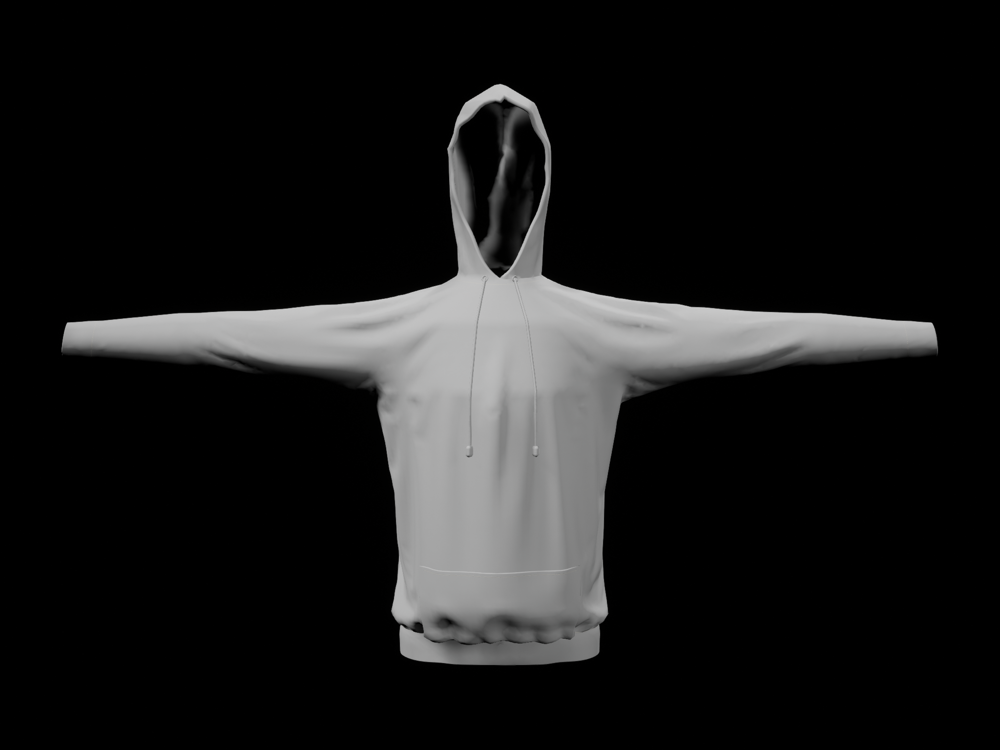
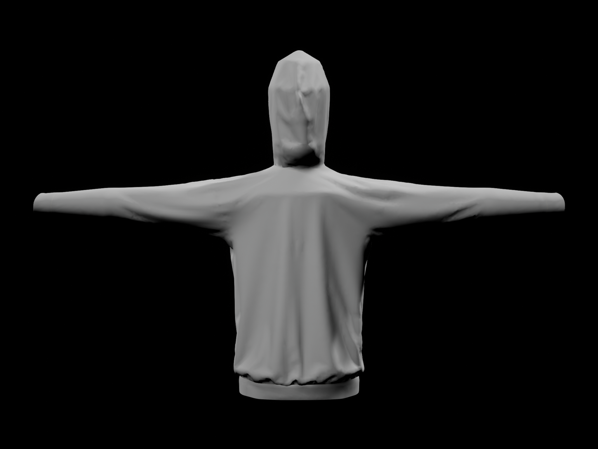
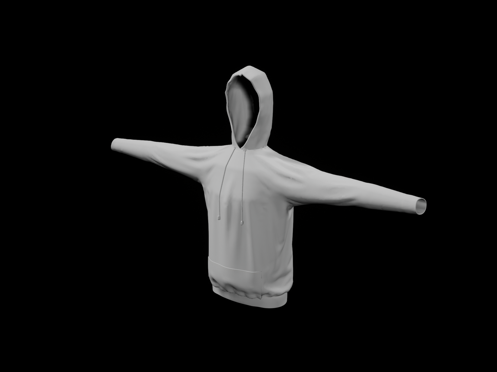

# Hoodie

**Status: Not rendered on the published 16 Nov build.**

Pictures rendered 16 Nov on an earlier build (not this file on the published build):

## What it is

A fleece hoodie: rib bands at the cuffs and hem, a hood grown and sewn, a face opening, and a drawcord end and eyelets from a parts file.

## What you need

- The T-posed body: build `../GarmentBodies/TPoseBody.gcshape` first (it makes `/Game/GraphCodeExamples/Garment/SM_TPoseBody`). Every ring in this file is measured on that body.
- `HoodieParts.gcshape` (in this folder): the hard parts the garment places. Its program path is `/Game/GraphCodeExamples/Garment/Hoodie/HoodieParts`, which the garment's `shape(...)` line names.
- The plugin's Garment guides: [GARMENT.md](../../Guides/GARMENT.md) and [GARMENT-PIECES-AND-EDGES.md](../../Guides/GARMENT-PIECES-AND-EDGES.md).

## What it shows

The exact lines, from `Hoodie.gcgarment`:

| Line | What it demonstrates |
|---|---|
| `Fleece = fabric(weight=288, thickness=1.69mm, stretch=(7.27%, 29.93%), shear=26.6, stiffness=(0.80, 0.79), friction=1.92)` | a fleece |
| `band($Wrist_L, width=5cm, fabric=$Rib, cut=78.2%)` | a rib cuff |
| `band($Hem, width=5cm, fabric=$Rib, cut=73.6%)` | a rib hem band |
| `sew($HoodL, $HoodR, match=ease)` | the hood's halves sewn |
| `add($Kit.Eyelet, at=$CordAt@2.75cm, hold=0)` | an eyelet part placed on the cloth |

## Build it

1. Copy this folder to `Content/GraphCodeExamples/Garment/Hoodie/` in your project, and copy `../GarmentBodies/` to `Content/GraphCodeExamples/Garment/`. The paths inside the files use those places; change them together if you move the files.
2. Ask the tool for its current form first: `gc_describe` with `kind:"garment"`, then `gc_apply` and `gc_render` with `{ "help": true }`.
3. `gc_apply` the body, then the parts file (if any), then the garment, in that order. A `.gcgarment` is a whole program: apply it whole.
4. Read every note the build prints, then render it lit from the front, back, both sides and at a grazing angle ([GARMENT.md](../../Guides/GARMENT.md), "Verify the garment as a garment").

## Limits

- The long working notes that carried each number's source were removed from this copy; the numbers are those the garment was built with on the example body. Re-measure the rings on any other body.
- The paths in this copy (`/Game/GraphCodeExamples/Garment/...`) were rewritten from the project's test paths and have not been built in this form.
