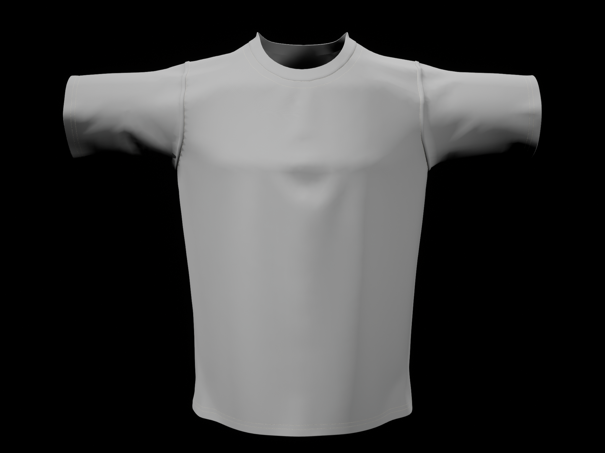
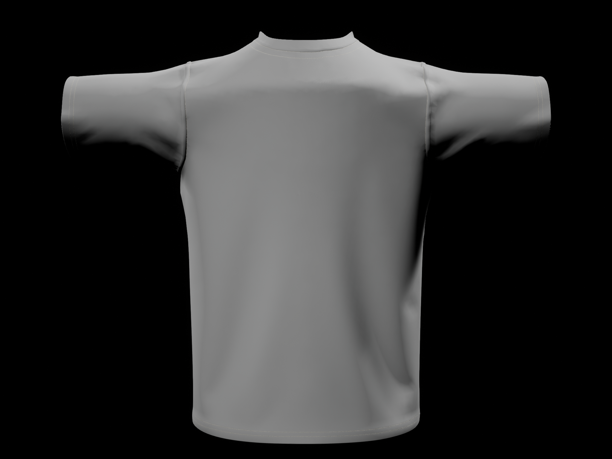
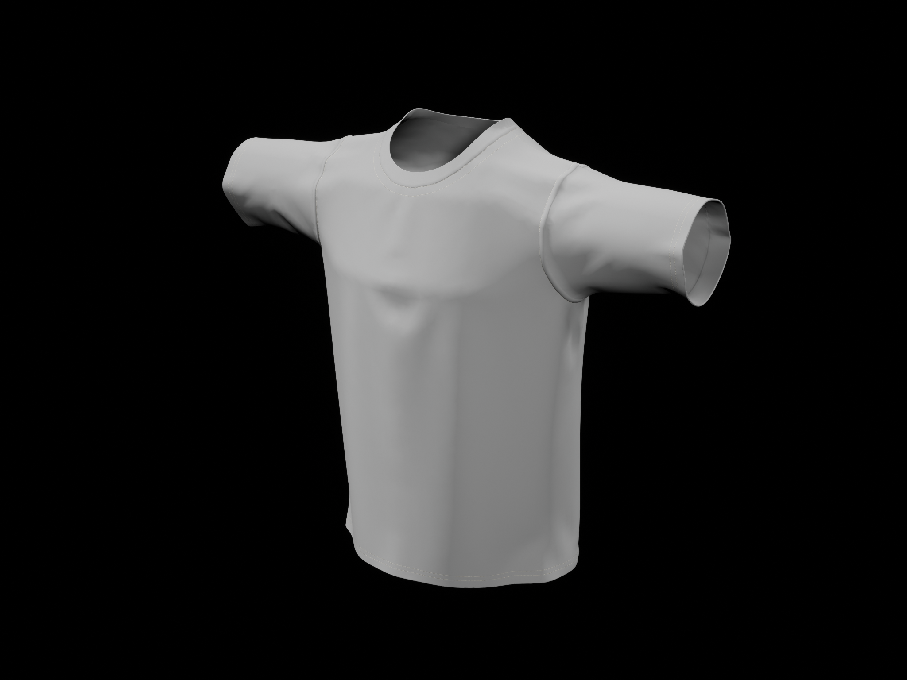
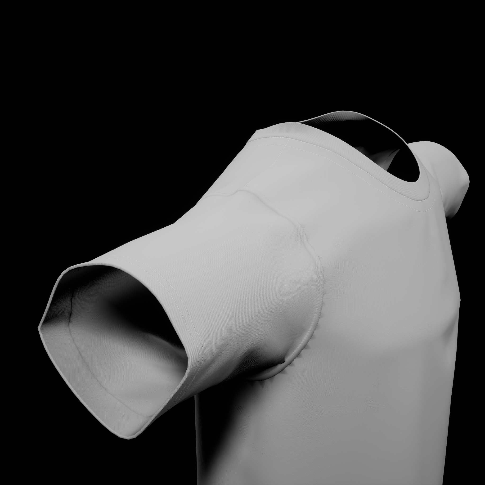
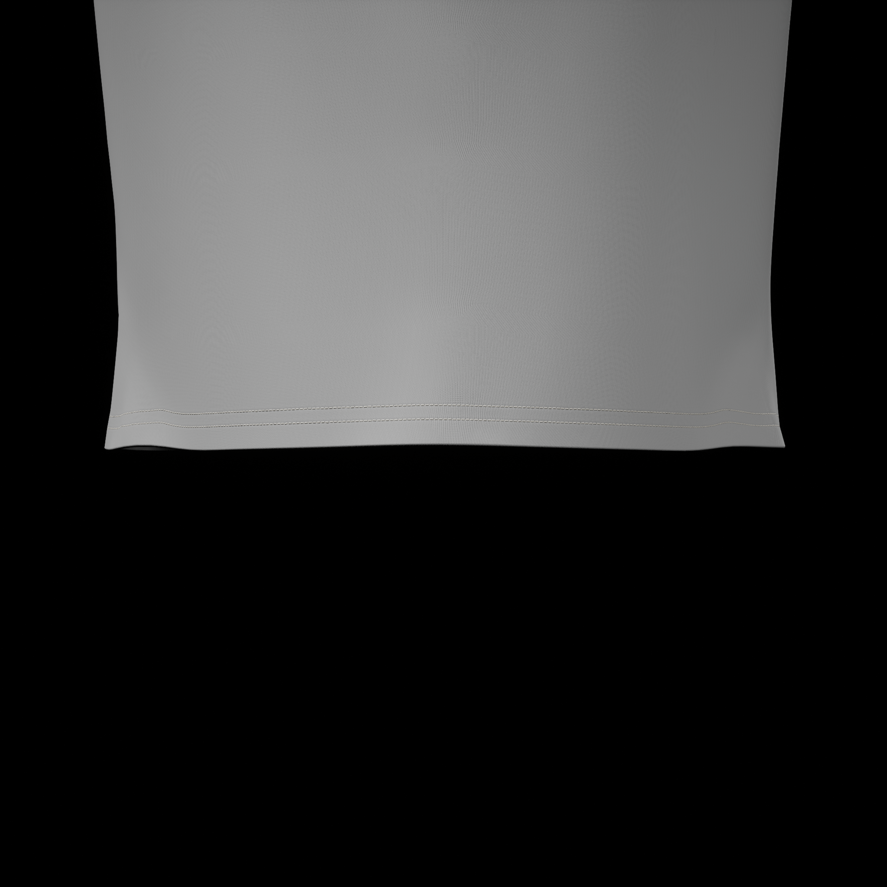

# Make this T-shirt, step by step

**Status: rendered on the published 16 Nov build** (the pictures below). This is the one shipped garment example that was.

A crew-neck T-shirt in cotton jersey: short sleeves ending on the upper arm, a rib neckband, hems turned and
coverstitched, pressed armhole seams, stitch rows everywhere a maker sews one. Everything is written in one
`.gcgarment`, [TShirt.gcgarment](TShirt.gcgarment), and every number in it is measured on the example body or taken
from a named pattern, spec sheet or fabric measurement.

## 1. The finished result

Front, back and three-quarter views, then a close-up of the armhole seam and sleeve hem, and the body hem. Rendered
lit, plain grey, no fabric colour (see "Known limits").







The armhole seam is pressed toward the sleeve and stands as a ridge on the outside, the sleeve hem is real turned
cloth you can see into, and the rib neckband stands up from the neckline with its two stitch rows:



The body hem, with its two coverstitch rows:



## 2. What you need

- **The plugin** with Garment (and, for the parts and body files, Shape). Read [GARMENT.md](../../Guides/GARMENT.md)
  and [GARMENT-PIECES-AND-EDGES.md](../../Guides/GARMENT-PIECES-AND-EDGES.md) first; this walkthrough follows them.
- **A body mesh.** The tee is cut to one specific body, the T-posed test body `GarmentBodies/TPoseBody.gcshape`
  (about 180 cm, arms straight out along X, +Z up, front +Y). A customer does not have this mesh, so it ships here as a
  Shape file: build it first and it makes `/Game/GraphCodeExamples/Garment/SM_TPoseBody`, the mesh the garment's header
  names. The body is a plain loft with no bust, ribs or hip bones, and an upright neck column.
- **Another body.** The header's `mesh:` is the only path that names the body. Every ring point in the file was measured
  on the example body's skin and is that body's, not yours: [GARMENT.md](../../Guides/GARMENT.md) ("Inspect and measure
  the real body") says to take every point from the render tool's hit query on the actual body, and never to reuse a
  fixture's coordinates. For a different body you change the `mesh:` path and re-measure every ring (the neck, chest,
  hem, armhole and sleeve-hem points); the fabrics, the construction lines and the stitch rows stay.
- **No parts file.** The tee places no hard parts, so there is nothing else to copy.

## 3. Build it up in the order a maker thinks

Each step quotes the lines from the file, says why in a sentence or two, and says what goes wrong if you change it
when the file or the guides say so. The long comments in the file carry the sources.

### Step 1: the header and the build block

```gcgarment
gcgarment 1  mesh:/Game/GraphCodeExamples/Garment/SM_TPoseBody  into:/Game/GraphCodeExamples/Garment/TShirt/Built

build {
  SM_TShirt = $TShirt
  T_TShirtStitches = bake(decal, resolution=2048)
}
```

`mesh:` is the body the garment is fitted to; `into:` is the folder the results go into. The `build` block names what
to make: `SM_TShirt` is the garment `$TShirt`, and `T_TShirtStitches` is its stitch rows baked into a decal texture at
2048 px.
### Step 2: the fabrics

```gcgarment
Jersey = fabric(weight=144.9, thickness=0.68mm, stretch=(20.75%, 20.75%), shear=20.30, stiffness=(1.16, 1.04), friction=1.92, knit=jersey, gauge=(15, 19.4))
Rib = fabric(weight=183, thickness=0.72mm, stretch=(122.47%, 119%), shear=11.74, stiffness=(1.18, 0.99), friction=1.75, knit=rib1x1, gauge=(11, 17))
```

What each number means ([GARMENT.md](../../Guides/GARMENT.md), "How cloth hangs and moves is its fabric's numbers"):
`weight=` is g/m2, `thickness=` the cloth's wall, `stretch=` the percent it lengthens under 100 gf/cm along and across,
`shear=` the shear rigidity in N/m, `stiffness=` the overhang-test bending length in cm along and across, `friction=` the
kinetic friction. `knit=` and `gauge=` (loops per cm, wales then courses) make the build draw the knit into a tiling
normal map. A garment that hangs is refused while its fabric leaves one of the first five out.

Where such numbers come from: from a fabric test report, in the test's own units (the guide says to write a fabric "as its
test report prints it"). Here the jersey's weight and thickness are a measured cotton jersey (Wang, "K6"), its bending and
shear are from the same fabric's FAST report, its stretch is a proxy (a KES test of a cotton single jersey, an upper bound,
because no cotton knit's E100 is measured), and its friction is the mean of Ajayi's cotton-knit measurements. The rib
borrows its weight and thickness from a circular 1x1 cotton rib (Truncyte T11) because a tee's neckband is a fine circular
rib, and its stretch, shear and bending from other ribs (the file says which are proxies). `gauge=` must come from a source,
never by eye; a knit with no gauge, or a gauge with no knit, is refused.

### Step 3: the neckline ring

```gcgarment
Neck = ring((0.000, 10.254, 141.400), (3.636, 9.478, 142.218), (6.299, 7.173, 144.450), (7.273, -0.636, 147.500), (5.143, -6.109, 146.157), (0.000, -7.674, 145.600), (-5.143, -6.109, 146.157), (-7.273, -0.636, 147.500), (-6.299, 7.173, 144.450), (-3.636, 9.478, 142.218)) {
  expand(0.306)
}
```

A crew neck is cut lower at the front than at the shoulders, so the ring is a curve, not a level hoop: FreeSewing's Brian
crew is a quarter ellipse each side, 6.1 cm below the shoulder-neck point at the front and 1.9 cm at the back. The ten
points are the body's own skin on that curve. `expand(0.306)` stands the ring off the skin by the distance the hang keeps
thin cloth from it. The guide's warnings apply: a ring on the neck column reads as a mock neck, and a pattern block's front
depth assumes a forward-leaning neck, so on an upright one it drops the front to a boat neck ([GARMENT.md](../../Guides/GARMENT.md),
"Shape a top from a real pattern").

### Step 4: the rings on the body

```gcgarment
ChestOnSkin = ring((0.000, 13.034, 125.560), (16.638, 1.350, 125.560), (0.000, -10.478, 125.560), (-16.638, 1.350, 125.560)) {
  expand((0.750, 2.40))
}
Chest = ring($ChestOnSkin) {
  move((0, 0.222, 0))
}
HemOnSkin = ring((0.000, 10.156, 90.500), (17.092, -0.950, 90.500), (0.000, -12.094, 90.500), (-17.092, -0.950, 90.500)) {
  expand((1.19, 1.10))
}
Hem = ring($HemOnSkin) {
  move((0, 0.88, 0))
}
```

The **chest ring** sits 1 in below the armhole, where a maker states a tee's chest (Gildan 5000's spec sheet), at the
pattern's chest ease (12 %: 92.3 cm x 1.12 = 103.38 at the armhole line). It is drawn on the skin in four points (front,
side, back, side), let out, then moved forward so the cloth hangs plumb from the bust. The **hem ring** is at the pattern's
length and hip ease (18 %), also in four points. The guide gives the reasons and what breaks: a ring found through one or two
points is the shortest flat cut and comes out tilted, a front-and-back-only hem comes out slanted; without a chest ring the
cloth bridges from neck to hem and hangs as a tent; a middle ring may not cross a cut armhole. Draw both rings at the same
place round the body (`@0` at the front) or the cloth spirals ([GARMENT.md](../../Guides/GARMENT.md), "Check every ring").

### Step 5: armholes and sleeves

```gcgarment
Armhole_L = ring((17.100, 0.000, 142.880), (17.100, 6.020, 136.990), (16.994, 1.500, 129.930), (17.100, -6.020, 136.990)) {
  expand(1.76)
}
HemArm_L = ring((34.800, 0.000, 142.080), (34.800, 5.350, 137.000), (34.800, 0.000, 131.920), (34.800, -5.350, 137.000)) {
  circular()
}
Cuff_L = ring($HemArm_L) {
  expand(0.90)
  move((0, 0, -0.86))
}
Sleeve_L = garment($Armhole_L, $Cuff_L, loose=100%, fabric=$Jersey)
```

(The right side is the mirror: `Armhole_R`, `HemArm_R`, `Cuff_R`, `Sleeve_R`.) The armhole ring goes round the arm's root
and down to the pattern's underarm, in the order top, front, underarm, back. The guide notes the armhole's underarm point
stands straight above the chest ring's built side, and that a side let out past it lays the body inside the sleeve (the
build says so in a note). The sleeve hem ring is a circle, let out to the biceps ease (39.24 cm round = biceps 37.37 x 1.05)
and dropped so the sleeve hangs from the top of the arm. The sleeve is a garment between its two rings at `loose=100%`:
a straight tube, as the pattern's sleeve is below its cap.

### Step 6: the body tube

```gcgarment
Yoke = profile(0=0%, 1=100%)
TShirt = garment($Neck, $Chest, $Hem, loose@1=$Yoke, loose@2=100%, fabric=$Jersey) {
  cut($Armhole_L)
  cut($Armhole_R)
  add($Sleeve_L)
  add($Sleeve_R)
```

The body spans neck to chest to hem. `loose@1=$Yoke` ramps the first section from 0 % (cloth on the body, over shoulders
and chest) to 100 % at the chest ring, and `loose@2=100%` spans the second. The guide's reason: a jump from 0 % to 100 %
at a ring shows as a ledge there, so ramp it. `cut()` opens each armhole and `add()` sews the sleeve to it.

### Step 7: the neckline's rib band, and why it is cut short

```gcgarment
  band($Neck, width=2cm, fabric=$Rib, cut=75%)
  stitch($Neck, every=2mm)
  stitch($Neck, offset=1cm, every=1.9mm)
```

`band()` sews a rib strip to the edge. `cut=75%` cuts the band **shorter than the neckline** and sews it on stretched,
which is what makes a rib neckband hug the neck instead of standing away from it. A rib neckband is cut 70-80 % of the
neckline (three sewing guides; the guide's band row repeats it). The file's own measurements: at 75 % the seam does not
pucker, the band lies along the skin's own slope within 1 degree front and back and 6 at the sides, and its free edge is
stretched 16 % over its rest. At 95 %, a knit binding's figure, the band stood up 21 degrees steeper than the cloth beside
it. The two `stitch` rows are the join (an overlock, `every=2mm`) and the topstitch 1 cm below it (a coverstitch,
`every=1.9mm`).

### Step 8: the hems as real turned cloth, with their stitch rows

```gcgarment
  construct(rim=(turned=2.54cm))
  relax(1)
  stitch($Hem, offset=1cm, every=1.9mm)
  stitch($Hem, offset=1.6cm, every=1.9mm)
  stitch($Cuff_L, offset=1cm, every=1.9mm)
  stitch($Cuff_L, offset=1.6cm, every=1.9mm)
  stitch($Cuff_R, offset=1cm, every=1.9mm)
  stitch($Cuff_R, offset=1.6cm, every=1.9mm)
```

`construct(rim=(turned=2.54cm))` turns every open edge in by one inch, two plies: a heavy tee's hems (Customink's 7.5 oz
heavyweight: "1 in double-needle stitched sleeve and bottom hems"). The turn is real cloth, a second layer, not a groove
drawn on a flat surface ([GARMENT-PIECES-AND-EDGES.md](../../Guides/GARMENT-PIECES-AND-EDGES.md) describes the edge's
declared depth and layers). `relax(1)` is the lay's smoothing, no point moved over 1 cm. The stitch rows are two needles
6 mm apart, a wide coverstitch's gauge (Janome CoverPro 1000CPX: "6mm (standard), 3mm (narrow)"), at `every=1.9mm`, centre
of Coats' coverstitch range of 1.7-2.1 mm; a closed row's pitch is adjusted so a whole number goes round. Where the pair sits
on the turn (1 cm and 1.6 cm) is this example's own choice: no source gives a stitch distance from the fold.

### Step 9: the shoulder seams

```gcgarment
ShoulderL = line($Neck@0.7065, $Armhole_L@0)
ShoulderR = line($Neck@0.2935, $Armhole_R@0)
  stitch($ShoulderL, every=2mm)
  stitch($ShoulderR, every=2mm)
```

A tee has a diagonal shoulder seam from the shoulder-neck point out to the top of the armhole. Each is a line drawn on
the cloth between the two rings (the `line()` is above the garment, the `stitch` rows inside it) and stitched at the
overlock pitch (Coats' 504 range 1.9-2.1 mm). **It is a stitch row on one piece of cloth, not a cut-and-sewn seam**: no
allowance, no thickness step, and the cloth cannot break along the line in the hang. The built ring counts round toward
-x, so `@0.7065` is the left shoulder-neck point and `@0.2935` the right; written the other way each row ran round the
back to the far armhole.

### Step 10: the pressed armhole seams

```gcgarment
  press($Armhole_L, -0.635cm)
  press($Armhole_R, -0.635cm)
  stitch($Armhole_L, every=2mm)
  stitch($Armhole_R, every=2mm)
```

The armhole's two-ply seam allowance is pressed **toward the sleeve**: the negative sign means "onto the cloth added
there", and the body is the cloth laid first at an armhole. Sleeve seams are pressed toward the sleeve (NMSU C210;
Seamwork). The width, 0.635 cm, is what a knit tee keeps ("trimmed to 1/4 in at neckline, sleeves, armholes", NMSU C210), not
a pattern's 1 cm cut allowance. The ridge's height is never written: it is the cloth's own thickness.
[GARMENT-PIECES-AND-EDGES.md](../../Guides/GARMENT-PIECES-AND-EDGES.md#which-way-a-pressed-seam-stands-plain-and-follow)
quotes these two lines as its plain-press example: **a plain press shows as a ridge on the outside**, the pressed seam a
real tee shows. A `follow=` press is the other thing, a facing hanging inward, and is not what a tee's armhole is.

## 4. Build, render and check

The tools' own help is the authority on parameters; ask it rather than copying values from here
([GRAPHCODE.md](../../../GRAPHCODE.md), section 1).

1. Copy `TShirt.gcgarment` to `Content/GraphCodeExamples/Garment/TShirt/` and `../GarmentBodies/` to
   `Content/GraphCodeExamples/Garment/` in your project. The file's paths use those places; change them together if you
   move the files. (This copy's paths were rewritten from the project's test paths; the original built and rendered with
   `/Game/__MCPTests/...`.)
2. `gc_describe` with `kind:"garment"`, then `gc_apply` and `gc_render` called with `{ "help": true }`.
3. `gc_apply` `GarmentBodies/TPoseBody.gcshape`, then `TShirt.gcgarment`. A `.gcgarment` is a whole program with no asset
   signature: apply it whole through the supported route ([GARMENT.md](../../Guides/GARMENT.md), "Discover the installed
   surface"). `gc_apply` with `save:false` leaves the build's assets dirty in the editor instead of saved.
4. Read every note the build prints before rendering. The build checks the rings against each other and each build line
   ends `folds N (M through), crossings C, inward I`; a ring fault shows there first.
5. Render it lit with `gc_render` (the guide: from the front, back, both sides, above and below, plus close-ups at the
   neck, armpits and hems; unlit and lit views answer different questions). The pictures above are the expected result.

## 5. Change it: three variants that ship beside it

Each is a sibling file in this folder, built on its own body or part. What differs, read from the files:

- **[TShirtArmsDown.gcgarment](TShirtArmsDown.gcgarment)** is the same tee on `GarmentBodies/ArmsDownBody.gcshape` (arms
  20 degrees out from the sides, EN ISO 20685-1 position A) instead of the T-pose. The neck ring, hem ring, fabrics and
  every construction line are the same; the chest ring (z 120.5, `expand((1.27, 2.96))`), the armholes (lower and further
  out) and the sleeve and cuff rings (tilted along the hanging arm) are re-measured. Use it to see which rings follow the
  body's pose and which do not.
- **[TShirtOversizedArmsDown.gcgarment](TShirtOversizedArmsDown.gcgarment)** is an oversized, dropped-shoulder cut on the
  arms-down body: chest and hem both at a 112 cm girth, the hem at z 77 (longer), larger armholes (`expand(3.135)`
  against 1.76) and cuff rings moved outward in x. It also keeps the older neck treatment (`band(..., cut=95%)`, `press($Neck, 1cm)`, no shoulder lines) and a
  jersey line without `knit=`/`gauge=`, so it is not the tee's finish with a bigger cut. Use it to see how far the cut
  changes the silhouette with the same construction.
- **[TeeSleeveHem.gcgarment](TeeSleeveHem.gcgarment)** is the left sleeve alone with a different way to make its hem:
  `rim($Cuff_L, turned=(2.54cm, once), ply)` turns the cuff in once as a real second ply that hangs, with its two stitch
  rows at 2.54 cm and 2.06 cm. It needs a fabric that states `crease=` (the jersey line here adds `crease=99`, a proxy).
  [GARMENT-PIECES-AND-EDGES.md](../../Guides/GARMENT-PIECES-AND-EDGES.md#a-hem-turned-as-real-cloth-ply-on-an-edge) calls
  this the fixture for that word. **Its own header says it had not been run when it was written**, and the guide says the
  `ply` edge builds as the relief of two layers until the edge slices land.

Two safe changes inside the main file: change the sleeve's cuff ring's `expand()` for a looser or tighter sleeve (a hem
ring several centimetres off all round flares, so keep it near the biceps ease), and change `turned=2.54cm` (the file's
earlier value was 1.9 cm for a light tee; the stitch rows then still lie inside the turn).

## 6. Known limits

- **The small saw-tooth along the armhole stitch row** is visible in the armhole close-up above (the notches along the
  seam at the underarm). Its cause is not explained in the file or the guides, so it is not explained here.
- **No fabric colour.** The tee renders plain grey. The `fabric()` line takes `colour=#RRGGBB`
  ([GARMENT.md](../../Guides/GARMENT.md#materials-uvs-and-visible-stitching)), but the file does not write one, and heathered
  yarn, prints and an albedo are not drawn.
- The shoulder seam is a stitch row on one piece of cloth, not a sewn seam (Step 9).
- The jersey's stretch and the rib's stretch, shear and bending are proxies from similar fabrics, not measurements of the
  tee's own cloth, and the file marks each one.
- The stitch distance from the fold (Step 8) is this example's own choice.
- It was built and rendered on the example body only. On another body every ring needs re-measuring.
