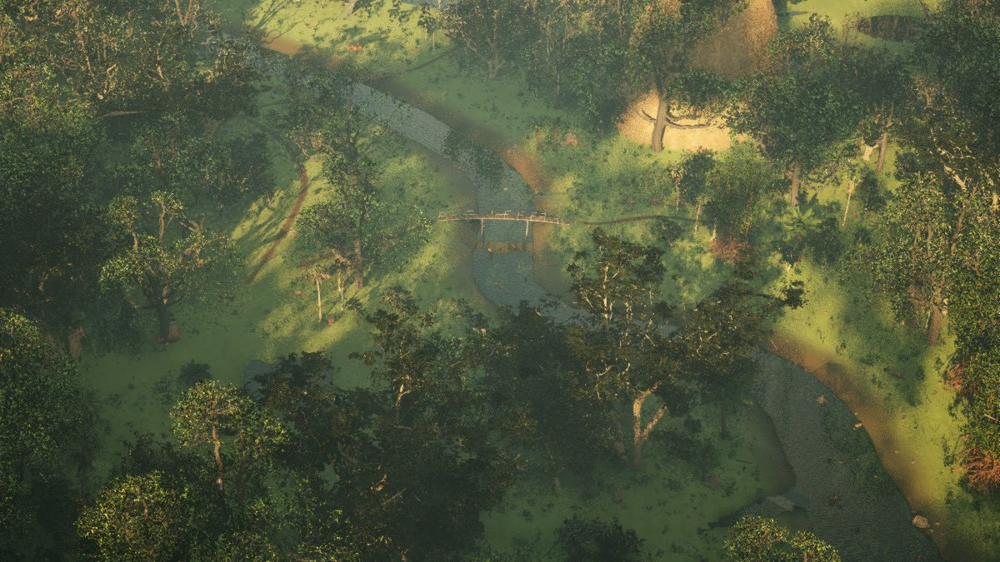
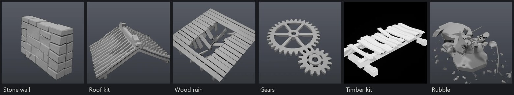

<h1 align="center">GraphCode</h1>

<p align="center"><b>Let your AI build in Unreal Engine, and review every change it makes like code.</b></p>

<p align="center">
<a href="https://github.com/xiangjie9999/GraphCode/releases/latest"><b>Download 0.1.13</b></a> ·
<a href="https://graphcode.dev/start"><b>Start the 14-day trial</b></a> ·
<a href="#what-you-can-make">Products</a> ·
<a href="#how-it-works">How it works</a> ·
<a href="#trust-and-privacy">Trust</a> ·
<a href="https://graphcode.dev/pricing">Pricing</a> ·
<a href="https://graphcode.dev">graphcode.dev</a>
</p>

GraphCode is a set of Unreal Engine editor plugins that give each supported asset (a Blueprint, a
widget, a material, a data table, a level, a Niagara effect) **one readable text document**, and build
meshes, animations, rigs, hair and clothing from short readable recipes. Your AI client reads a
document whole, changes the lines it means to change, and writes it back into the real asset. A write
is checked before it lands: one made against an out-of-date copy is refused, and by default one that
would break a working Blueprint is not saved. Every change shows up in your version control as a diff
you can review.

| | |
|---|---|
| **Runs on** | Unreal Engine **5.7.4**, Windows 64-bit. Blueprint-only projects work; no compiler needed. |
| **You bring** | An AI client that speaks MCP (we build and test with Claude Code and Codex). GraphCode never calls an AI provider itself. |
| **You get** | Ten products in one package: Blueprints, UI, materials, data, levels, terrain and PCG, procedural meshes, animation and effects, rigs, hair, clothing, MetaHumans, Blender import, and a free Market of ready-made packs. |
| **Try it** | 14 days of everything with just an email: no card, no code. |
| **Then** | A [one-time licence](https://graphcode.dev/pricing) per product or for all of them. One PC at a time per licence. |
| **What it is** | Closed-source, precompiled plugins with their public C++ headers. What leaves your PC is listed [below](#trust-and-privacy), and it never includes your project. |

<table>
<tr>
<td width="33%"><br><sub><b>Materials.</b> Velvet, rugs, wallpaper and wood. Every surface here is a material written as GraphCode. <a href="https://graphcode.dev/features/assets#materials">Case study</a></sub></td>
<td width="33%"><br><sub><b>Levels.</b> A walled canal town whose layout is two text files; its level document holds 2,648 actors. <a href="https://graphcode.dev/features/worlds#levels">Case study</a></sub></td>
<td width="33%"><br><sub><b>Effects.</b> A Niagara system written as text: emitters, modules and user parameters. <a href="https://graphcode.dev/features/assets#vfx">Case study</a></sub></td>
</tr>
<tr>
<td><br><sub><b>Animation.</b> A MetaHuman violinist whose bow, fingers, face and sway are curves written from a recording. <a href="https://graphcode.dev/features/characters#animation">Case study</a></sub></td>
<td><br><sub><b>Worlds.</b> A jungle valley about 1 km square, planted from about 130 lines in one level file. <a href="https://graphcode.dev/features/worlds#pcg">Case study</a></sub></td>
<td><br><sub><b>Meshes.</b> Clay renders of free Market packs, each an ordinary Static Mesh built from a <code>.gcshape</code> recipe. <a href="https://graphcode.dev/marketplace">Market</a></sub></td>
</tr>
</table>
<sub>Captures from the case studies on graphcode.dev, made in Unreal Engine 5.7 with GraphCode. Violin and bow model by RafalTlalka (Sketchfab), CC BY 4.0.</sub>

---

## One edit, one diff

An 18 m airship first flew with a dark, closed cabin. Replacing it with a lit, glazed bridge was a
few lines in the airship Blueprint's document, rebuilt in Unreal with the same ship and the same camera:

<table>
<tr>
<td width="50%"><br><sub>Before</sub></td>
<td width="50%"><br><sub>After</sub></td>
</tr>
</table>

```diff
-  Cabin = StaticMeshComponent(StaticMesh=…SM_AirshipCabin)
+  BridgeFrame = StaticMeshComponent(StaticMesh=…SM_AirshipBridge)
+  BridgeGlass = StaticMeshComponent(StaticMesh=…SM_AirshipBridgeGlass)
+  BridgeLight1 = PointLightComponent(Intensity=700.0, …)
```
<sub>`BP_Airship.gc`, excerpt as published in the <a href="https://graphcode.dev/features/assets#geometry">airship case study</a>. The bridge's meshes themselves are <code>.gcshape</code> recipes.</sub>

This is what a reviewer sees in place of `Binary files differ`, and the same holds for a material.
An ivy material in our test project looked like plastic, and this was the whole change:

```diff
-gc 1  kind:material_instance  asset:/Game/__MCPTests/Leaf/MI_GcLeafSurf_Ivy  sig:da7e2352…  bin:2dea5279…
+gc 1  kind:material_instance  asset:/Game/__MCPTests/Leaf/MI_GcLeafSurf_Ivy  sig:bf179c71…  bin:21b1866e…
 omits: none
@@ parameters {
-  Roughness: float = 0.3
-  RoughnessFromMap: float = 1.0
+  Roughness: float = 0.62
+  RoughnessFromMap: float = 0.55
```

The first line changes on every write (new `sig` and `bin`); the rest is the real edit. Most kinds
declare something they leave out (the Blueprint below does); a material instance declares nothing, so
for this asset the diff is the whole authored change.

## One asset, one document

A whole Character Blueprint, as shipped in the package's
[StairsInAGame](Plugins/GraphCode/Docs/Examples/StairsInAGame/BP_StairWalker.gc) example. It walks
forward each tick until it passes `StopX`:

```gc
gc 1  kind:blueprint  asset:/Game/StairsInAGame/BP_StairWalker
parent: /Script/Engine.Character

properties {
  StopX: double = 285.0 [instance_editable]
}

components {
  CharMoveComp = CharacterMovementComponent(bRunPhysicsWithNoController=true, MaxStepHeight=40.0, MaxWalkSpeed=100.0)
    @native[property=CharacterMovement]
  CollisionCylinder = CapsuleComponent(CapsuleHalfHeight=96.0, CapsuleRadius=24.0)
    @native[property=CapsuleComponent]
}

graph {
  eventgraph EventGraph {
    n1 = Event ReceiveTick() [bOverrideFunction=True] : ->n2
    n2 = IfThenElse(Condition=n3.ReturnValue) : then->n7, else->_
    n3 = CallFunction KismetMathLibrary:Less_DoubleDouble(A=n4.X, B=n6.StopX)
    n4 = CallFunction KismetMathLibrary:BreakVector(InVec=n5.ReturnValue)
    n5 = CallFunction Actor:K2_GetActorLocation()
    n6 = VariableGet StopX()
    n7 = CallFunction Pawn:AddMovementInput(WorldDirection=n8.ReturnValue, bForce=True) : ->_
    n8 = CallFunction Actor:GetActorForwardVector()
  }
}
```
<sub>Shortened for this page: the mesh component and the empty blocks are left out. The whole file is 1,658 bytes, roughly 400 tokens.</sub>

Each node is one line. `->n2` is an execution wire and `n4.X` a data wire, and the names are the
engine's real functions. The AI reads the whole Blueprint in one call and sends back only the block
it changed. Nodes it did not change keep their GUIDs and positions.

When GraphCode projects an asset you already have, the document's first lines carry what makes it
safe to edit. This header is real:

```gc
gc 1  kind:blueprint  asset:/Game/GraphCodeExamples/HouseDoor_20261024/BP_HouseDoorStage  sig:193cc0e7…  bin:98c81306…  seal:2.47bc…
omits: blueprint_extensions blueprint_metadata variable_metadata collision_geometry
source: OraStudio 5.7.4-51494982+++UE5+Release-5.7  projector:32  ir: blueprintir/2 actorir/1
```

- `sig:` is a digest of this exact text. A write computed against an older one is refused.
- `bin:` is a digest of the binary asset the text describes.
- `omits:` is everything this document does not carry for this kind of asset. Of the 60 kinds,
  16 omit nothing; [docs/KINDS.md](docs/KINDS.md) lists the rest, generated from the registry
  that ships in the release.
- `seal:` signs the last write to the licence and PC that made it.

## When the AI gets it wrong

These are the protections, with the messages your AI actually receives, taken from the tools' own
help and source:

| What goes wrong | What GraphCode does |
|---|---|
| The AI edits an out-of-date copy, or two edits race | The write carries the `sig` it was computed against. *"A stale value is refused, never merged."* |
| The AI wants to try something first | `dry_run: true`: *"Validate everything against the live asset and touch nothing - including the .gc on disk."* |
| A write breaks a Blueprint that compiled | Not saved (unless you pass `allow_broken`): *"this write left a Blueprint that compiled before it with compile errors, so it was NOT saved … the file on disk is still the version that compiled."* |
| A partial payload would silently drop entries | Leaving an entry out keeps it (`patch`, the default). Four blocks (actors, rows, components, widgets) refuse a partial write rather than guess; removal is always an explicit `delete` line. |
| The AI asks for something that does not exist | It is refused by name, with the valid choices: *"'editor' is not a section of unreal_info."* followed by the list of sections. |
| The AI deletes an asset | It moves to `/Game/__MCPTrash`, which GraphCode never empties. Referenced assets refuse unless the exact impact is accepted. |
| You want yesterday's version back | `gc_versions` keeps the previous text on every changing save and restores through a plan you confirm (`plan_sig`). The plan lists anything the restore would remove. |
| You need to see the result, not the text | `gc_render` renders materials, meshes, Actor Blueprints, effects and the level from named views. For widgets it paints several screen sizes and reports overlap, clipping and contrast. `gc_play` drives Play-in-Editor and captures the world to text. |

Epic's [experimental MCP plugin in Unreal Engine 5.8](https://engadget.com/2196807/epic-games-details-how-its-embracing-gen-ai-in-unreal-engine) and the community MCP servers let an AI operate
the editor step by step. GraphCode works on whole documents with the checks above. Try both on the
same task; that comparison is what the trial is for.

## What you can make

Ten products, one package, one trial. Full detail for each is in [docs/PRODUCTS.md](docs/PRODUCTS.md)
and on its graphcode.dev page.

| | Product | You write | You get | Worth knowing |
|---|---|---|---|---|
| **Worlds** | [Core: levels](docs/PRODUCTS.md#graphcode-core-levels) | The level's `.gc`: actors, components, volumes, splines, Level Blueprint | The level, changed only where the text changed | Place by intent (`@anchor`, `@surface`, `@facing`). World Partition and HLOD partly covered |
| | [World](docs/PRODUCTS.md#graphcode-world) | `.gcw` regions, terrain, water, navigation, populate rules; PCG graphs | Landscape, Water, foliage, navigation, PCG | `gcw_ask` answers "can this agent walk there". Render and walk the result |
| | [Shape](docs/PRODUCTS.md#graphcode-shape) | `.gcshape` recipes: outlines, lofts, cuts, joins, profiles, edge finishes, LODs | Ordinary Static Meshes | One number changes every part built from it. Geometry only: surfaces come from your materials |
| | [Market](docs/PRODUCTS.md#graphcode-market-free) | Nothing: search and install | 36 free signed packs: walls, timber, roofs, rope, gears, vegetation, pose libraries | Updating a pack does not yet update its dependencies |
| **Characters** | [Move](docs/PRODUCTS.md#graphcode-move) | `.gcmove` motion programs; Niagara, sequences, behaviour and state trees as `.gc` | Animation Sequences, montages, blend spaces, effects, cinematics | Motion is measured, not guaranteed natural. Long clips take minutes |
| | [Rig](docs/PRODUCTS.md#graphcode-rig) | `.gcrig`: where a mesh bends, ranges, contacts, grips | Skeleton, skin weights, physics bodies, IK rig, Control Rig | Deep folds can still show artefacts |
| | [Groom](docs/PRODUCTS.md#graphcode-groom) | `.gcgroom`: layers, zones, combing, braids, cards, feathers | Unreal Groom assets and bindings | Needs the Groom plugin; judge on a GPU render |
| | [Garment](docs/PRODUCTS.md#graphcode-garment) | `.gcgarment`: how a garment is cut, sewn and hangs | Static, skinned or MetaHuman clothing | The newest product: of the 19 examples only the T-shirt has been render-checked so far, and Dress and Button Shirt may fail to build |
| | [Core Extension](docs/PRODUCTS.md#graphcode-core-extension) | `.gchuman` identities; MetaSounds, EQS, vegetation graphs | MetaHumans, audio graphs, queries, trees | MetaHuman rigging uses Epic's services |
| **Gameplay, UI, data** | [Core](docs/PRODUCTS.md#graphcode-core-blueprints-widgets-materials-data) | Blueprints, widgets, materials, data tables, curves, input as `.gc` | The same assets, written back | Each kind declares what it omits ([KINDS.md](docs/KINDS.md)) |
| | [Play](docs/PRODUCTS.md#graphcode-play) | Steps for `gc_play`: inputs, calls, waits | A driven Play session and `.gcp` world captures you can diff | Runs the tests you write; not an autonomous tester |
| **Bring work in** | [Integrate](docs/PRODUCTS.md#graphcode-integrate) | Nothing: pick meshes in Blender | Static meshes with materials translated to Unreal | Static meshes only, Blender only |

## How it works

```
your AI client  --stdio-->  graphcode-bridge.exe  --HTTP, this machine only-->  Unreal Editor + GraphCode
 (Claude Code, Codex,        (in the package; no                                (reads and writes the real
  any MCP client)             Node.js needed)                                    assets; writes .gc on save)
```

The plugins also write a `.gc` sidecar next to each supported asset whenever you save, with no AI
involved. Those files are what your version control diffs.

**Fifteen tools.** Their definitions total 26 KB, roughly 6,500 tokens of your AI's context. That
was measured by asking the shipped bridge for its tool list.

| Tool | What it does |
|---|---|
| `gc_read` | Read an asset, level or actor as its document: `saved` on disk or `live` with unsaved edits. |
| `gc_apply` | **The one write.** Apply a document to an asset or create a new one, with dry runs, patch or snapshot. |
| `gc_describe` | The grammar of a kind or block, a native type, or one node of an asset. Works with the editor closed. |
| `gc_search` | Find assets, nodes, declarations, widgets, callable functions and presets. |
| `gc_render` | See or hear the result: renders, widget layouts, motion trails, short videos, audio, "what is at this pixel". |
| `gc_versions` | List and compare earlier versions; restore one through a confirmed plan. |
| `gc_play` | Drive and capture the running game. |
| `gc_sync` · `gc_asset` · `gc_import` · `gc_invoke` · `gc_open` · `gc_market` · `gcw_ask` · `unreal_info` | Sidecars; rename, move or recoverable delete; imports; press a button or call a function; show you an asset; Market packs; spatial questions; what is installed and running. |

**Each tool teaches itself**, from help generated from the code you are calling, with no editor needed:

```jsonc
{ "help": true }                                  // what the verb does, one line per parameter
{ "help": "omission" }                            // what that parameter accepts
{ "help": "omission", "omission": "snapshot" }    // what one value does and what it brings
```

The package carries 96 guides and the worked examples. The AI reads them as it needs them, starting
from [`GRAPHCODE.md`](Plugins/GraphCode/GRAPHCODE.md), and the MCP server tells every client to
read that first. You can read the same guides [here](Plugins/GraphCode/Docs/Guides/README.md).

## Get started

**You need:** Windows 64-bit, Unreal Engine **5.7.4**, an MCP-capable AI client, and a project you
are happy to experiment in (start with a copy).

1. **Download** `graphcode-0.1.13-win64.tar.xz` (130 MB), `release.json` and `release.sig.json` from
   the [latest release](https://github.com/xiangjie9999/GraphCode/releases/latest).
2. **Verify it** (optional). Clone this repository (or download `tools/Verify-GraphCodeRelease.ps1`
   and `release/release-keys.json` keeping that layout) and run the verifier from it. It checks our
   signature and the archive hash, and sends nothing anywhere:
   ```powershell
   .\tools\Verify-GraphCodeRelease.ps1 -Archive "$HOME\Downloads\graphcode-0.1.13-win64.tar.xz"
   ```
3. **Install.** Close Unreal, unpack with Windows' built-in `tar`, and copy the plugin folders into your project:
   ```powershell
   mkdir GraphCode-0.1.13; tar -xf graphcode-0.1.13-win64.tar.xz -C GraphCode-0.1.13
   Copy-Item GraphCode-0.1.13\Plugins\* "C:\Path\To\YourProject\Plugins\" -Recurse
   ```
   Check your engine is exactly 5.7.4 (**Help > About Unreal Editor**). Open the project, enable
   **GraphCode** (Core) and any other GraphCode products you want in **Edit > Plugins**, accept the
   engine plugins they ask for, and restart. Each product's page lists what it needs. Windows may ask about the unsigned bridge program the first time it runs.
4. **Start the trial.** Enter your email at [graphcode.dev/start](https://graphcode.dev/start) to get
   `graphcode-activation-<your email>.txt`. Save it as `%USERPROFILE%\.graphcode\activation.txt`
   (or drop it in place of `Plugins/GraphCode/activation.txt`; the first use moves it there, out of
   your project). It holds your email and the licence server address, not a password, but keep it
   out of version control. GraphCode needs it before first use; activation starts the 14 days.
5. **Connect your AI.** Opening the project writes `Saved/UnrealAIBridge/mcp-config.json`, a
   standard `mcpServers` entry named `unreal`:

   | Client | Where the entry goes |
   |---|---|
   | Claude Code | Copy the file to `.mcp.json` in the project folder (or merge it in), then approve the server when Claude Code asks. |
   | Cursor | Merge its `mcpServers` into `.cursor/mcp.json` in the project folder. |
   | Claude Desktop | Merge its `mcpServers` into `%APPDATA%\Claude\claude_desktop_config.json`. |
   | Codex | Add `[mcp_servers.unreal]` to `~/.codex/config.toml` with `command = '<bridge path>'` and `env = { UNREAL_PROJECT_PATH = '<.uproject path>' }`. Single quotes keep Windows backslashes literal. |
   | Anything else | Add a stdio server with the generated `command`, `args` and `env`. |

   Keep `UNREAL_PROJECT_PATH`: it is how the bridge finds the right editor. The port can change
   between sessions, and the bridge finds it by itself.
6. **Ask for something.**
   - *"Read `Plugins/GraphCode/SETUP.md` and set up this project for GraphCode."*
   - *"Read BP_Player as GraphCode and explain what it does."* (This only reads.)
   - *"Find a stone wall in the GraphCode Market, install it and build one in this level."*

## The trial and the licence

| | |
|---|---|
| **Trial** | 14 days of all ten products from the first activation. One trial per email and one per PC. No card. |
| **When it ends** | Reading, help, sidecars, search and renders keep working. Writes, restores and AI dry runs stop until you buy. Your assets are untouched. |
| **Licence** | One-time purchase, per product or all products, for individuals or per studio seat: [pricing](https://graphcode.dev/pricing). |
| **One PC at a time** | A licence writes from one PC at a time. Moving it can take up to 15 minutes to free the old PC. |
| **Offline** | Reading, help, search, renders and sidecars work offline. Writes use a short-lived token from the licence server and pause, saying why, while it cannot be reached; Market downloads and MetaHuman service steps need the network too. |
| **Clock** | Keep Windows' clock set automatically. Writes are refused while the PC clock is more than 5 minutes off. |
| **Updates** | The editor offers a new release with a notice. Nothing installs until you click, and the previous version is kept so you can go back. |

## Trust and privacy

You are being asked to load closed-source DLLs into your editor, so here is exactly what they send
and how to check what you downloaded.

| When | To | Sent | Never sent |
|---|---|---|---|
| Before a write, if no recent token covers it | GraphCode licence service | Your email, licence id, this PC's device id and public key, a session secret, a request id, and a signature over a server challenge | Project content, asset text, file names |
| First activation, or moving to another PC | GraphCode licence service | Your email, the activation code if you bought one, this PC's public key | Same |
| Editor start, then every 24 h (switch off in **Project Settings > Plugins > GraphCode Updates**) | GraphCode update service | A signed proof of this PC | Version, project, usage |
| When you search or install Market packs | graphcode.dev | Your search, the pack you chose | Project content |
| When you request a trial file on graphcode.dev/start | graphcode.dev | The email (and optional name and studio) you typed, plus the country and referring page our host adds | — |
| When you rig or assemble a MetaHuman (Core Extension) | Epic's MetaHuman services, through Unreal's MetaHuman plugin | What Epic's service needs, under Epic's terms | — |

- **GraphCode never calls an AI provider** and sends no usage data. Your AI client sends what it
  reads to the provider *you* chose, under that provider's terms. That is the only path for your project's content.
- **Who can reach the editor:** only programs on this machine. Tool requests from web pages
  (a browser `Origin` header) are refused. GraphCode trusts your local user account, the same as the
  editor itself does, so treat a shared or multi-user PC accordingly.
  [Threat model](docs/STUDIOS.md#threat-model-who-can-talk-to-the-editor).
- **Signed releases:** each `release.json` is signed (ES256) by one of our published release keys,
  and it carries the archive's SHA-256. [`release/0.1.13/BUNDLE-SHA256.txt`](release/0.1.13/BUNDLE-SHA256.txt)
  lists every file. The [verify script](tools/Verify-GraphCodeRelease.ps1) checks all of it,
  prints the key's fingerprint, and flags any file that is not ours. 0.1.13 is signed with our
  backup key, [for a reason we explain](docs/STUDIOS.md#release-signing-and-keys).
- **What you can and cannot inspect:** every public header, build rule, plugin descriptor, guide and
  example is in this repository. The implementation source is not, and we say so rather than imply otherwise.
- [PRIVACY.md](PRIVACY.md) (draft) · [SECURITY.md](SECURITY.md) · [THIRD-PARTY-NOTICES.md](Plugins/GraphCode/THIRD-PARTY-NOTICES.md)

## Known limits

We would rather you read these now than find them in week two.

- **Windows 64-bit and Unreal Engine 5.7.4 only.** A new engine version needs a matching release.
- **Closed source**, and the binaries are not yet Authenticode-signed; use the release signature to verify them.
- **The editor must be running** for writes, renders, searches and live reads. Saved reads, help and
  grammar work with it closed. Renders need a GPU editor session, not a headless one.
- **The `.uasset` is still the source of truth.** Binary assets still conflict in Git merges, and the
  safe default is `merge=binary`. A semantic text merge is built and in validation, not enabled.
- **Not every facet is text.** Each kind lists what it omits. Meshes, textures, sound waves,
  skeletons, imported animations, MetaHumans and grooms are built or imported, then patched.
- **Generated content is measured, not guaranteed.** Motion, rigs, hair and clothing come with build
  notes and renders to judge by, and the shipped examples state their own remaining defects. Garment is the newest product.
- **Licence:** writes need the licence server, a correct clock and one PC at a time per licence.
- **Perforce** is not integrated or tested yet.

## For studios

[docs/STUDIOS.md](docs/STUDIOS.md) covers the threat model, release keys, CI, Perforce, packaged
games, version pinning and uninstalling. The short version:

- **CI:** `UnrealEditor-Cmd.exe MyGame.uproject "-run=GraphCode.GcCheck"` checks every sidecar
  headlessly, with **no licence and no network**, and exits 1 on anything missing or stale.
- **Packaged games:** what GraphCode makes are ordinary assets. A few small runtime modules are packaged
  while the plugins are enabled; only Groom feature sockets and Play test nodes reference them.
- **Pinning:** keep this release's archive and switch the update check off. Nothing ever installs without a click.
- **If we disappear:** your assets and games are ordinary Unreal content and need nothing from us to open,
  build or ship. Your `.gc` documents and recipes stay readable text; rebuilding from a recipe is a GraphCode write.

## What is in this repository

The browsable half of the download. Binaries are attached to each
[release](https://github.com/xiangjie9999/GraphCode/releases) and never committed.

| Path | What it is |
|---|---|
| `Plugins/<Product>/` | The ten plugin descriptors, every public C++ header and `.Build.cs` rule, exactly as shipped. |
| `Plugins/GraphCode/GRAPHCODE.md`, `SETUP.md` | What your AI reads first, and the project setup it follows. |
| `Plugins/GraphCode/Docs/` | All 96 shipped guides and the worked examples. |
| `Plugins/GraphCode/Resources/mcp-bridge/` | The capability registry and the tool catalog. |
| `docs/` | [PRODUCTS.md](docs/PRODUCTS.md), [KINDS.md](docs/KINDS.md) (generated), [STUDIOS.md](docs/STUDIOS.md). |
| `release/` | Signed manifests, public keys and per-file checksums. |
| `tools/` | The download verifier and the kinds generator. |

## Support and legal

- **Questions and bugs:** [GitHub Issues](https://github.com/xiangjie9999/GraphCode/issues). Include
  the version, the tool call and the full reply, since a refusal message usually explains itself.
- **Licences and billing:** support@graphcode.dev · **Security:** [SECURITY.md](SECURITY.md), please not as a public issue.
- [LICENSE.md](LICENSE.md) (end-user licence agreement) · [PRIVACY.md](PRIVACY.md) · [CHANGELOG.md](CHANGELOG.md).
  The licence agreement and privacy policy are drafts under legal review and are marked as such.
- Unreal Engine is a trademark of Epic Games, Inc. GraphCode is independent and not affiliated with or
  endorsed by Epic Games. Your use of Unreal Engine is governed by Epic's EULA.

<p align="center"><sub>GraphCode 0.1.13 · Unreal Engine 5.7.4 · Win64 · <a href="https://graphcode.dev">graphcode.dev</a></sub></p>
