<h1 align="center">GraphCode</h1>

<p align="center"><b>Tell your AI what to build in Unreal Engine. It builds it, in your editor.</b></p>

<p align="center">
<a href="https://github.com/xiangjie9999/GraphCode/releases/download/v0.1.14/graphcode-0.1.14-win64.tar.xz"><b>Download 0.1.14</b></a> ·
<a href="https://graphcode.dev/start"><b>Start the 14-day trial</b></a> ·
<a href="#what-your-ai-can-build">Capabilities</a> ·
<a href="docs/SETUP.md"><b>Setup guide</b></a> ·
<a href="#questions">FAQ</a> ·
<a href="https://graphcode.dev/pricing">Pricing</a> ·
<a href="https://graphcode.dev/marketplace">Market</a>
</p>

<p align="center"></p>
<p align="center"><sub>Asked in plain words on the left; built in Unreal on the right (7× speed).</sub></p>

GraphCode is a set of Unreal Engine plugins that let the AI you already use build your game: gameplay,
menus, levels, terrain, props, characters, animation, hair, clothing and effects. You describe what you
want; the AI makes it as ordinary Unreal assets in your project, renders and plays it to check its work,
and every change it makes is saved so you can compare it or take it back.

| | |
|---|---|
| **Runs on** | Unreal Engine 5.7.4, Windows 64-bit. Blueprint-only projects work; no compiler needed. |
| **Works with** | The AI you already use, through MCP: Claude Code, Codex, Cursor, Claude Desktop or any MCP client. |
| **Includes** | Ten products in one package, a free Market of ready-made packs, and 96 guides the AI reads as it works. |
| **Try it** | 14 days of everything with just an email. No card. |
| **Then** | A [one-time licence](https://graphcode.dev/pricing) per product or for all of them. |

## Start here

**What you download:** ten Unreal Engine plugins in one package (about 132 MB). You copy them into your
project, turn them on, start the free trial with your email, and connect the AI you already use.
Setup takes about 15 minutes: **[the setup guide](docs/SETUP.md)**.

**What you get:** your AI building inside your open Unreal editor, on your project: you ask in its chat,
it makes real Unreal assets, shows you renders and test runs, and every change can be undone.

**How to read this page:**

| Section | What it tells you |
|---|---|
| [Made with GraphCode](#made-with-graphcode) | Things it has built. |
| [How it works](#how-it-works) | What a session with your AI looks like. |
| [Get started](#get-started) | The setup in five steps, and the full guide. |
| [What your AI can build](#what-your-ai-can-build) | Each of the ten products: a picture, an example, and everything it can do. |
| [Trial and licence](#trial-and-licence) · [Trust and privacy](#trust-and-privacy) · [Questions](#questions) | Before you buy. |

## Made with GraphCode

A few of the 39 free packs in the [GraphCode Market](https://graphcode.dev/marketplace), each built by the AI in Unreal. Your AI can install any of them and build them in your project, or make its own.

<table>
<tr>
<td align="center"><a href="https://graphcode.dev/marketplace/GraphCode/StoneWall/"><br><sub>Stone walls</sub></a></td>
<td align="center"><a href="https://graphcode.dev/marketplace/GraphCode/RoofKit/">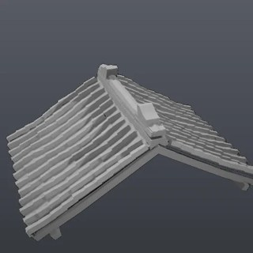<br><sub>Roofs</sub></a></td>
<td align="center"><a href="https://graphcode.dev/marketplace/GraphCode/WoodRuin/">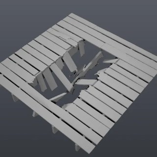<br><sub>Wood ruins</sub></a></td>
<td align="center"><a href="https://graphcode.dev/marketplace/GraphCode/TimberKit/">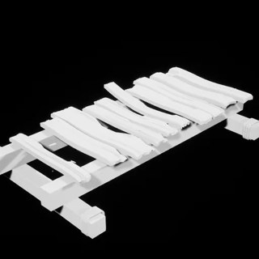<br><sub>Timber</sub></a></td>
</tr>
<tr>
<td align="center"><a href="https://graphcode.dev/marketplace/GraphCode/RocksCliffsKit/"><br><sub>Rocks and cliffs</sub></a></td>
<td align="center"><a href="https://graphcode.dev/marketplace/GraphCode/UnderstoryKit/"><br><sub>Understory plants</sub></a></td>
<td align="center"><a href="https://graphcode.dev/marketplace/GraphCode/StoneKit/">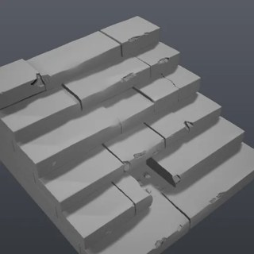<br><sub>Stone stairs</sub></a></td>
<td align="center"><a href="https://graphcode.dev/marketplace/GraphCode/BrokenConcrete/">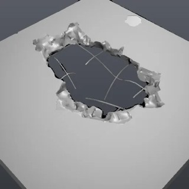<br><sub>Broken concrete</sub></a></td>
</tr>
<tr>
<td align="center"><a href="https://graphcode.dev/marketplace/GraphCode/BarkMaterials/">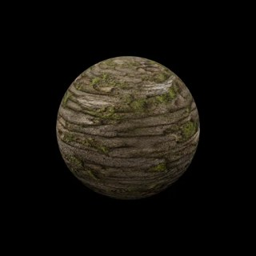<br><sub>Bark materials</sub></a></td>
<td align="center"><a href="https://graphcode.dev/marketplace/GraphCode/CleanGeneratedMesh/"><br><sub>Cleaned AI models</sub></a></td>
<td align="center"><a href="https://graphcode.dev/marketplace/GraphCode/Gears/"><br><sub>Gears</sub></a></td>
<td align="center"><a href="https://graphcode.dev/marketplace/GraphCode/Rubble/"><br><sub>Rubble</sub></a></td>
</tr>
</table>

All packs: [docs/MARKET.md](docs/MARKET.md). Case studies with films and samples: [docs/EXAMPLES.md](docs/EXAMPLES.md).

## How it works

1. **You ask** in plain words: *"Put an oval glass dome on the hall."* *"Give the cat a thick grey coat."*
   *"Add a reload key to the gun and show the ammo on the HUD."*
2. **The AI builds it** inside your Unreal editor, as real assets: Blueprints, levels, meshes,
   materials, animations, effects. It reads the relevant guide first, tries the change before making it,
   then renders it and plays it to check, and fixes what it sees.
3. **You look, and fine-tune where you want to.** Ask for changes in words, or take over by hand where
   GraphCode gives you a panel: the **Pose** panel for motion, the **Market** tab for ready-made packs,
   and **Version Control** to compare and undo.
4. **You keep it or take it back.** Every change is saved as a version you can compare and restore, one
   asset or the whole project, and shows up in Git as a readable diff.

While the AI works, your project is protected: it can't overwrite newer work, a change that would break
a working Blueprint is not saved, and anything it deletes goes to a trash folder it never empties.

## Get started

**You need:** Windows 64-bit, Unreal Engine **exactly 5.7.4**, and an AI client that supports MCP
(Claude Code, Cursor, Claude Desktop, Codex or any other). No compiler, Visual Studio or Node.js.

1. **Download** [`graphcode-0.1.14-win64.tar.xz`](https://github.com/xiangjie9999/GraphCode/releases/download/v0.1.14/graphcode-0.1.14-win64.tar.xz) (one click; every release is on the
   [Releases](https://github.com/xiangjie9999/GraphCode/releases) page) and unpack it.
2. **Copy** the folders in its `Plugins` folder into your project's `Plugins` folder, open the project,
   tick the GraphCode plugins in **Edit > Plugins** and restart.
3. **Start the trial** at [graphcode.dev/start](https://graphcode.dev/start): save the file it gives you
   as `%USERPROFILE%\.graphcode\activation.txt`.
4. **Connect your AI:** give your AI client the `unreal` entry from your project's
   `Saved\UnrealAIBridge\mcp-config.json`. Ask it *"Run unreal_info"*: it should answer **CONNECTED**.
5. **Ask:** *"Read Plugins/GraphCode/SETUP.md and set up this project for GraphCode."* It looks at your
   project, asks how involved you want to be, and builds a first thing so you see it working.

**[The full setup guide](docs/SETUP.md)**: what you see at each step, how to tell it worked, where the
file goes for each AI client, and what to do if something goes wrong.

## What your AI can build

All ten products ship in one package and are included in the trial. Jump to:
[Core](#graphcode-core-gameplay-ui-materials-data-and-levels) ·
[World](#graphcode-world-terrain-water-forests-and-navigation) ·
[Shape](#graphcode-shape-props-buildings-machines-creatures-and-plants) ·
[Move](#graphcode-move-animation-effects-cutscenes-and-ai-behaviour) ·
[Rig](#graphcode-rig-skeletons-and-skinning) ·
[Groom](#graphcode-groom-hair-fur-and-feathers) ·
[Garment](#graphcode-garment-clothing-and-armour) ·
[Core Extension](#graphcode-core-extension-metahumans-crowds-sound-and-trees) ·
[Play](#graphcode-play-testing-the-game) ·
[Integrate](#graphcode-integrate-blender) ·
[Market](#graphcode-market-free)

---

### GraphCode Core: gameplay, UI, materials, data and levels

The game itself: the rules, the screens, the surfaces and the levels, built as ordinary Unreal assets.

<table><tr>
<td width="50%">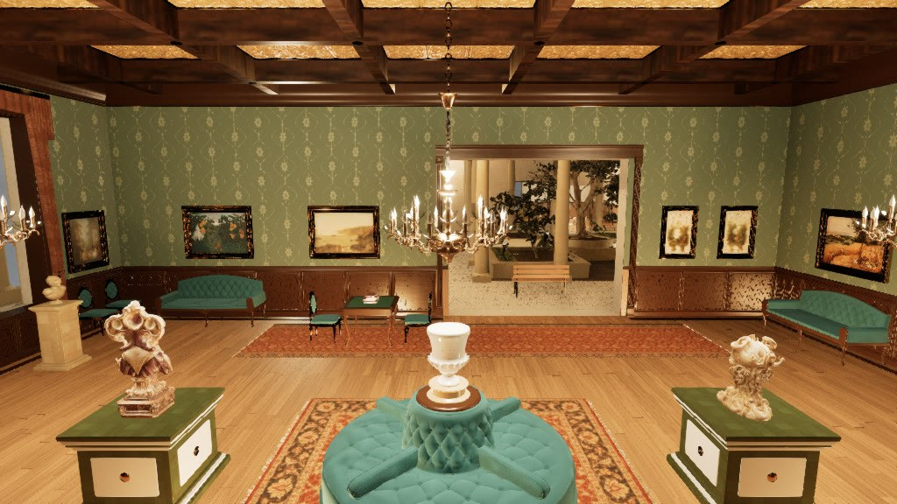<br><sub>A hall's materials: wallpaper, panelled ceiling, parquet, velvet.</sub></td>
<td width="50%">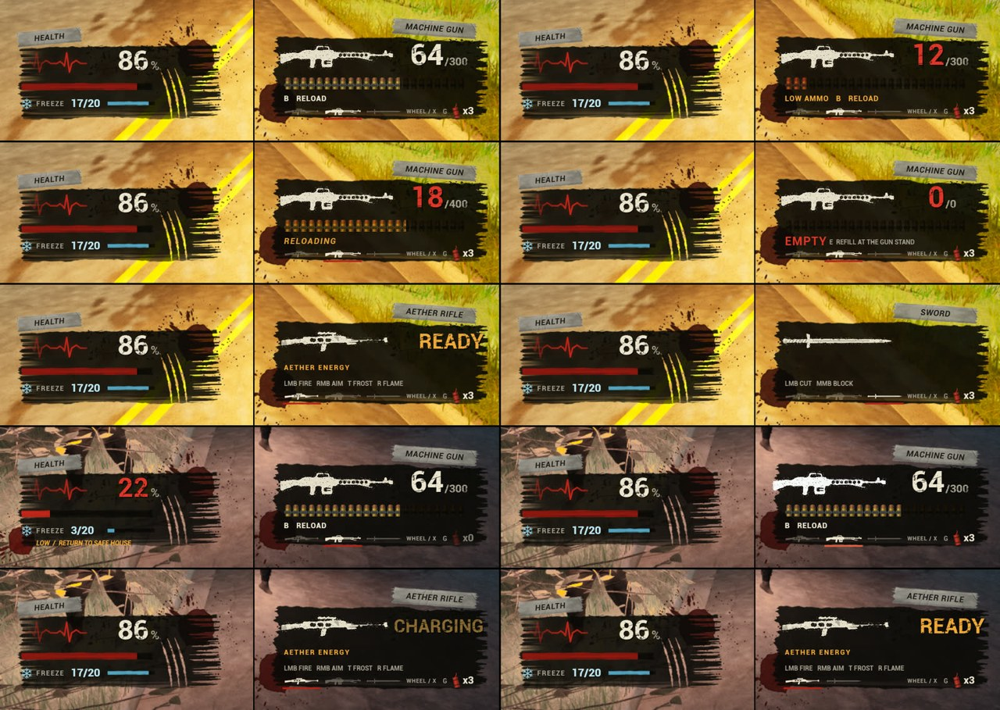<br><sub>One HUD in twenty states (reload, empty, charging, ready), each checked.</sub></td>
</tr></table>

**How it goes:** *"Add a reload key and show the ammo on the HUD."* The AI adds the input, the
Blueprint logic and the widget, plays the game, presses the key and shows you the result. Don't like
it? Click **GraphCode** in the editor's status bar to open **Version Control**: compare what changed
against the last commit, a branch or a moment in local history, and restore one file or the whole project.

- **Blueprints:** characters, weapons, doors, pickups, game rules: variables, components, events,
  functions, macros, interfaces, event dispatchers and timelines.
- **Animation Blueprints** with their state machines.
- **Menus, HUDs and screens:** widget layouts, bindings and animations, checked at up to eight screen
  sizes for overlap, clipping and contrast, with buttons pressed to test them.
- **Materials:** material graphs, reusable material functions and material instances.
- **Game data:** data assets, data tables, localised text tables, curves, structs, enums and data registries.
- **Controls:** Enhanced Input actions and mapping contexts for keyboard, mouse and gamepad.
- **Sound cues, fonts, physical materials, foliage types, render targets and HLOD layers.**
- **Levels:** placing, moving and arranging actors, sublevels, volumes, splines and the Level Blueprint;
  placing things by intent ("on the floor, facing the door"); editing one World Partition actor without
  loading the map.
- **Importing** meshes, textures and audio (FBX, glTF, OBJ, images, archives) with the import settings planned first.
- **Finding things:** assets, nodes, functions, widgets, and what depends on what before anything is deleted.
- **Looking and listening:** renders from any angle, short videos and contact sheets, "what is at this
  pixel", and sounds rendered with their loudness.
- **History:** every change saved, compared and restorable; a recoverable trash; readable diffs in Git; a
  merge of two people's edits to the same asset; a check for your CI that needs no licence.

### GraphCode World: terrain, water, forests and navigation

Whole places, at real scale: the land, the water, what grows on it and how characters cross it.

<p>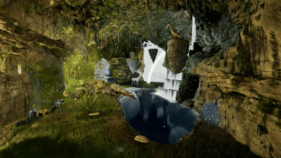</p>

**How it goes:** *"A wooded valley with a waterfall into a pool, cliffs on both sides."* The AI shapes the
terrain, carves the riverbed, adds the water and plants the slopes, then renders it from several
angles. Then: *"More erosion on the cliffs, and keep the trees out of the path."*

- **Terrain** shaped by instruction: mountains, ridges, valleys, carved riverbeds, erosion, noise and
  smoothing, at real scale in metres.
- **Height brushes** from your own heightmap images, and hand sculpting that is recorded and replayed exactly.
- **Open worlds:** terrain streamed in World Partition tiles.
- **Water:** lakes, rivers and ponds, with water materials tuned for depth, reflections, flow and foam.
- **Planting:** forests, grass and plants spread by region, density, height and slope, and kept out of
  rivers, paths and ponds; PCG graphs.
- **Places and routes:** named points and courses that terrain, rivers, roads and placed objects share.
- **Roads and buildings** that meet at the right heights, with a check that every door can be reached
  from the street.
- **Navigation:** "can this character walk from here to there?", and AI characters that find a way round.
- **Surfaces:** landscape paint layers and texture variation; placed meshes baked into one atlas.

### GraphCode Shape: props, buildings, machines, creatures and plants

The things in your world, modelled part by part from measurements, so they stay editable.

<p></p>

**How it goes:** *"An 18 metre airship with a glazed bridge and four engines."* The AI models the hull,
gondola, engines and propellers, each with its own material, and renders it turning. Then: *"Make it
longer"*, and every part sized from the length follows. This is the text the AI keeps for it:

```
# centimetres. +X is the nose and forward thrust.
Length = 1800
Radius = 250
# the deck hangs 70 cm lower so the glazed bridge has standing headroom
DeckZ = -470
EngineRadius = 38
PropellerRadius = 90
```

- **Props, furniture, buildings, machines, vehicles and weapons,** built part by part, each part with its
  own material.
- **Sizes that stay connected:** change one measurement and every part built from it follows.
- **Forms:** outlines (including from SVG art), extrusions, revolves, sweeps, lofts along curves, bends,
  tapers, shells, cuts, joins, and rounded, chamfered or crisp edges.
- **Creatures and soft shapes** grown from blended masses.
- **Wear and damage:** chips, cracks, gouges, split and snapped wood, erosion, fracture, and loose piles
  that settle.
- **Plants:** leaves of five species at any age, twigs and sprays for Unreal's tree tools, grasses, rushes,
  climbing ivy and leaf litter, spread by PCG.
- **Game-ready meshes:** UVs, material slots, sockets, collision, levels of detail, a triangle budget and
  Nanite; detail baked into normal maps and atlases.
- **Repeatable:** the same recipe builds the same mesh every time, and every build reports its triangle
  counts and any broken faces.
- **Assembly:** bringing in separate models (from an AI model generator, for example) and joining them
  into one clean mesh.
- **35 preset libraries** ship with it: solids, profiles, fixings, gears, masonry, timber, roofs, stone
  walls, concrete, rubble, debris, hands and more.

### GraphCode Move: animation, effects, cutscenes and AI behaviour

Motion for your characters, made from poses and physics, and a panel where you fine-tune it by hand.

<p></p>

**How it goes:** *"A two-handed sword slash: wind up over the right shoulder, cut down across, follow
through."* The AI builds the key poses from body-part presets (feet, hips, back, arms, hands, grip),
times them, checks the feet stay planted and the hands hold the sword, and renders the motion. Then you
open it in the **Pose** panel and adjust it yourself:

<p></p>

1. **Window > GraphCode Pose**, then choose the motion your AI made. The character appears on the right.
2. **Pick a pose** from the strip at the top (here *Cock*, *Slash*, *Spent*).
3. **Drag the sliders** of any body part: a foot's reach and turn, the hips, the back, the head, each
   arm's reach, each hand's grip. A tick marks a value you set yourself; untick it and it follows the
   value it inherits. Headers show how many values you changed. Ctrl+Z undoes.
4. **Apply** builds a trial of the animation so you can watch it play; the saved animation stays as it
   is. **Save** keeps your values and rebuilds the animation (Version Control takes you back);
   **Discard** throws the trial away.
5. **Hand it back.** Your AI picks up from your values: *"Keep my slash pose, make the follow-through
   heavier."*

<table><tr>
<td width="50%"><br><sub>Effects built as timed layers: a portal opening.</sub></td>
<td width="50%"><br><sub>Hands and arms in contact: playing the violin.</sub></td>
</tr></table>

- **Character animation** on your skeleton: walking, running, stairs, jumping and landing, climbing,
  reaching, grabbing, throwing, fighting, sitting, opening doors and looking around.
- **Believable contact:** feet that stay planted and roll heel to toe, hands that land where they should,
  balance, speed that follows effort, and limbs that never pass through the body or a table.
- **Props:** picking things up, carrying, handing over and dropping them into physics; sword, pistol and
  rifle grips.
- **Pose libraries** of body parts for people and four-legged animals, used by the AI and by the Pose panel.
- **Faces:** smiles, blinks and jaw movement, and lip sync from a voice recording.
- **Checking motion:** motion trails and speed graphs, rendered as video.
- **Effects:** fire, smoke, explosions, magic, ice, lightning and portals in Niagara, built as timed layers.
- **Cutscenes:** Level Sequences and camera moves; montages, composites and blend spaces.
- **AI behaviour:** Behavior Trees and State Trees for enemies and companions.
- **Physics and retargeting:** physics assets, IK rigs and animation retargeting between characters.

### GraphCode Rig: skeletons and skinning

Any model, ready to animate, even one that arrived with no bones.

<p></p>

**How it goes:** *"Rig this cat."* The AI builds the skeleton (shown above, walking), paints the skin weights,
adds physics bodies and an IK rig, and moves the joints to check them. Then: *"The
knees crease too much; soften them."*

- **Rigging any model,** even one with no bones: skeleton, skin weights, physics bodies, IK rig and a
  Control Rig, ready to animate.
- **Joints with real ranges** taken from anatomy, and shoulder twist that follows the arm.
- **Contacts and grips:** heel, ball and toe for walking; finger pads and grip sockets for holding things.
- **Skin that behaves:** creases, folds and bulges where joints bend, and corrective shapes driven by the joints.
- **MetaHumans:** a ready MetaHuman body template and face controls.

### GraphCode Groom: hair, fur and feathers

Strand hair and fur grown on your characters, in Unreal's own groom format.

<p></p>

**How it goes:** *"Give the cat a thick grey British Shorthair coat."* The AI grows the fur by region,
sets its length, flow and clumping in layers, binds it to the cat and previews it moving. Then:
*"Shorter on the face, denser on the chest."*

- **Hair, fur, eyebrows and stubble** grown as Unreal's own strands: regions, flow, combing, clumping and
  layered coats.
- **Styles:** braids, plaits, buns, ties and stray hairs.
- **Short fur, anime hair and feathers:** dense shell fur, stylised card hair with toon shading and
  outlines, and rows of feathers.
- **Ready for games:** levels of detail, hair bound to MetaHumans, and previews with hair physics.

### GraphCode Garment: clothing and armour

Clothing cut to the body and made the way a tailor makes it, from real fabric.

<p></p>

**How it goes:** *"A long coat with two rows of buttons for this character."* The AI cuts the panels to the
body, gives them the fabric's weight and stiffness, sews on the collar, pockets and buttons, lets the
cloth settle and renders it front, back and three-quarter. Then: *"Lengthen it to the knee."*

- **Clothing cut to the body:** shirts, T-shirts, trousers, jeans, jackets, coats, dresses, cloaks,
  scarves, vests and more.
- **Real fabric:** weight, thickness, stretch and stiffness from real cloth.
- **Real construction:** pockets and belt loops sewn on, collars, lapels, cuffs, bands, darts,
  waistbands, turned hems, pressed seams and stitching.
- **Armour:** padded gambesons, leather and plates fitted over the cloth.
- **Every use:** static meshes, clothing skinned to the body, simulated cloth that hangs and moves,
  MetaHuman outfits, and curtains.
- **20 example garments** ship with it, the four above among them.

### GraphCode Core Extension: MetaHumans, crowds, sound and trees

People: as many as your game needs, each one different.

<p>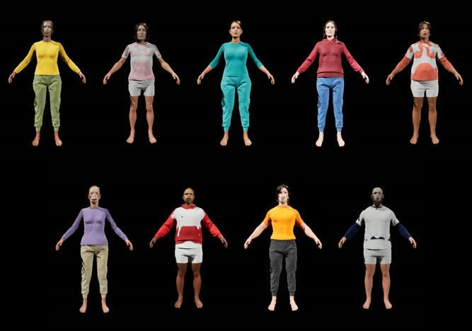</p>

**How it goes:** *"Nine different townspeople for the street."* The AI blends faces and bodies, chooses
hair and clothes, assembles each one as a playable character and lines them up for you to look at.
Then: *"Make the third one older and heavier."*

- **MetaHumans with any face and body:** preset faces blended, 21 face regions sculpted, height and waist
  set, eyelashes and teeth chosen.
- **A likeness** from a drawing, a scan or a generated head.
- **Playable characters:** rigged and assembled, ready for a game or a cinematic.
- **Crowds** of different people that rebuild the same.
- **MetaSounds, AI environment queries and procedural trees.**

### GraphCode Play: testing the game

Your AI plays the game for you, and shows you what happened.

<p>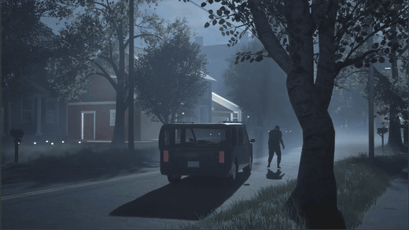</p>

**How it goes:** *"Zombie hands go through my character. Fix it and prove it."* The AI plays the scene,
measures every swipe, fixes it, plays again and gives you the before and after, with screenshots from
both runs.

- **Plays the game:** starts it, presses inputs, clicks HUD buttons, calls functions and spawns things.
- **Screenshots** of the running game, HUD included.
- **Captures** of the whole game world, compared between runs, and restarting from a captured moment.
- **Records of every run,** compared to show what changed; the game's audio recorded with its loudness.

### GraphCode Integrate: Blender

Keep modelling in Blender; your AI brings it into Unreal and keeps it in step.

**How it goes:** in Blender, open the **GraphCode** tab in the sidebar (N) and press **Export selected
meshes**, or **Export material bundle** in the shader editor. Then ask: *"Bring the new tavern sign in
from Blender."* The AI imports the meshes and rebuilds the materials as editable Unreal materials.
**Open conversion report** shows what was translated and what was baked. When you change the model in
Blender, export again and the Unreal asset updates in place.

- **Blender models into Unreal** with their materials, translated into editable Unreal materials.
- **Baking** the shader branches Unreal can't translate, with a report of what was converted.
- **Updating in place** when the Blender model changes, from the Blender add-on or by asking your AI.

### GraphCode Market (free)

Ready-made packs your AI can install and build on, in a tab inside your editor.

<p>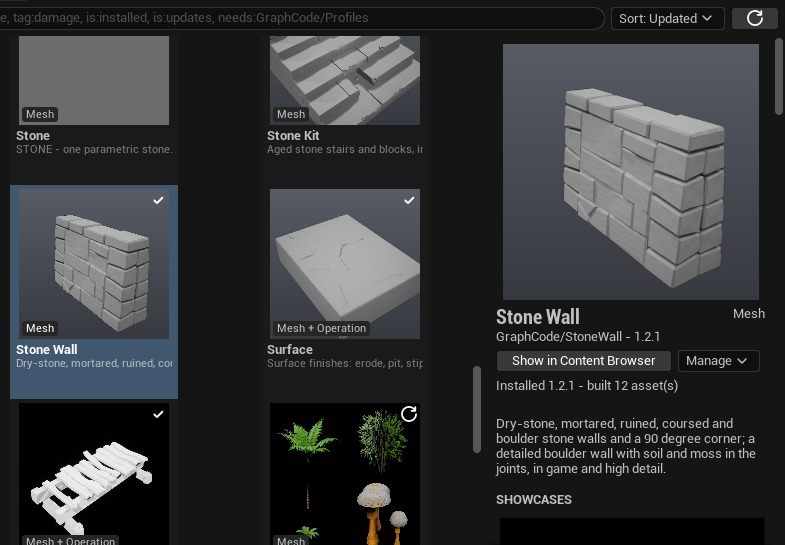</p>

**How it goes:** **Tools > GraphCode Market**. Search or filter by category, pick a pack to see what you
get, what it needs and what uses it, and press **Install** (tick *with its textures* for photo
materials; an installed pack shows **Manage** instead). Then ask your AI: *"Build the ruined stone wall from the Stone Wall pack, three metres
long."* Or skip the tab: *"Find a pack for broken concrete and use it."*

- **39 ready-made packs** of walls, roofs, timber, rocks, cliffs, plants, materials, mechanical parts,
  damage and human and animal poses, plus guides and AI skills. All of them: [docs/MARKET.md](docs/MARKET.md).
- **Checked and signed:** every install verifies the catalogue's signature and every file, and installs
  what a pack needs first.
- **Yours to change:** updates keep the files you edited; removing a pack is refused while another needs it.

The full technical reference, for your AI and your team: [docs/REFERENCE.md](docs/REFERENCE.md) ·
[docs/TOOLS.md](docs/TOOLS.md) · [docs/KINDS.md](docs/KINDS.md).

## Trial and licence

| | |
|---|---|
| **Trial** | 14 days of all ten products from the first sign-in on your PC. One trial per email and one per PC. No card. |
| **After the trial** | Everything you made stays. The AI can still read and look; building and changing things needs a licence. |
| **Licence** | One-time purchase with no time limit, per product or all products, for individuals or per studio seat: [pricing](https://graphcode.dev/pricing). |
| **Computers** | A licence works on one PC at a time; move it by signing the old PC out. |
| **What you make** | Yours to ship in any game, commercial or not. |
| **Updates** | Offered inside the editor; nothing installs until you click, and you can go back to the previous version. |

## Trust and privacy

| When | To | Sent | Never sent |
|---|---|---|---|
| Before the AI changes something, if no recent pass covers it | GraphCode licence service | Your email, licence id and this PC's key, signed | Project content, asset text, file names |
| Editor start, then daily (can be switched off) | GraphCode update service | A signed proof of this PC | Version, project, usage |
| When you search or install Market packs | graphcode.dev | Your search, the pack you chose | Project content |
| When you make a MetaHuman | Epic's MetaHuman services | What Epic's service needs | — |

- **GraphCode never calls an AI provider** and sends no usage data. Your AI client sends what it sees to
  the provider *you* chose.
- **Only programs on your PC can reach the editor,** and web pages are refused.
- **Releases are signed,** every file has a published checksum, and a [script](tools/Verify-GraphCodeRelease.ps1)
  checks a download for you.
- **Closed source,** with every public header, guide and example published in this repository.
- [Privacy policy](PRIVACY.md) · [Security](SECURITY.md) · [For studios](docs/STUDIOS.md) · [Third-party notices](Plugins/GraphCode/THIRD-PARTY-NOTICES.md)

## Questions

<details><summary><b>Do I need to know how to code, or learn GraphCode's format?</b></summary>

No. You describe what you want and your AI does the work. GraphCode gives the AI the tools and the
96 guides it reads as it goes. Blueprint-only projects work.
</details>

<details><summary><b>Does GraphCode include an AI?</b></summary>

No. You bring the AI you already use (Claude Code, Codex, Cursor or any MCP client) with your own
subscription. GraphCode is what lets that AI build inside Unreal Engine.
</details>

<details><summary><b>Does my project leave my computer?</b></summary>

Not through GraphCode. It only contacts our servers to check your licence, offer updates and download
Market packs, with no project content. Your AI client sends what it reads to the AI provider you chose.
</details>

<details><summary><b>What if the AI gets something wrong?</b></summary>

Undo it. Every change is saved as a version you can compare and restore, deleted assets go to a trash
folder, and a change that would break a working Blueprint is never saved.
</details>

<details><summary><b>Can I use what it makes in a commercial game?</b></summary>

Yes. Everything you make is yours, and it is ordinary Unreal content that needs nothing from GraphCode
to open, build or ship.
</details>

<details><summary><b>Does it work offline?</b></summary>

Reading, looking and searching work offline. Building and changing things checks your licence with our
server, so it needs a connection.
</details>

<details><summary><b>Which Unreal versions and platforms?</b></summary>

Unreal Engine 5.7.4 on Windows 64-bit. Each new engine version comes with a matching GraphCode release.
</details>

<details><summary><b>Does it work for a team?</b></summary>

Yes. Studio licences are per seat, changes show up as readable diffs in Git (and work alongside
Perforce), and a check runs in CI without a licence. See [For studios](docs/STUDIOS.md).
</details>

<details><summary><b>How do I uninstall it?</b></summary>

Close Unreal and delete the `Plugins/GraphCode*` folders, then the `%USERPROFILE%\.graphcode` folder.
Everything the AI made stays in your project.
</details>

## More

[Setup guide](docs/SETUP.md) · [Market packs and presets](docs/MARKET.md) · [Case studies and samples](docs/EXAMPLES.md) ·
[For studios](docs/STUDIOS.md) · [Changelog](CHANGELOG.md) · [Licence agreement](LICENSE.md) ·
[Issues](https://github.com/xiangjie9999/GraphCode/issues) · support@graphcode.dev

<sub>Unreal Engine is a trademark of Epic Games, Inc. GraphCode is independent and not affiliated with or endorsed by Epic Games.</sub>
