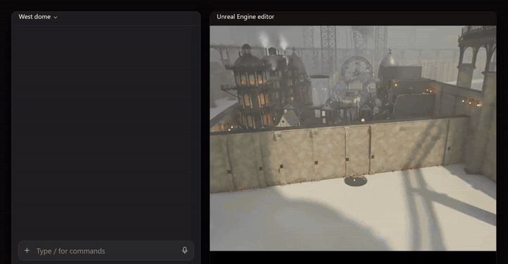
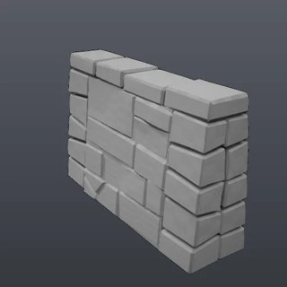
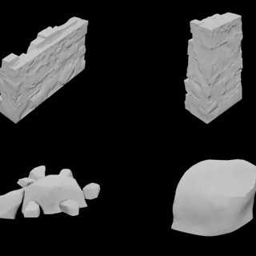
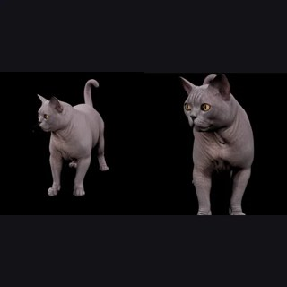
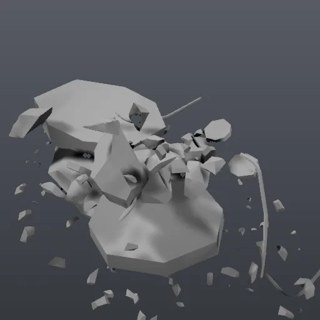

<h1 align="center">GraphCode</h1>

<p align="center"><b>Tell your AI what to build in Unreal Engine. It builds it, in your editor.</b></p>

<p align="center">
<a href="https://github.com/xiangjie9999/GraphCode/releases/latest"><b>Download 0.1.13</b></a> ·
<a href="https://graphcode.dev/start"><b>Start the 14-day trial</b></a> ·
<a href="https://graphcode.dev/pricing">Pricing</a> ·
<a href="https://graphcode.dev/marketplace">Market</a> ·
<a href="https://graphcode.dev">graphcode.dev</a>
</p>

<p align="center"></p>
<p align="center"><sub>Asked in plain words on the left; built in Unreal on the right (7× speed).</sub></p>

GraphCode lets your AI build in Unreal Engine: gameplay, levels, terrain, props, characters, animation,
hair, clothing, effects. You say what you want; the AI makes it as real assets in your project, checks
it, and every change can be undone.

| | |
|---|---|
| **Runs on** | Unreal Engine 5.7.4, Windows 64-bit |
| **Works with** | The AI you already use: Claude Code, Codex, Cursor or any MCP client |
| **Try it** | 14 days, everything included, just an email |
| **Then** | A [one-time licence](https://graphcode.dev/pricing) |

## Made with GraphCode

A few of the 39 free packs in the [GraphCode Market](https://graphcode.dev/marketplace), each built by the AI in Unreal:

<table>
<tr>
<td align="center"><a href="https://graphcode.dev/marketplace/GraphCode/StoneWall/"><br><sub>Stone walls</sub></a></td>
<td align="center"><a href="https://graphcode.dev/marketplace/GraphCode/RoofKit/"><br><sub>Roofs</sub></a></td>
<td align="center"><a href="https://graphcode.dev/marketplace/GraphCode/WoodRuin/"><br><sub>Wood ruins</sub></a></td>
<td align="center"><a href="https://graphcode.dev/marketplace/GraphCode/TimberKit/"><br><sub>Timber</sub></a></td>
</tr>
<tr>
<td align="center"><a href="https://graphcode.dev/marketplace/GraphCode/RocksCliffsKit/"><br><sub>Rocks and cliffs</sub></a></td>
<td align="center"><a href="https://graphcode.dev/marketplace/GraphCode/UnderstoryKit/"><br><sub>Understory plants</sub></a></td>
<td align="center"><a href="https://graphcode.dev/marketplace/GraphCode/StoneKit/"><br><sub>Stone stairs</sub></a></td>
<td align="center"><a href="https://graphcode.dev/marketplace/GraphCode/BrokenConcrete/"><br><sub>Broken concrete</sub></a></td>
</tr>
<tr>
<td align="center"><a href="https://graphcode.dev/marketplace/GraphCode/BarkMaterials/"><br><sub>Bark materials</sub></a></td>
<td align="center"><a href="https://graphcode.dev/marketplace/GraphCode/CleanGeneratedMesh/"><br><sub>Cleaned AI models</sub></a></td>
<td align="center"><a href="https://graphcode.dev/marketplace/GraphCode/Gears/"><br><sub>Gears</sub></a></td>
<td align="center"><a href="https://graphcode.dev/marketplace/GraphCode/Rubble/"><br><sub>Rubble</sub></a></td>
</tr>
</table>

Every pack: [docs/MARKET.md](docs/MARKET.md). More of what it has made: [graphcode.dev](https://graphcode.dev).

## How it works

1. **Ask** in plain words: *"Put an oval glass dome on the hall."* *"Add a reload key to the gun."*
2. **The AI builds it** in your Unreal editor as real assets, then renders and plays it to check.
3. **Keep it or undo it.** Every change is saved as a version you can restore, and shows in Git as a diff.

The AI can't overwrite newer work, won't save a change that breaks a working Blueprint, and anything it
deletes goes to a trash folder you can restore from.

## What it can build

| | |
|---|---|
| **Core** | Gameplay, menus and HUDs, materials, game data, controls, levels |
| **World** | Terrain, water, forests, roads, navigation |
| **Shape** | Props, buildings, machines, vehicles, creatures, plants |
| **Move** | Animation, effects, cutscenes, AI behaviour |
| **Rig** | Skeletons and skinning for any model |
| **Groom** | Hair, fur, feathers |
| **Garment** | Clothing and armour |
| **Core Extension** | MetaHumans, crowds, sound, trees |
| **Play** | Playing the game to test it |
| **Integrate** | Blender models into Unreal |

All ten in one package and one trial. More: [docs/PRODUCTS.md](docs/PRODUCTS.md).

## Get started

1. Download `graphcode-0.1.13-win64.tar.xz` from the [latest release](https://github.com/xiangjie9999/GraphCode/releases/latest).
2. Close Unreal, unpack it, and copy its `Plugins` folders into your project's `Plugins` folder:
   ```powershell
   mkdir GraphCode; tar -xf graphcode-0.1.13-win64.tar.xz -C GraphCode
   Copy-Item GraphCode\Plugins\* "C:\Path\To\YourProject\Plugins\" -Recurse
   ```
3. Get your trial file at [graphcode.dev/start](https://graphcode.dev/start) and save it as `%USERPROFILE%\.graphcode\activation.txt`.
4. Open the project, enable the GraphCode plugins, and add `Saved/UnrealAIBridge/mcp-config.json` to your AI
   client ([how, per client](https://graphcode.dev/start#connect)).
5. Ask your AI: *"Read Plugins/GraphCode/SETUP.md and set up this project for GraphCode."*

## Trust

GraphCode never sends your project anywhere and never calls an AI provider; your AI client talks to the
provider you chose. It only contacts our servers to check your licence, offer updates and download Market
packs. Releases are signed and every file is checksummed. Everything the AI makes is ordinary Unreal content
that is yours to ship. Details: [privacy](PRIVACY.md) · [security](SECURITY.md) · [for studios](docs/STUDIOS.md).

## More

[Products](docs/PRODUCTS.md) · [Market packs](docs/MARKET.md) · [Examples](docs/EXAMPLES.md) ·
[Changelog](CHANGELOG.md) · [Licence](LICENSE.md) · [Issues](https://github.com/xiangjie9999/GraphCode/issues) ·
support@graphcode.dev

For your AI and technical team: [tools](docs/TOOLS.md) · [asset kinds](docs/KINDS.md) ·
[technical reference](docs/REFERENCE.md) · [shipped guides](Plugins/GraphCode/Docs/Guides/README.md)

<sub>Unreal Engine is a trademark of Epic Games, Inc. GraphCode is independent and not affiliated with or endorsed by Epic Games.</sub>
