<h1 align="center">GraphCode</h1>

<p align="center"><b>Tell your AI what to build in Unreal Engine. It builds it, in your editor.</b></p>

<p align="center">
<a href="https://github.com/xiangjie9999/GraphCode/releases/download/v0.1.14/graphcode-0.1.14-win64.tar.xz"><b>Download 0.1.14</b></a> ·
<a href="docs/SETUP.md#4-start-the-trial"><b>Start the 14-day trial</b></a> ·
<a href="#what-your-ai-can-build">Capabilities</a> ·
<a href="docs/SETUP.md"><b>Setup guide</b></a> ·
<a href="#questions">FAQ</a> ·
<a href="https://graphcode.dev/pricing">Pricing</a> ·
<a href="https://graphcode.dev/marketplace">Market</a>
</p>

<p align="center"></p>
<p align="center"><sub>Asked in plain words on the left; built in Unreal on the right (7× speed).</sub></p>

GraphCode is a set of Unreal Engine plugins that let the AI you already use build your game: gameplay,
menus, levels, terrain, props, characters, animation, hair, clothing and effects. You describe what you
want; the AI makes it as ordinary Unreal assets in your project, renders and plays it to check its work,
and every change it makes is saved so you can compare it or take it back.

| | |
|---|---|
| **Runs on** | Unreal Engine 5.7.4, Windows 64-bit. Blueprint-only projects work; no compiler needed. |
| **Works with** | The AI you already use, through MCP: Claude Code, Codex, Cursor, Claude Desktop or any MCP client. |
| **Includes** | Ten products in one package, a free Market of ready-made packs, and about 100 guides the AI reads as it works. |
| **Try it** | 14 days of everything with just an email. No card. |
| **Then** | Core, Shape and Integrate stay free for personal use, for ever. The rest: a [one-time licence](https://graphcode.dev/pricing) per product or for all of them. |

## Start here

**What you download:** ten Unreal Engine plugins in one package (about 132 MB). You copy them into your
project, turn them on, start the free trial with your email, and connect the AI you already use.
Setup takes about 15 minutes: **[the setup guide](docs/SETUP.md)**.

**What you get:** your AI building inside your open Unreal editor, on your project: you ask in its chat,
it makes real Unreal assets, shows you renders and test runs, and every change can be undone.

**How to read this page:**

| Section | What it tells you |
|---|---|
| [Made with GraphCode](#made-with-graphcode) | Things it has built. |
| [How it works](#how-it-works) | What a session with your AI looks like. |
| [Why GraphCode](#why-graphcode-what-goes-wrong-when-an-ai-drives-unreal-and-how-graphcode-fixes-it) | The seven problems with an AI driving Unreal through a free MCP server or Blender MCP, and how GraphCode fixes each. |
| [Get started](#get-started) | The setup in five steps, and the full guide. |
| [What your AI can build](#what-your-ai-can-build) | Each of the ten products: a picture, an example, why it beats the alternative, and everything it can do. |
| [Trial and licence](#trial-and-licence) · [Trust and privacy](#trust-and-privacy) · [Questions](#questions) | Before you buy. |

## Made with GraphCode

Machines and buildings from the [GraphCode showcase](https://graphcode.dev/showcase), and pieces from the free [GraphCode Market](https://graphcode.dev/marketplace) packs, every one built by the AI inside Unreal. Your AI can install any Market pack and build it in your project, or make its own.

<table>
<tr>
<td align="center" width="25%"><a href="https://graphcode.dev/showcase/airship/"><br><sub>Airship</sub></a></td>
<td align="center" width="25%"><a href="https://graphcode.dev/showcase/steam-house/">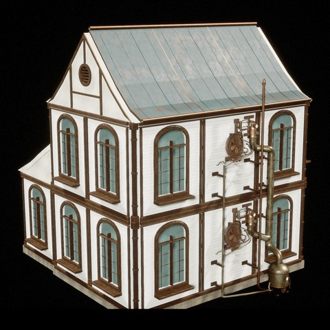<br><sub>Steam house</sub></a></td>
<td align="center" width="25%"><a href="https://graphcode.dev/showcase/milliner/">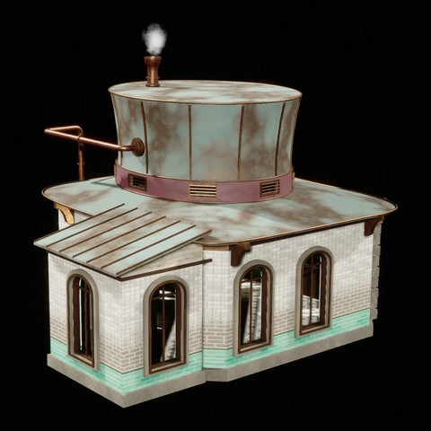<br><sub>Milliner's shop</sub></a></td>
<td align="center" width="25%"><a href="https://graphcode.dev/showcase/compressor/">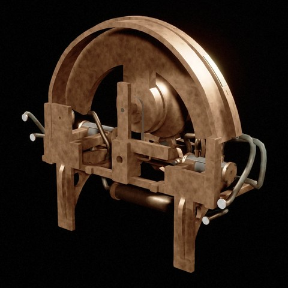<br><sub>Compressor</sub></a></td>
</tr>
<tr>
<td align="center" width="25%"><a href="https://graphcode.dev/showcase/street-carrier/">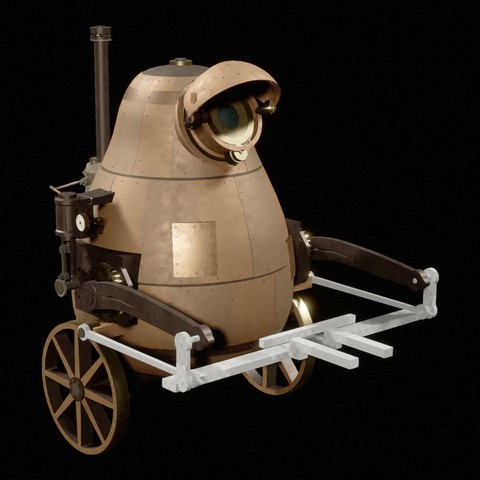<br><sub>Street carrier</sub></a></td>
<td align="center" width="25%"><a href="https://graphcode.dev/showcase/auto-duster/">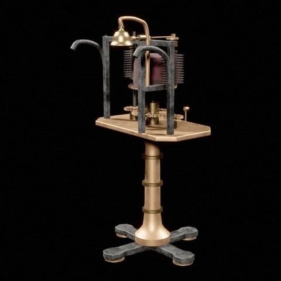<br><sub>Auto-duster</sub></a></td>
<td align="center" width="25%"><a href="https://graphcode.dev/showcase/watchman-lamp/"><br><sub>Watchman lamp</sub></a></td>
<td align="center" width="25%"><a href="https://graphcode.dev/showcase/street/">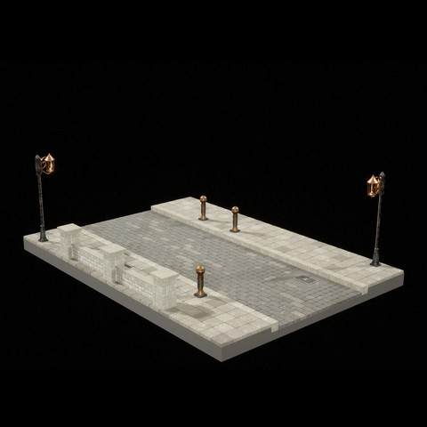<br><sub>Street</sub></a></td>
</tr>
<tr>
<td align="center" width="25%"><a href="https://graphcode.dev/marketplace/GraphCode/RocksCliffsKit/">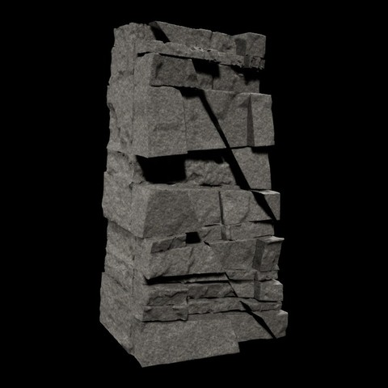<br><sub>Cliffs</sub></a></td>
<td align="center" width="25%"><a href="https://graphcode.dev/marketplace/GraphCode/RocksCliffsKit/">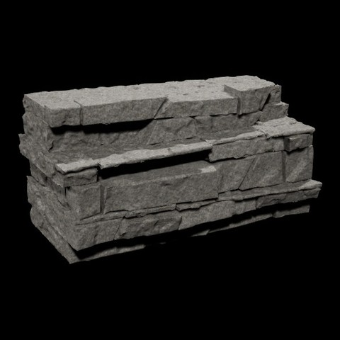<br><sub>Rock ledges</sub></a></td>
<td align="center" width="25%"><a href="https://graphcode.dev/marketplace/GraphCode/BarkMaterials/">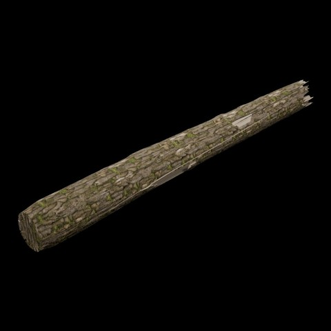<br><sub>Mossy oak bark</sub></a></td>
<td align="center" width="25%"><a href="https://graphcode.dev/marketplace/GraphCode/UnderstoryKit/"><br><sub>Hazel</sub></a></td>
</tr>
<tr>
<td align="center" width="25%"><a href="https://graphcode.dev/marketplace/GraphCode/UnderstoryKit/"><br><sub>Male fern</sub></a></td>
<td align="center" width="25%"><a href="https://graphcode.dev/marketplace/GraphCode/UnderstoryKit/"><br><sub>Moss</sub></a></td>
<td align="center" width="25%"><a href="https://graphcode.dev/marketplace/GraphCode/VegetationKit/"><br><sub>Oak leaf</sub></a></td>
<td align="center" width="25%"><a href="https://graphcode.dev/marketplace/GraphCode/VegetationKit/"><br><sub>Leaf litter</sub></a></td>
</tr>
</table>

All packs: [docs/MARKET.md](docs/MARKET.md). Case studies with films and samples: [docs/EXAMPLES.md](docs/EXAMPLES.md).

## How it works

1. **You ask** in plain words: *"Put an oval glass dome on the hall."* *"Give the cat a thick grey coat."* The first time, your AI reads your project, asks how hands-on you want to be, and writes your answers down so you never repeat them.
2. **The AI builds it** inside your Unreal editor, as real assets: Blueprints, levels, meshes,
   materials, animations, effects. It reads the relevant guide first, tries the change before making it,
   then renders it and plays it to check, and fixes what it sees.
3. **You look, and fine-tune where you want to.** Ask for changes in words, or take over by hand where
   GraphCode gives you a panel: the **Pose** panel for motion, the **Market** tab for ready-made packs,
   and **Version Control** to compare and undo.
4. **You keep it or take it back.** Every change is saved as a version you can compare and restore, one
   asset or the whole project, and shows up in Git as a readable diff.

While the AI works, your project is protected: it can't overwrite newer work, a change that would break
a working Blueprint is not saved, and anything it deletes goes to a trash folder it never empties.

## Why GraphCode: what goes wrong when an AI drives Unreal, and how GraphCode fixes it

You can already connect an AI to Unreal for free: community MCP servers, Epic's own experimental Unreal
MCP, or Blender MCP with an export to Unreal. They give your AI **verbs**: spawn an
actor, set a property, add a node, run some Python, take a screenshot. That is enough to block out a
room. Making a game takes more, and the same seven problems come up again and again. Here is each one,
why it happens, and what GraphCode does about it.

### 1. The AI can't see your scene, so every number it types is a guess

**What goes wrong.** Ask for *"a crate fifty centimetres behind the boss, on the floor, facing the
door"*. With spawn-and-set-transform, the AI has to produce `X=1234.5, Y=-882.1, Z=37.0, Yaw=143.2`.
It doesn't know how high the floor is under that spot, where the crate's pivot sits, or which way the
door faces. The crate floats, sinks or faces the wall, and the tool still says it worked.

**Why.** A language model has no ground truth about your level. It can query objects one at a time, but
nothing turns *"on the floor, facing the door"* into a transform for it, so every absolute coordinate is a
guess about a scene it cannot see, and the more things it places, the more guesses there are to get wrong.

**How GraphCode fixes it.** The AI says what it means, and GraphCode measures the real scene to work out
the numbers:

```
Crate_01 = /Game/Props/BP_Crate.BP_Crate_C()
  @anchor[target=BP_Boss_01, forward=-50, right=-30]
  @surface[target=Floor_01, distance=0]
  @facing[target=FixtureDoor]
```

Distances are measured from the middle of each object's real bounds, so a pivot in a strange place
never matters; the crate rests on its own footprint; the reply says exactly where it landed; and if
there is no floor within reach, the write is refused with that reason instead of leaving the crate in the
air.

The same idea runs through every product, and it is why your AI can build a whole place instead of a
pile of objects:

| Instead of… | the AI says… |
|---|---|
| a heightmap of numbers | carve a stream **along this course**, 65 m wide, deepest at its head |
| hundreds of tree coordinates | plant oaks **in the grove, off the trail, below 18 m, on slopes under 28°** |
| bone rotations at each frame | **plant** both feet on the floor, **reach** the shelf edge, keep the weight **over** the standing foot |
| where each gear goes | two gears of 32 and 16 teeth, **spaced by their teeth** so they always mesh |
| a joint's axis in degrees | the hip **turns in** this region and **closes forward**, with the range from anatomy |
| strand points | hair on **this region of the scalp**, flowing **this way**, combed **toward the ear** |

### 2. It edits blind, one call at a time

**What goes wrong.** To add a Reload function to a rifle, the AI adds nodes and wires pins one call
at a time. A mis-wired pin still comes back "success", Unreal quietly drops the call when it compiles,
and when the AI retries, duplicate nodes pile up. Node wiring is a known weak spot of the free servers
([example](https://github.com/prajwalshettydev/UnrealGenAISupport)).

**Why.** Unreal assets are binary files. The engine's API shows them to a script piece by piece, so the
AI never sees the whole Blueprint at once and can't check what it built.

**How GraphCode fixes it.** Every Blueprint, widget, material, data table and level has a **readable text
twin**. The AI reads the whole asset in one call, writes the whole change in one step, and sees the change
as a readable difference before it lands. Nodes it didn't touch keep their place and identity. If a call
has nothing wired into it, the reply says so. A change that would break a working Blueprint is **not
saved**, and a change made over newer work is **refused**.

### 3. It says "done" when it isn't

**What goes wrong.** One user's analysis of 1,477 calls through an Unreal MCP found a single formal error:
the other failures came back as "OK" with the error buried in the text
([report](https://forums.unrealengine.com/t/unreal-mcp-codex-issue-analysis-report/2730883)). In Puget
Systems' hands-on with Epic's experimental MCP, the AI was asked for a procedural city, couldn't build the
PCG graph, placed meshes instead, and said so only when asked
([article](https://www.pugetsystems.com/blog/2026/07/09/unreal-engine-mcp-hands-on-testing-ai-inside-the-editor/)).

**Why.** A generic tool returns a string. Nothing measures what was actually built, so the AI can't tell
success from failure, and neither can you.

**How GraphCode fixes it.** Everything is measured and every refusal is named. Your AI **sees** its work:
renders from any angle, turntables and video, contact sheets, menus painted at 8 screen sizes with a report
of overlaps and low contrast, "what is at this pixel", sounds with their loudness, and the game actually
played. And every build **reports in numbers**: how far a planted foot slid, how many centimetres short a
hand stopped, how much scalp shows through the hair, where a garment folds through itself, which joint hit
its limit. A refused or interrupted test is never reported as a pass.

### 4. It forgets what it changed

**What goes wrong.** An hour in, you say *"put the HUD back the way it was before lunch, but keep the new
ammo counter"*. The AI has nothing to go on: Unreal's undo is one linear stack, and binary assets don't
diff in Git.

**Why.** Nothing records the project's history in a form the AI can read.

**How GraphCode fixes it.** Every saved change is kept as readable text, so your AI can look back through
the project's history the way a developer reads Git, and so can you:

- *"What did you change in the HUD since yesterday?"* It shows the difference as readable lines: which
  widget moved, which binding changed.
- *"Compare my unsaved level with the last commit."* It compares what is open in your editor, before you
  save, with any branch or commit.
- *"Put the HUD back the way it was at noon, but keep everything I did after lunch."* It restores just that
  window of time and keeps later work.
- *"Undo everything since this morning."* It restores the whole project to a moment, **showing you the plan
  first**: every asset it will restore, recreate or remove. Nothing changes until it's confirmed, and the
  state it replaces is kept, so you can go back again.

You do not need Git for any of this. Local history is on by default, with a size budget for the whole project, so a project that has never had a commit still keeps your recent saves. Versions are named the way you would say them: *"compare the HUD with yesterday 3pm"*, *"what did the level look like at 1am"*, or `HEAD`, a branch or a commit if you do use Git. A restore is planned first: your AI shows every asset it would change, recreate or remove, and nothing happens until you confirm the plan. Local history covers your recent saves and Git covers what you committed, so the two together cover everything.

For a team, the same text makes Git useful for Unreal: pull requests show readable diffs instead of
"binary file changed", two people's edits to one asset can be merged, and a CI check flags any asset whose
text is out of date, with no licence needed. You get the same history in the editor: click **GraphCode** in
the status bar.

### 5. It guesses the API

**What goes wrong.** Scripting Unreal through Python, the AI invents functions that don't exist and
arguments in the wrong order ([kvick-games/UnrealMCP](https://github.com/kvick-games/UnrealMCP) notes how often
it errs with Unreal's Python).

**Why.** It is working from memory of an enormous API that changes between engine versions.

**How GraphCode fixes it.** Every GraphCode tool answers questions about itself: each parameter, each
value, and what each one does, from the installed version, without the editor even open. About 100 guides
tell the AI how each kind of work is done, from a door Blueprint to a dry-stone wall, and it reads the
right one before it starts.

### 6. Verbs can't make real content

**What goes wrong.** Ask an AI in Blender for *"a ruined dry-stone wall that climbs the slope"*. It can
script one: jittered stones, exported as an FBX and imported. Then the work starts. The stones don't vary
like real ones, the wall floats where the ground dips, and UVs, collision and levels of detail are still to
do. A second wall, or a more ruined one, means a new script. And there is no verb at all for eroding a
valley, growing hair, sewing a pocket or balancing a body.

**Why.** Generic tools stop at the engine's API. Real content needs knowledge of how the thing is made:
masonry, cloth, anatomy, terrain.

**How GraphCode fixes it.** Each product carries that knowledge as recipes your AI can change. For the wall,
your AI installs the free Stone Wall pack and writes one line:

```
SW = shape('/GraphCodeShape/Presets/StoneWall', Face = $Stone, Joint = $Core, Soil = $Dirt)
Wall = mesh() { add($SW.Wall, len=300, height=130, damage=0.3, noise=7) }
```

That builds a dry-stone wall in a game version and a high-detail one, with baked maps, sunk into the
ground so it never floats. `damage` makes it more ruined, `noise` gives a different wall from the same
stones, and the same line always builds the same wall. Kits share parts: the wooden ruins are built from
the timber kit, the rubble from the concrete and rebar parts. Damage, wear and weathering apply to **your
own** shapes too, and rocks, cliffs and plants come with PCG graphs that spread them across your level.

**Built inside Unreal, not imported from Blender.** An export carries Blender's metres, its axes and its naming conventions into Unreal, and each mismatch (scale, rotation, mirrored sides, a pivot in the wrong place, `SOCKET_` and `UCX_` dummy objects) is a chance for the mesh to arrive wrong. GraphCode builds the mesh in Unreal, in centimetres and Unreal's own rotations, with sockets, collision and materials declared in the recipe. Nothing is converted on the way in, and a change is a rebuild of the same asset, not a second import.

### 7. It forgets your project between sessions

**What goes wrong.** Monday you tell your AI the game is a moody third-person survival game, that the UI is cold blue, and that nothing is deleted without asking. Tuesday is a new chat. It suggests a cheerful orange HUD, asks again what genre this is, and renames a folder you told it to leave alone. Every session starts from nothing, so the first ten minutes go on re-explaining a game you already explained.

**Why.** An AI has no memory of its own between chats, and Unreal has nowhere to keep the decisions you have made. A free server hands the AI tools but no knowledge of your project.

**How GraphCode fixes it.** Setup is something your AI does with you once. What it learns is written into your project, where every later session reads it first.

- **It looks before it asks.** It reads your `Content/` folder, your enabled plugins, any `CLAUDE.md` or `AGENTS.md`, your Git history and your default map. A project with a half-built shooter is never asked what genre it is: the AI says what it found and you correct it.
- **It works on the game you already have.** Nothing is rebuilt or moved. Packs you bought or vendored can be left out of GraphCode's readable-text copies by folder, and an excluded folder can still be read, searched and changed.
- **You choose how hands-on you are, and not as one answer for the whole game.** Approve everything, approve each draft, review at milestones, or let it just do it. Then say what you drive and what the AI drives, separately for **game direction, art direction, mechanics and sound**. *"You do the art, I decide how it plays"* is a normal answer. Where you drive, the AI shows you a render before it places the second wall. Where you handed over, it decides, tells you once and stops asking.
- **It writes down what you decided.** A small routing file read at the start of every session, one short document each for game, art, mechanics and sound, a board of open work, and a folder for mood-board images. A decision goes in the moment it is made, so a settled question stays settled.
- **Your rules are enforced, not just written.** Where your AI client has a real settings layer (Claude Code's permission rules and hooks, for example), setup writes your rules there too, so "never delete without asking" is applied by the client.

The next session, and the one after, opens with your AI already knowing the game.

**At a glance:**

| Your AI needs to… | With a free MCP server | With GraphCode |
|---|---|---|
| **Put things in the world** | Compute coordinates for a scene it can't see. | Say where things go relative to what's there; GraphCode measures the rest. |
| **Understand what's there** | Query objects and properties one by one. | Read a whole Blueprint, widget, material or level as one readable text. |
| **Change it safely** | One call per node or property. | The whole change in one step; a break is not saved; stale writes are refused. |
| **Know it worked** | A screenshot, usually. | Renders, video, layout reports, loudness, play-tests and numbers from every build. |
| **Go back** | Unreal's undo, and Git, where binary assets don't diff. | Every version compared and restored, one asset or the whole project, to any moment. |
| **Make real content** | Script it from scratch, one asset at a time. | Recipes for terrain, meshes, motion, rigs, hair and clothing, and ready-made kits. |
| **Bring a model in** | Export an FBX from Blender, then fix scale, axes, pivot, sockets and collision by naming convention. | Built in Unreal in centimetres and Unreal's own rotations; sockets, collision and materials declared in the recipe; change it and rebuild in place. |
| **Remember your project** | Nothing. Each new chat starts from zero. | Your choices, art direction and rules are written into your project, and every session reads them first. |

### Why more tools don't close the gap

A server can advertise 200 tools, or 1,000. Every one of them is still a verb over the same binary assets:
the AI still types coordinates into a scene it can't see, still changes things one call at a time, and
still has no history to go back to. GraphCode is different **underneath**, and everything else is built
on that foundation:

- **Every asset is readable text.** Blueprints, widgets, materials, levels, meshes, motions, rigs, hair and
  clothing each have a text twin. Your AI understands the whole asset before it touches it, and you can read
  exactly what it changed.
- **Relationships, not coordinates.** On the floor, facing the door, along the river, the foot planted, cut
  to this body, sized from that measurement. GraphCode works out the numbers from the real scene.
- **Every version, for the AI and for you.** Compare any asset or the whole project with any commit or any
  moment, and restore just what you want, with the plan shown first.
- **You fine-tune by hand, on the very thing the AI made.** No export, no second app, no round trip:
  - the **Pose panel**: your AI writes the motion, you drag sliders for each body part, effort and timing,
    press Apply to watch it and Save to keep it, and your AI carries on from your values;
  - the **Version Control panel**: see what changed, compare with a commit or a moment, restore one file or
    the project, and settle merge conflicts;
  - the **Market tab**: browse, install and update packs inside the editor;
  - the **Blender add-on**: send meshes and materials across with one button.
- **Built for teams.** Pull requests show what changed in a Blueprint or a level as readable lines instead
  of "binary file changed". Two people's edits to one asset merge, and a real clash becomes a conflict you
  settle in the editor. A write made over a teammate's newer work is refused, whether the writer is a person
  or another AI session. A CI check flags any asset whose text is out of date, with no licence needed. It
  works alongside Git and Perforce, with studio seats.
- **Knowledge, not just access.** Solvers for balance, cloth, strands, terrain and settling piles; recipes
  and kits for walls, roofs, rocks, plants and machines; about 100 guides your AI reads as it works.
- **It checks itself.** Renders, video, layout reports, loudness, play-tests, and numbers from every build.
- **Safe by design.** Dry runs before writes, refusals that name the reason, restores planned first, and a
  trash folder that is never emptied.
- **Light on your AI.** 15 tools, each explaining itself on demand, so your AI's attention goes on your game,
  not on a tool list.
- **Secure.** Only programs on your PC can reach the editor, web pages are refused, releases are signed, and
  GraphCode never calls an AI provider.
- **Yours, in plain Unreal.** Everything it makes is ordinary Unreal content that opens, builds and packages like anything else in your project. Almost all of GraphCode is editor-only, and the few small runtime pieces that ship are checked in Development and Shipping packaging with every release. Blueprint-only projects work, no compiler needed, and you can switch AI clients whenever you like.

## Get started

**You need:** Windows 64-bit, Unreal Engine **exactly 5.7.4**, and an AI client that supports MCP
(Claude Code, Cursor, Claude Desktop, Codex or any other). No compiler, Visual Studio or Node.js.

1. **Download** [`graphcode-0.1.14-win64.tar.xz`](https://github.com/xiangjie9999/GraphCode/releases/download/v0.1.14/graphcode-0.1.14-win64.tar.xz) (one click; every release is on the
   [Releases](https://github.com/xiangjie9999/GraphCode/releases) page) and unpack it.
2. **Copy** the folders in its `Plugins` folder into your project's `Plugins` folder, open the project,
   tick the GraphCode plugins in **Edit > Plugins** and restart.
3. **Start the trial** with just your email: save the three-line file from the
   [setup guide](docs/SETUP.md#4-start-the-trial) as `%USERPROFILE%\.graphcode\activation.txt`. No card,
   nothing to confirm by email.
4. **Connect your AI:** give your AI client the `unreal` entry from your project's
   `Saved\UnrealAIBridge\mcp-config.json`. Ask it *"Run unreal_info"*: it should answer **CONNECTED**.
5. **Ask:** *"Read Plugins/GraphCode/SETUP.md and set up this project for GraphCode."* It reads your existing project first, asks how hands-on you want to be (for game, art, mechanics and sound separately), saves what you decide in your project, and builds a first thing so you see it working.

**[The full setup guide](docs/SETUP.md)**: what you see at each step, how to tell it worked, where the
file goes for each AI client, and what to do if something goes wrong.

## What your AI can build

All ten products ship in one package and are included in the trial. Jump to:
[Core](#graphcode-core-gameplay-ui-materials-data-and-levels) ·
[World](#graphcode-world-terrain-water-forests-and-navigation) ·
[Shape](#graphcode-shape-props-buildings-machines-creatures-and-plants) ·
[Move](#graphcode-move-animation-effects-cutscenes-and-ai-behaviour) ·
[Rig](#graphcode-rig-skeletons-and-skinning) ·
[Groom](#graphcode-groom-hair-fur-and-feathers) ·
[Garment](#graphcode-garment-clothing-and-armour) ·
[Core Extension](#graphcode-core-extension-metahumans-crowds-sound-and-trees) ·
[Play](#graphcode-play-testing-the-game) ·
[Integrate](#graphcode-integrate-blender) ·
[Market](#graphcode-market-free)

---

### GraphCode Core: gameplay, UI, materials, data and levels

The game itself: the rules, the screens, the surfaces and the levels, built as ordinary Unreal assets.

<table><tr>
<td width="50%"><br><sub>A hall's materials: wallpaper, panelled ceiling, parquet, velvet.</sub></td>
<td width="50%"><br><sub>One HUD in twenty states (reload, empty, charging, ready), each checked.</sub></td>
</tr></table>

**How it goes:** *"Add a reload key and show the ammo on the HUD."* The AI adds the input, the
Blueprint logic and the widget, plays the game, presses the key and shows you the result. Don't like
it? Click **GraphCode** in the editor's status bar to open **Version Control**: compare what changed
against the last commit, a branch or a moment in local history, and restore one file or the whole project.


**Why GraphCode Core?** Your AI places things by what they relate to, and changes whole assets it can read, instead of guessing coordinates and wiring nodes blind.

*"Add a Reload function to the rifle and call it from the R key."*
- **The problem with a free MCP server:** the AI wires the Blueprint one node at a time and can't read it
  back to check. A mis-wired pin still reports success, and a retry piles up duplicate nodes.
- **How GraphCode Core solves it:** the AI reads the rifle Blueprint as text, writes the function and its
  caller in one change, sees the difference before it lands, and is told if a call has nothing wired in. A
  break is not saved, and the earlier version is one restore away.

Only with GraphCode Core:
- Place by relationship: anchor to an actor, rest on a surface, face a target, with distances measured from
  each object's real middle, so pivots never matter.
- Scatter inside a volume or only where characters can walk, landing the same way every time.
- Whole Blueprints, widgets, materials and levels as readable text; a level of 2,648 actors is one document,
  and one World Partition actor can be edited without loading the map.
- Menus painted at up to 8 screen sizes with a report of overlaps, clipping and low contrast, then their
  buttons pressed by name.
- Before anything is renamed, moved or deleted: every asset that depends on it, soft references included.

- **Blueprints:** characters, weapons, doors, pickups, game rules: variables, components, events,
  functions, macros, interfaces, event dispatchers and timelines.
- **Animation Blueprints** with their state machines.
- **Menus, HUDs and screens:** widget layouts, bindings and animations, checked at up to eight screen
  sizes for overlap, clipping and contrast, with buttons pressed to test them.
- **Materials:** material graphs, reusable material functions and material instances.
- **Game data:** data assets, data tables, localised text tables, curves, structs, enums and data registries.
- **Controls:** Enhanced Input actions and mapping contexts for keyboard, mouse and gamepad.
- **Sound cues, fonts, physical materials, foliage types, render targets and HLOD layers.**
- **Levels:** placing, moving and arranging actors, sublevels, volumes, splines and the Level Blueprint;
  placing things by intent ("on the floor, facing the door"); editing one World Partition actor without
  loading the map.
- **Importing** meshes, textures and audio (FBX, glTF, OBJ, images, archives) with the import settings planned first.
- **Finding things:** assets, nodes, functions, widgets, and what depends on what before anything is deleted.
- **Looking and listening:** renders from any angle, short videos and contact sheets, "what is at this
  pixel", and sounds rendered with their loudness.
- **History:** every change saved, compared and restorable; a recoverable trash; readable diffs in Git; a
  merge of two people's edits to the same asset; a check for your CI that needs no licence.

### GraphCode World: terrain, water, forests and navigation

Whole places, at real scale: the land, the water, what grows on it and how characters cross it.

<p>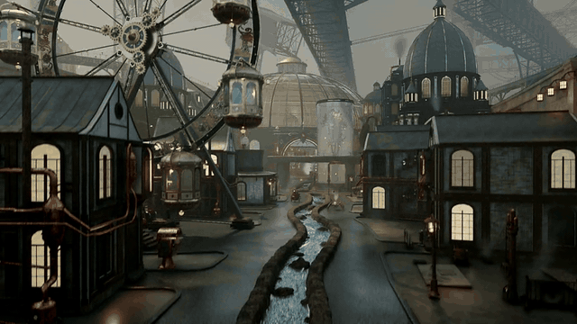</p>

**How it goes:** *"A wooded valley with a waterfall into a pool, cliffs on both sides."* The AI shapes the
terrain, carves the riverbed, adds the water and plants the slopes, then renders it from several
angles. Then: *"More erosion on the cliffs, and keep the trees out of the path."*


**Why GraphCode World?** Your AI names the places in your world once (the stream, the trail, the crypt, the street) and puts everything in relation to them. GraphCode works out the coordinates against the real terrain, every time it applies.

*"A wooded valley with a stream and a trail, a forest that keeps off both, a lantern halfway along the crypt's north wall, and a row of houses facing the street."*
- **The problem with a free MCP server:** the AI guesses a coordinate for every tree, the lantern and each
  house. Nothing tells it where the trail or the wall is, so trees land on the path, the lantern floats,
  and every house is aimed at the same point in the middle of the street. Running the script again plants
  a second forest. Terrain tools like Gaea make excellent heightmaps, but the heightmap knows nothing about
  your trail or your doors.
- **How GraphCode World solves it:** the AI names the stream, the trail and the street once. The forest is
  planted by a rule that keeps off both and off steep slopes; the lantern is *halfway along the north wall,
  resting on it*; each house is *on the street, facing the nearest part of it*. Edit a point of the trail
  and what was built from it follows on the next apply, and applying again changes only what changed: no
  second forest.

Only with GraphCode World:
- Places by relationship, with no x, y or z in the request: *halfway along the wall*, *on the street, facing it*.
- Named points and routes shared by the terrain, rivers, planting, volumes and placed actors.
- Terrain in real metres as ordered passes, each limited to the ground it should touch: *only above 14 m and
  steeper than 18°*.
- Answers about space from the world's text alone: distances, gaps in centimetres, how far a wall bows.
- *"Can a person get from the road to this door? Can a mouse?"* answered from the navigation mesh, per body size.
- Hand sculpting recorded and replayed exactly, and your own heightmaps (from Gaea or anywhere) used as brushes.

- **Terrain** shaped by instruction: mountains, ridges, valleys, carved riverbeds, erosion, noise and
  smoothing, at real scale in metres.
- **Height brushes** from your own heightmap images, and hand sculpting that is recorded and replayed exactly.
- **Open worlds:** terrain streamed in World Partition tiles.
- **Water:** lakes, rivers and ponds, with water materials tuned for depth, reflections, flow and foam.
- **Planting:** forests, grass and plants spread by region, density, height and slope, and kept out of
  rivers, paths and ponds; PCG graphs.
- **Places and routes:** named points and courses that terrain, rivers, roads and placed objects share.
- **Roads and buildings** that meet at the right heights, with a check that every door can be reached
  from the street.
- **Navigation:** "can this character walk from here to there?", and AI characters that find a way round.
- **Surfaces:** landscape paint layers and texture variation; placed meshes baked into one atlas.

### GraphCode Shape: props, buildings, machines, creatures and plants

The things in your world, modelled part by part from measurements, so they stay editable.

<p>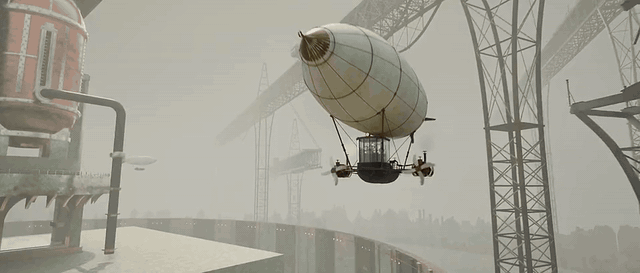</p>

**How it goes:** *"An 18 metre airship with a glazed bridge and four engines."* The AI models the hull,
gondola, engines and propellers, each with its own material, and renders it turning. Then: *"Make it
longer"*, and every part sized from the length follows. This is the text the AI keeps for it:

```
# centimetres. +X is the nose and forward thrust.
Length = 1800
Radius = 250
# the deck hangs 70 cm lower so the glazed bridge has standing headroom
DeckZ = -470
EngineRadius = 38
PropellerRadius = 90
```

**Why GraphCode Shape?** Your AI declares how the parts relate, and GraphCode rebuilds the mesh from that, so a change ripples through instead of starting over.

*"A clockwork with two gears that turn together. Now make the whole thing smaller."*
- **The problem with Blender MCP:** the AI scripts the gear outlines, works out where each gear goes, and
  exports a fixed mesh. Making it smaller means scaling the mesh, which throws the clearances off, or
  rewriting the script, and nothing checks that the teeth still mesh. UVs, collision and levels of detail
  are still to do.
- **How GraphCode Shape solves it:** the gears are spaced by their tooth counts, so any pair meshes at any
  size; *smaller* is one number at the top of the recipe, and the build reports any teeth that pass through
  each other. Each mesh comes out game-ready, and the same text always builds the same mesh.

**Built inside Unreal, not imported from it.** A model made in Blender carries Blender's habits with it: metres, a different up axis, its own idea of which side is left, and naming tricks Unreal has to decode on import. GraphCode Shape builds the mesh in Unreal, in Unreal's own terms, so there is nothing to convert on the way in.

| Problem with the Blender-to-Unreal route | Why it happens | In GraphCode Shape |
|---|---|---|
| **Wrong size.** The prop arrives 100x too small or too big. | Blender works in metres, Unreal in centimetres. | A recipe is written in centimetres. There is no export step to apply a unit scale in. |
| **Wrong way round.** Parts arrive turned 90 degrees or facing backwards. | The two programs disagree about which axis is up and which way is forward. | Turns are Unreal's own roll, pitch and yaw (`rotate=(roll, pitch, yaw)`), and a socket is declared with the direction it faces and which way is up, in Unreal's frame. |
| **Left and right swap.** The mirrored half is not the half you meant. | A mirror is applied in whatever frame the exporter chose. | `add($Half, mirror=Y)` reflects the part in its own frame, and the build's left/right note says where the two sides differ. |
| **Wrong pivot.** The sword spins about its middle, not its grip. | The origin is wherever the modeller left it. | The pivot is stated in the recipe (`[pivot=(0, 0, 0)]`), and a held prop's origin sits at its grip. |
| **Attachment points by name.** Dummy objects called `SOCKET_Hand`, with parts hand-placed on them. | Epic's FBX pipeline reads sockets from objects with a `SOCKET_` prefix ([Epic's FBX static mesh pipeline](https://dev.epicgames.com/documentation/en-us/unreal-engine/fbx-static-mesh-pipeline-in-unreal-engine)). | Declare a `socket(...)` and join a part with `into=$body.Socket`; the build reports the joint as touching, gapped or overlapping. |
| **Collision by naming.** Extra meshes called `UCX_` or `UBX_` that must match the visible one. | The same pipeline reads collision from objects with those prefixes. | One line on the build: `[collision=$Solid]`. A build without it says so. |
| **Wrong shading.** Hard edges look soft, or the reverse. | Smoothing does not always survive the export. | The recipe states the angle above which an edge shades hard (`shade:`). |
| **A look that does not transfer.** It looked right in Eevee or Cycles, not in your game. | Those are not Unreal's renderer. | Materials are Unreal materials bound to the mesh's slots, and the AI checks them in the editor's own renderer while it builds. |
| **No light version.** Mobile, VR and distant LODs are another round of work. | Baking is a separate job in a separate app. | `SM_X5k = $X [triangles=5000, maps=(normal, ao, curvature)]` makes a light mesh with its normal and AO maps baked from the full detail. |
| **Every change is a re-import.** | The mesh is a finished file, not a recipe. | Change the recipe and rebuild: the same asset updates in place, and the same recipe always builds the same mesh. |

The AI never leaves Unreal, so there is no unit, axis or naming mistake to find afterwards.

Only with GraphCode Shape:
- Parts sized from named measurements: change one number and every part built from it follows.
- Stones and rubble that fall, tip and come to rest on each other, instead of being placed by eye.
- Kit pieces sunk into the ground by a stated depth, so they stand on any terrain without floating.
- Joints declared between parts, with the build reporting each one as touching, gapped or overlapping.
- A triangle budget per mesh, with a light version baked from the full detail; a mesh that folds through
  itself is refused.
- Damage, wear and weathering that apply to **your own** shapes; 35 preset libraries and the Market kits.

- **Props, furniture, buildings, machines, vehicles and weapons,** built part by part, each part with its
  own material.
- **Sizes that stay connected:** change one measurement and every part built from it follows.
- **Forms:** outlines (including from SVG art), extrusions, revolves, sweeps, lofts along curves, bends,
  tapers, shells, cuts, joins, and rounded, chamfered or crisp edges.
- **Creatures and soft shapes** grown from blended masses.
- **Wear and damage:** chips, cracks, gouges, split and snapped wood, erosion, fracture, and loose piles
  that settle.
- **Plants:** leaves of five species at any age, twigs and sprays for Unreal's tree tools, grasses, rushes,
  climbing ivy and leaf litter, spread by PCG.
- **Game-ready meshes:** UVs, material slots, sockets, collision, levels of detail, a triangle budget and
  Nanite; detail baked into normal maps and atlases.
- **Repeatable:** the same recipe builds the same mesh every time, and every build reports its triangle
  counts and any broken faces.
- **Assembly:** bringing in separate models (from an AI model generator, for example) and joining them
  into one clean mesh.
- **35 preset libraries** ship with it: solids, profiles, fixings, gears, masonry, timber, roofs, stone
  walls, concrete, rubble, debris, hands and more.

### GraphCode Move: animation, effects, cutscenes and AI behaviour

Motion for your characters, made from poses and physics, and a panel where you fine-tune it by hand.

<p>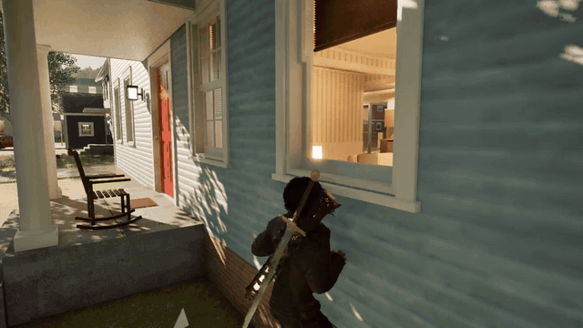</p>

**How it goes:** *"A two-handed sword slash: wind up over the right shoulder, cut down across, follow
through."* The AI builds the key poses from body-part presets (feet, hips, back, arms, hands, grip),
times them, checks the feet stay planted and the hands hold the sword, and renders the motion. Then you
open it in the **Pose** panel and adjust it yourself:

<p>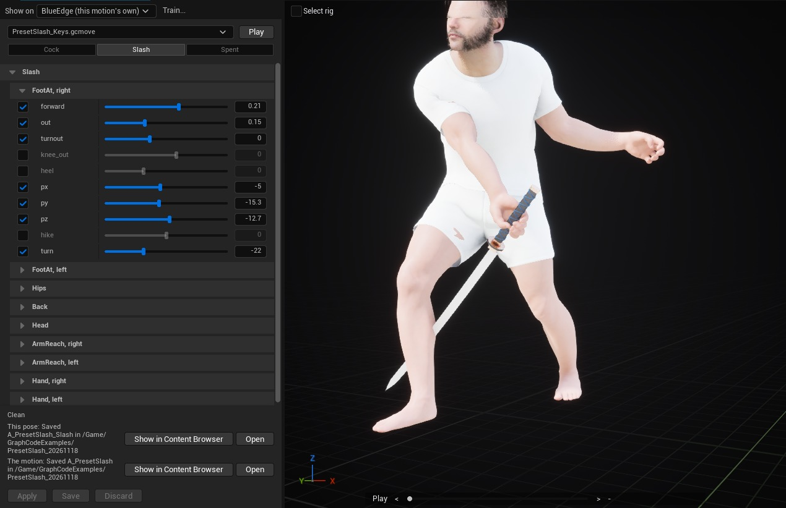</p>

1. **Window > GraphCode Pose**, then choose the motion your AI made. The character appears on the right.
2. **Pick a pose** from the strip at the top (here *Cock*, *Slash*, *Spent*).
3. **Drag the sliders** of any body part: a foot's reach and turn, the hips, the back, the head, each
   arm's reach, each hand's grip. A tick marks a value you set yourself; untick it and it follows the
   value it inherits. Headers show how many values you changed. Ctrl+Z undoes.
4. **Apply** builds a trial of the animation so you can watch it play; the saved animation stays as it
   is. **Save** keeps your values and rebuilds the animation (Version Control takes you back);
   **Discard** throws the trial away.
5. **Hand it back.** Your AI picks up from your values: *"Keep my slash pose, make the follow-through
   heavier."*

**Working together on one motion:**

| You | Your AI |
|---|---|
| *"A two-handed sword slash: wind up over the right shoulder, cut down across, follow through."* | Builds the three key poses (wind-up, cut, follow-through) from body-part presets, keeps the feet planted and both hands on the grip, and shows you the motion. |
| Open it in the Pose panel. The wind-up feels low: raise the right arm, press **Apply** and watch it. | |
| Press **Save**. | Reads your values from the same file and carries on: *"Keep my wind-up, make the follow-through heavier."* |

Nothing is exported, nobody overwrites anybody: you and your AI edit the same motion, and every save is a version either of you can go back to.

<table><tr>
<td width="50%"><br><sub>Effects built as timed layers: a portal opening.</sub></td>
<td width="50%"><br><sub>Hands and arms in contact: playing the violin.</sub></td>
</tr></table>

**Why GraphCode Move?** Your AI says where the hands go, where the feet stay and how hard the effort is. GraphCode solves the body against your real skeleton, and tells you anything it couldn't keep.

*"A right hook: feet planted, weight shifting forward, the fist fastest at contact. Then make it slower."*
- **The problem with a free MCP server:** the AI types bone rotations at points in time. The feet slide unless
  it checks every frame, the balance is a guess, and "fastest at contact" isn't written down anywhere, so
  making it slower means re-keying the whole thing. Mixamo has the punch but not your character's stance;
  Cascadeur and motion capture mean another app and a hand clean-up.
- **How GraphCode Move solves it:** the AI writes four body-part poses, plants both feet, and names the fist as
  the point that must be fastest at contact. The build solves against your skeleton and floor and reports
  each foot's slide, each joint limit and any reach that fell short. *Slower* is one effort value, and you
  can drag it yourself in the Pose panel.

Only with GraphCode Move:
- Hands sent to a place in body words (*145 forward, 135 up*), with the trunk, hips and free arm joining a far reach.
- Balance checked against the body's real mass and the soles actually touching the floor.
- Speed from effort, with the fastest point placed at the strike.
- Poses reused with values (*lean the back 45°*), and a value outside the body's range refused by name.
- The floor, props and the body itself kept clear through the whole clip, between keys too.

- **Character animation** on your skeleton: walking, running, stairs, jumping and landing, climbing,
  reaching, grabbing, throwing, fighting, sitting, opening doors and looking around.
- **Believable contact:** feet that stay planted and roll heel to toe, hands that land where they should,
  balance, speed that follows effort, and limbs that never pass through the body or a table.
- **Props:** picking things up, carrying, handing over and dropping them into physics; sword, pistol and
  rifle grips.
- **Pose libraries** of body parts for people and four-legged animals, used by the AI and by the Pose panel.
- **Faces:** smiles, blinks and jaw movement, and lip sync from a voice recording.
- **Checking motion:** motion trails and speed graphs, rendered as video.
- **Effects:** fire, smoke, explosions, magic, ice, lightning and portals in Niagara, built as timed layers.
- **Cutscenes:** Level Sequences and camera moves; montages, composites and blend spaces.
- **AI behaviour:** Behavior Trees and State Trees for enemies and companions.
- **Physics and retargeting:** physics assets, IK rigs and animation retargeting between characters.

### GraphCode Rig: skeletons and skinning

Any model, ready to animate, even one that arrived with no bones.

<p align="center">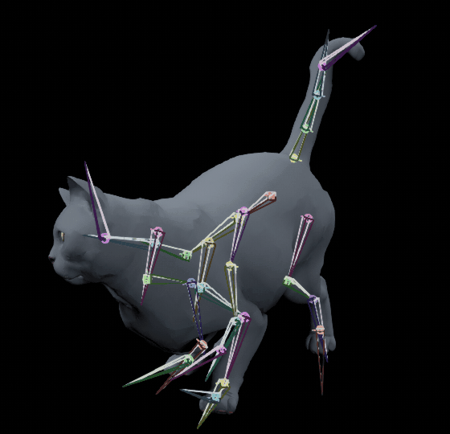</p>

**How it goes:** *"Rig this cat."* The AI builds the skeleton (shown above, walking), paints the skin weights,
adds physics bodies and an IK rig, and moves the joints to check them. Then: *"The
knees crease too much; soften them."*


**Why GraphCode Rig?** Your AI names where a mesh bends, and gets a skeleton, skin, physics, IK and Control Rig that agree with the mesh, with every joint's axis reported.

*"Rig this bare elephant mesh."*
- **The problem with an auto-rigger or a Blender armature:** they expect a human, or joints placed by eye,
  and the axis each joint bends about is inferred. When GraphCode's own elephant was first rigged that way,
  its hip axis came out 132° off the stride and the walk ran backwards, and an auto-rig gives no reason why.
  Joint limits, collision bodies and IK are still left to you.
- **How GraphCode Rig solves it:** the AI measures points on the mesh, declares each joint by the region it
  bends in and the way it closes (`hip_L [turns_in=$hip_out_L, range=(-35, 60), closes=forward]`), and
  gets the skeleton, skin weights, Physics Asset, IK Rig and Control Rig from one file, with each joint's
  axis reported against the way its bones bend.

Only with GraphCode Rig:
- Every point measured on the mesh, never typed from memory.
- Joint ranges from published studies of the human body, and a limit that's too tight reported.
- Heel, ball and toe named on the foot, so a walk rolls through them; finger pads and grip sockets for holding.
- Corrective shapes that follow a joint while the game runs: the elbow creases, the bicep bulges.
- A MetaHuman adapter in four lines, over a shared 84-joint map.

- **Rigging any model,** even one with no bones: skeleton, skin weights, physics bodies, IK rig and a
  Control Rig, ready to animate.
- **Joints with real ranges** taken from anatomy, and shoulder twist that follows the arm.
- **Contacts and grips:** heel, ball and toe for walking; finger pads and grip sockets for holding things.
- **Skin that behaves:** creases, folds and bulges where joints bend, and corrective shapes driven by the joints.
- **MetaHumans:** a ready MetaHuman body template and face controls.

### GraphCode Groom: hair, fur and feathers

Strand hair and fur grown on your characters, in Unreal's own groom format.

<p></p>

**How it goes:** *"Give the cat a thick grey British Shorthair coat."* The AI grows the fur by region,
sets its length, flow and clumping in layers, binds it to the cat and previews it moving. Then:
*"Shorter on the face, denser on the chest."*


**Why GraphCode Groom?** Your AI grows hair on your character's own scalp from regions and directions, so a new parting is one changed line, not a new groom.

*"Part it in the centre, sweep the fringe off her face, let the back fall straight, and add a plait."*
- **The problem with the usual route:** free MCP servers have no hair tools. A Blender or Houdini groom is
  styled by hand on one head and imported as a fixed cache; a bought groom was made for someone else's
  head. A different parting or a different character means grooming it again.
- **How GraphCode Groom solves it:** the AI measures points on your character's scalp, divides it into
  regions, gives each a direction, combs the fringe off the face, plaits one region, and grows the strands
  on that mesh, bound to your MetaHuman. A new parting is an edited region.

Only with GraphCode Groom:
- Hair that leaves the skin already turned along its flow, so it lies down instead of standing up.
- Combing that follows the skin toward a place: over the ears, off the face.
- Braids, ties, buns and half-up knots as features; a braid that would fold says how tight the bend is.
- Builds that report how much scalp shows and where locks cross, so the AI can fix it.
- Strands, short fur, anime hair and feathers from one recipe; a cat's coat of over a million strands in
  four layers from 64 lines.

- **Hair, fur, eyebrows and stubble** grown as Unreal's own strands: regions, flow, combing, clumping and
  layered coats.
- **Styles:** braids, plaits, buns, ties and stray hairs.
- **Short fur, anime hair and feathers:** dense shell fur, stylised card hair with toon shading and
  outlines, and rows of feathers.
- **Ready for games:** levels of detail, hair bound to MetaHumans, and previews with hair physics.

### GraphCode Garment: clothing and armour

Clothing cut to the body and made the way a tailor makes it, from real fabric.

<p>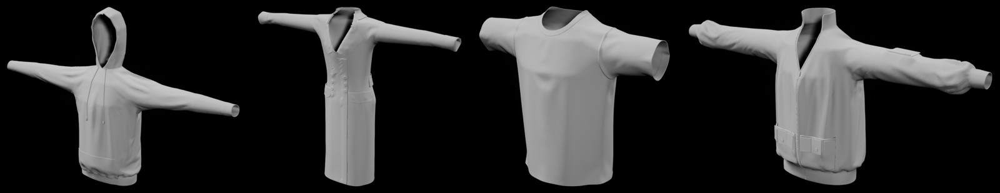</p>

**How it goes:** *"A long coat with two rows of buttons for this character."* The AI cuts the panels to the
body, gives them the fabric's weight and stiffness, sews on the collar, pockets and buttons, lets the
cloth settle and renders it front, back and three-quarter. Then: *"Lengthen it to the knee."*


**Why GraphCode Garment?** Clothing your AI sews, not sculpts: measured on your character's body, made from real fabric, and built the way a maker builds it.

*"A denim jacket with a chest pocket and a hem turned twice. Then let it out two centimetres."*
- **The problem with the usual route:** a clothing pack fits someone else's body. A Blender cloth simulation
  gives back a mesh with no idea what a pocket or a hem is. Marvelous Designer makes excellent cloth, but a
  person drives it in another app and Unreal receives a fixed mesh. In each case the pocket is part of the
  surface, and "let it out" means starting again.
- **How GraphCode Garment solves it:** the AI measures rings on your character's own skin, cuts the panels
  from them, sews the pocket on as its own piece of cloth with its mouth left open, turns the hem twice, and
  gives the denim its real weight, stretch and stiffness. *Let it out* changes the rings, and everything
  built from them follows.

Only with GraphCode Garment:
- Every ring is placed on the real body; one that isn't touching the skin is refused.
- Pockets, belt loops and labels are separate cloth sewn on, not marks on the surface.
- Seams pressed toward a side; facings that follow their topstitching; hems turned, faced or raw.
- Fabric by its test-report numbers: the same skirt falls in narrow folds in 80 g/m² silk and broad ones in 400 g/m² denim.
- Builds that report folds and crossings ring by ring, so the AI sees what's wrong.
- One recipe becomes a static mesh, clothing skinned to the body, simulated cloth, or a MetaHuman outfit.

- **Clothing cut to the body:** shirts, T-shirts, trousers, jeans, jackets, coats, dresses, cloaks,
  scarves, vests and more.
- **Real fabric:** weight, thickness, stretch and stiffness from real cloth.
- **Real construction:** pockets and belt loops sewn on, collars, lapels, cuffs, bands, darts,
  waistbands, turned hems, pressed seams and stitching.
- **Armour:** padded gambesons, leather and plates fitted over the cloth.
- **Every use:** static meshes, clothing skinned to the body, simulated cloth that hangs and moves,
  MetaHuman outfits, and curtains.
- **20 example garments** ship with it, the four above among them.

### GraphCode Core Extension: MetaHumans, crowds, sound and trees

People: as many as your game needs, each one different.

<p>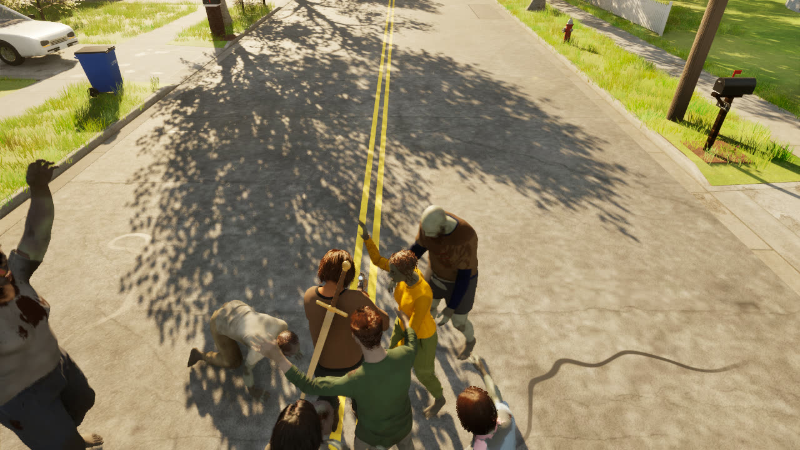</p>

**How it goes:** *"Nine different townspeople for the street."* The AI blends faces and bodies, chooses
hair and clothes, assembles each one as a playable character and puts them into the scene.
Then: *"Make the third one older and heavier."*


**Why GraphCode Core Extension?** Your AI describes the person, whose nose, how tall, which drawing, and the MetaHuman is built to match, the same way every time.

*"Twelve villagers between 165 and 186 cm, none alike, one with Bruce's nose on Ada's face. Tomorrow's rebuild must give the same twelve."*
- **The problem with the usual route:** MetaHuman Creator is excellent for one hero, but each person is a
  separate session of slider work, a likeness is judged by eye, and nothing repeats tomorrow.
- **How GraphCode Core Extension solves it:** the AI writes the cast as text: Ada's face blended with
  Bruce's nose, heights drawn from 165 to 186 cm, one build line per person. The same draw rebuilds the
  same twelve, and each face is previewed before it goes to Epic's rig service.

Only with GraphCode Core Extension:
- Faces blended whole or region by region; 21 regions sculpted, mirrored or not.
- Bodies set by measurement (height, waist), and each face measured back in centimetres.
- A likeness fitted life-size from a scan, a drawing or a generated head, with a report of how close each
  feature landed.
- Details drawn between the face's own landmarks, such as a double eyelid crease.
- Crowds that rebuild the same people every time.

- **MetaHumans with any face and body:** preset faces blended, 21 face regions sculpted, height and waist
  set, eyelashes and teeth chosen.
- **A likeness** from a drawing, a scan or a generated head.
- **Playable characters:** rigged and assembled, ready for a game or a cinematic.
- **Crowds** of different people that rebuild the same.
- **MetaSounds, AI environment queries and procedural trees.**

### GraphCode Play: testing the game

Your AI plays the game for you, and shows you what happened.

<p>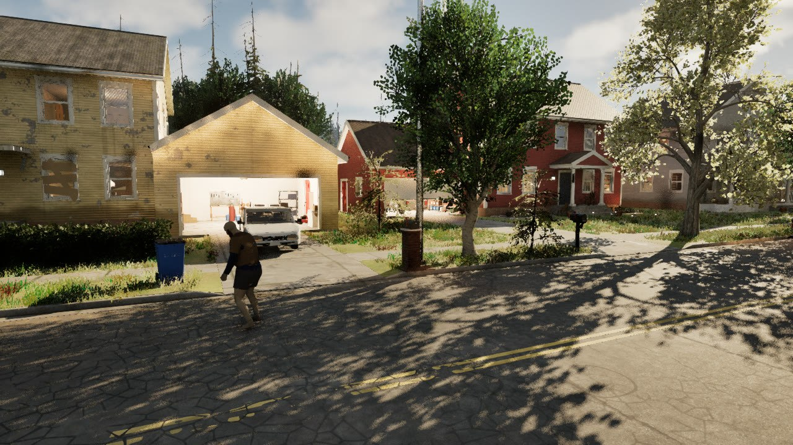</p>

**How it goes:** *"Zombie hands go through my character. Fix it and prove it."* The AI plays the scene,
measures every swipe, fixes it, plays again and gives you the before and after, with screenshots from
both runs.


**Why GraphCode Play?** Your AI names the moment and the button, and the game answers when it happens, so a test checks the game, not the timing of the editor.

*"Walk into the shop, open the inventory, buy the sword, and prove the gold went down by 50 and the HUD shows it."*
- **The problem with a free MCP server:** the AI sleeps a few seconds, clicks at screen coordinates and takes
  a screenshot. A hitch in the editor shifts every beat, a click on a button hidden behind a window still
  "works", and a screenshot can't say which button is which.
- **How GraphCode Play solves it:** the AI waits for the moments the game itself announces, presses the buy
  button by its name, and captures the world before and after. The reply says what ran, on which frame, and
  exactly what changed.

Only with GraphCode Play:
- Waits on named moments or counted game frames, so an editor hitch can't shorten them.
- HUD buttons pressed by name; a hidden, disabled or covered one is refused with the reason.
- Every screenshot comes with a text map of the screen: each widget's name, position, text, and what can be pressed.
- The whole game world captured as text, compared between moments, and a run restarted from any captured moment.
- A log of every run with the frame and time of each step, and two runs compared mark by mark.

- **Plays the game:** starts it, drives input through the game's own actions, presses HUD buttons by name, calls functions and spawns things.
- **Screenshots** of the running game, HUD included.
- **Captures** of the whole game world, compared between runs, and restarting from a captured moment.
- **Records of every run,** compared to show what changed; the game's audio recorded with its loudness.

### GraphCode Integrate: Blender

Keep modelling in Blender; your AI brings it into Unreal and keeps it in step.

**How it goes:** in Blender, open the **GraphCode** tab in the sidebar (N) and press **Export selected
meshes**, or **Export material bundle** in the shader editor. Then ask: *"Bring the new tavern sign in
from Blender."* The AI imports the meshes and rebuilds the materials as editable Unreal materials.
**Open conversion report** shows what was translated and what was baked. When you change the model in
Blender, export again and the Unreal asset updates in place.


**Why GraphCode Integrate?** Your AI sends Blender objects across as meshes with editable Unreal materials, not as an FBX and a flat bake, and updates them in place.

*"Send the chair and table to Unreal, keep the wood editable, bake only what Unreal can't do, and update them when I change the grain."*
- **The problem with a plain export or Blender MCP:** the AI exports an FBX, then either bakes the material
  flat, losing every control, or rewires it by hand in Unreal. Each change in Blender means doing it all
  again, and a re-import can overwrite edits made in Unreal.
- **How GraphCode Integrate solves it:** the AI names the objects and the intent. Supported nodes become an
  Unreal material with real parameters; only the branches Unreal can't express are baked; a render checks
  the result; and the report lists every decision. The next send updates the chair in place.

Only with GraphCode Integrate:
- Blender node graphs translated: Principled BSDF, node groups, colour ramps, maths, mixes, normal maps, bump
  and alpha cut-outs.
- A report naming every translated output, every baked branch and every frozen control.
- Updates in place, and an asset someone edited in Unreal is never overwritten.
- Displacement carried into Nanite tessellation, its strength still editable.
- Works from a saved .blend in the background, or from your open scene.

- **Blender models into Unreal** with their materials, translated into editable Unreal materials.
- **Baking** the shader branches Unreal can't translate, with a report of what was converted.
- **Updating in place** when the Blender model changes, from the Blender add-on or by asking your AI.

### GraphCode Market (free)

Ready-made packs your AI can install and build on, in a tab inside your editor.

<p></p>

**How it goes:** **Tools > GraphCode Market**. Search or filter by category, pick a pack to see what you
get, what it needs and what uses it, and press **Install** (tick *with its textures* for photo
materials; an installed pack shows **Manage** instead). Then ask your AI: *"Build the ruined stone wall from the Stone Wall pack, three metres
long."* Or skip the tab: *"Find a pack for broken concrete and use it."*

- **39 ready-made packs** of walls, roofs, timber, rocks, cliffs, plants, materials, mechanical parts,
  damage and human and animal poses, plus guides and AI skills. All of them: [docs/MARKET.md](docs/MARKET.md).
- **Checked and signed:** every install verifies the catalogue's signature and every file, and installs
  what a pack needs first.
- **Yours to change:** updates keep the files you edited; removing a pack is refused while another needs it.

The full technical reference, for your AI and your team: [docs/REFERENCE.md](docs/REFERENCE.md) ·
[docs/TOOLS.md](docs/TOOLS.md) · [docs/KINDS.md](docs/KINDS.md).

## Trial and licence

| | |
|---|---|
| **Trial** | 14 days of all ten products from the first sign-in on your PC. One trial per email and one per PC. No card. |
| **After the trial** | Core, Shape and Integrate keep building, free for personal use, for ever. The other products need a licence; everything you made stays, and the AI can still read and look. |
| **Licence** | One-time purchase with no time limit, per product or all products, for individuals or per studio seat: [pricing](https://graphcode.dev/pricing). |
| **Computers** | A licence works on one PC at a time; move it by signing the old PC out. |
| **What you make** | Yours to ship in any game, commercial or not. |
| **Updates** | Offered inside the editor; nothing installs until you click, and you can go back to the previous version. |

## Trust and privacy

| When | To | Sent | Never sent |
|---|---|---|---|
| Before the AI changes something, if no recent pass covers it | GraphCode licence service | Your email, licence id and this PC's key, signed | Project content, asset text, file names |
| Editor start, then daily (can be switched off) | GraphCode update service | A signed proof of this PC | Version, project, usage |
| When you search or install Market packs | graphcode.dev | Your search, the pack you chose | Project content |
| When you make a MetaHuman | Epic's MetaHuman services | What Epic's service needs | — |

- **GraphCode never calls an AI provider** and sends no usage data. Your AI client sends what it sees to
  the provider *you* chose.
- **Only programs on your PC can reach the editor,** and web pages are refused.
- **Releases are signed,** every file has a published checksum, and a [script](tools/Verify-GraphCodeRelease.ps1)
  checks a download for you.
- **Closed source,** with every public header, guide and example published in this repository.
- [Privacy policy](PRIVACY.md) · [Security](SECURITY.md) · [For studios](docs/STUDIOS.md) · [Third-party notices](Plugins/GraphCode/THIRD-PARTY-NOTICES.md)

## Questions

<details><summary><b>Do I need to know how to code, or learn GraphCode's format?</b></summary>

No. You describe what you want and your AI does the work. GraphCode gives the AI the tools and the
about 100 guides it reads as it goes. Blueprint-only projects work.
</details>

<details><summary><b>Does GraphCode include an AI?</b></summary>

No. You bring the AI you already use (Claude Code, Codex, Cursor or any MCP client) with your own
subscription. GraphCode is what lets that AI build inside Unreal Engine.
</details>

<details><summary><b>Does it work on my existing project?</b></summary>

Yes. You copy the plugins in and turn them on; nothing in your project is rebuilt or moved. On first setup your AI reads what is already there (your content, plugins, Git history and any agent notes) before it asks you anything, and it asks only what the project cannot answer. Packs you bought can be left out of GraphCode's readable-text copies by folder, and those folders stay fully readable to your AI.
</details>

<details><summary><b>Does it cost me AI tokens?</b></summary>

GraphCode adds no AI charge: it never calls an AI provider, and the AI you already use bills you as it always does. It is also built to be light on your AI. There are 15 tools, not hundreds, and each one explains itself on demand, so your AI's attention goes on your game and not on a tool list. Reading a whole Blueprint or level as one text and changing it in one step also takes fewer calls than wiring it node by node.
</details>

<details><summary><b>Does my project leave my computer?</b></summary>

Not through GraphCode. It only contacts our servers to check your licence, offer updates and download
Market packs, with no project content. Your AI client sends what it reads to the AI provider you chose.
</details>

<details><summary><b>Is it closed source? Can I trust it?</b></summary>

The plugin binaries are closed source, and everything you need to check them is public. Every release is signed, every file has a published checksum, and a [script](tools/Verify-GraphCodeRelease.ps1) verifies a download on your PC and sends nothing anywhere. The in-editor updater runs the same checks and deletes a download that fails; nothing installs until you click.

The tool server in your editor answers only programs on your own PC, and it refuses any request that comes from a web page. GraphCode never calls an AI provider and sends no usage data: the only traffic is licence checks, update checks and Market downloads, all listed in [Trust and privacy](#trust-and-privacy). Every public header, guide and example is in this repository, and the [security policy](SECURITY.md) and [threat model](docs/STUDIOS.md#threat-model-who-can-talk-to-the-editor) say exactly who can talk to the editor and what they can do.
</details>

<details><summary><b>What if GraphCode disappears, or the licence server is down?</b></summary>

Everything you already made is ordinary Unreal content and stays yours. It opens, builds and ships without contacting us. Reading, searching, rendering and all normal editor work carry on, and your recipe files (`.gcshape`, `.gcmove`, `.gcrig` and the rest) are plain text in your own repository. Only AI-driven writes need a token from our licence server; they pause with a message saying so and resume as soon as it is reachable. Every release stays downloadable, so you can keep running the version you have.
</details>

<details><summary><b>What if the AI gets something wrong?</b></summary>

Undo it. Every change is saved as a version you can compare and restore, deleted assets go to a trash
folder, and a change that would break a working Blueprint is never saved.
</details>

<details><summary><b>Can I use what it makes in a commercial game?</b></summary>

Yes. Everything you make is yours, and it is ordinary Unreal content: Blueprints, materials, meshes, animations, Niagara systems. It opens in any Unreal editor, builds with the normal Unreal tools and packages like the rest of your game. Almost all of GraphCode is editor-only and stays out of your game, and every release is checked by packaging and launching Development and Shipping games with GraphCode installed.
</details>

<details><summary><b>Can I sell what I make on Fab?</b></summary>

What GraphCode makes is ordinary Unreal content, and it is yours to sell. A listing on Fab is subject to Fab's own rules, including its policy on AI-generated content, so tag and describe your assets as that policy asks when you publish them.
</details>

<details><summary><b>Will it replace my artists?</b></summary>

No. The AI authors and your people direct. You say what you want, and your artist fine-tunes it on the very asset the AI made: the **Pose** panel for motion, **Version Control** to compare and restore, and a readable diff of every change the AI makes, to review before it goes in. You choose how hands-on you are separately for game direction, art direction, mechanics and sound, so an art lead can own the look while the AI builds it.
</details>

<details><summary><b>Does it work offline?</b></summary>

Reading, looking and searching work offline. Building and changing things checks your licence with our
server, so it needs a connection.
</details>

<details><summary><b>Which Unreal versions and platforms?</b></summary>

Unreal Engine 5.7.4 on Windows 64-bit. Each new engine version comes with a matching GraphCode release.
</details>

<details><summary><b>What happens when Unreal 5.8 comes out?</b></summary>

Each GraphCode release targets one exact engine build, and a new engine version comes with a matching GraphCode release. Until you move, nothing changes: updates never install without a person clicking, you can turn the automatic check off, and every release stays downloadable with its signature and checksums, so you can stay on the version that matches your engine.
</details>

<details><summary><b>Does it work for a team?</b></summary>

Yes. Studio licences are per seat, changes show up as readable diffs in Git (and work alongside
Perforce), and a check runs in CI without a licence. See [For studios](docs/STUDIOS.md).
</details>

<details><summary><b>How do I uninstall it?</b></summary>

Close Unreal and delete the `Plugins/GraphCode*` folders, then the `%USERPROFILE%\.graphcode` folder.
Everything the AI made stays in your project.
</details>

## More

[Setup guide](docs/SETUP.md) · [Market packs and presets](docs/MARKET.md) · [Case studies and samples](docs/EXAMPLES.md) ·
[For studios](docs/STUDIOS.md) · [Changelog](CHANGELOG.md) · [Licence agreement](LICENSE.md) ·
[Issues](https://github.com/xiangjie9999/GraphCode/issues) · support@graphcode.dev

<sub>Unreal Engine is a trademark of Epic Games, Inc. GraphCode is independent and not affiliated with or endorsed by Epic Games.</sub>
