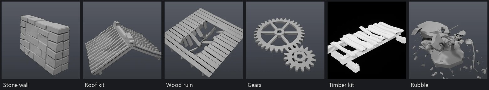
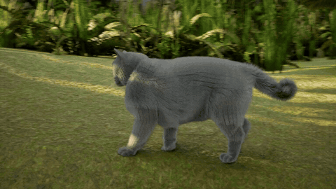

# The ten GraphCode products, and the free Market

All ten ship in one package and one 14-day trial. Each section says what you write, what you get,
what it can do and what it cannot do yet. Every product's asset kinds, blocks and omissions are
listed in [KINDS.md](KINDS.md), and each product has a longer page on graphcode.dev.

- **Worlds:** [Core: levels](#graphcode-core-levels) · [World](#graphcode-world) · [Shape](#graphcode-shape) · [Market](#graphcode-market-free)
- **Characters:** [Move](#graphcode-move) · [Rig](#graphcode-rig) · [Groom](#graphcode-groom) · [Garment](#graphcode-garment) · [Core Extension](#graphcode-core-extension)
- **Gameplay, UI and data:** [Core](#graphcode-core-blueprints-widgets-materials-data) · [Play](#graphcode-play)
- **Bring work in:** [Integrate](#graphcode-integrate)

---

## Worlds

### GraphCode Core: levels

The persistent level and every actor in it as one document.

- **You write** the level's `.gc`: actors, components, sublevels, volumes, splines and the Level
  Blueprint. **You get** the level in the editor, changed only where your text changed.
- Change one actor and leave the rest. Removing one is an explicit `delete Name` line, never an omission.
- Place by intent: `@anchor`, `@surface`, `@facing` and `@scale` ("resting on the floor, facing the
  door") resolve when the write is applied.
- One World Partition actor can be read and written without loading the whole map (`external_actor`).
- **Limits:** World Partition, HLOD and sublevel streaming are partly covered. The level declares
  what it omits, including built lighting data, BSP geometry and foliage instances.
- More: [graphcode.dev/products/core](https://graphcode.dev/products/core)

### GraphCode World

Terrain, water, regions, navigation, foliage and PCG.

- **You write** `.gcw` region programs (terrain, water, named regions, navigation, populate rules)
  and PCG graphs as `.gc`. **You get** native Landscape, Water, foliage, navigation and PCG assets.
- `gcw_ask` answers spatial questions about the open level: what is at this point, which region it
  is in, and whether an agent of a given size can walk from here to there (straight-line versus path length).
- PCG graphs, graph instances and settings are readable and creatable as text.
- Example: a jungle valley about 1 km square, planted from about 130 lines in the level's populate
  block. Each line names its plants, region, density and seed.
- **Limits:** a valid `.gcw` write does not prove the result is grounded, navigable or visible, so
  render and walk it. Heightfield terrain cannot make caves. Needs Unreal's PCG and Water plugins for those features.
- More: [graphcode.dev/products/world](https://graphcode.dev/products/world)

### GraphCode Shape

Props, buildings, vehicles and vegetation from `.gcshape` recipes.

- **You write** a recipe: outlines, extrusions, lofts, cuts, joins, profiles, edge finishes, UVs,
  material slots and LODs, with sizes tied to named values. **You get** an ordinary Static Mesh in your project.
- Change one number and rebuild, and every part built from it follows. The airship's deck was
  lowered 70 cm with one edit.
- Reuse parts and presets (rods, fasteners, timber, stone, roofs, rope, gears, leaves). SVG outlines
  can drive profiles.
- Import a mesh from elsewhere and repair or assemble it with organic joins.
- **Limits:** surfaces come from the materials you supply; Shape makes geometry, not textures.
  Build time grows with the recipe. The grammar is still growing. Needs Unreal's Geometry Scripting plugins.
- More: [graphcode.dev/products/shape](https://graphcode.dev/products/shape)

### GraphCode Market (free)

Ready-made recipes, pose libraries, guides and AI skills.

- 36 signed packs at the time of this release, including stone walls, timber, roofs, rope, gears,
  fixings, rubble, damage, weather, vegetation, bark and foliage materials, and human and quadruped
  pose libraries.
- Your AI searches and installs them with `gc_market`, or you click **Get in Unreal** on
  [graphcode.dev/marketplace](https://graphcode.dev/marketplace). Every pack is checked against its
  signature and file hashes and is written whole or not at all. Installing never builds anything until you ask.
- AI agents can browse the catalogue through the public read-only MCP endpoint
  `https://graphcode.dev/mcp` (`search`, `fetch`) without installing anything.
- **Limits:** updating one pack does not yet pull its dependencies' updates. Some materials are flat
  until you add the optional photo-texture packs.

---

## Characters

### GraphCode Move

Animation, effects, cinematics and AI decisions.

- **You write** `.gcmove` motion programs: key poses from body-part presets, plants and reaches,
  balance, travel by velocity, collision stops, props picked up and put down, face curves.
  **You get** Animation Sequences on your skeleton, plus montages, composites and blend spaces.
- Niagara systems and parameter collections as text: emitters, stack modules and user parameters.
- Level Sequences, Behavior Trees, State Trees, Physics Assets, IK Rigs and IK Retargeters.
- See a clip move: `gc_render` draws motion trails and graphs as well as frames, and writes mp4 or animated PNG.
- **Limits:** a motion program is measured, not guaranteed natural; the shipped examples list their
  own remaining defects (the WalkAndRun example says plainly it is "not a whole-motion
  certificate"). Long clips take minutes to build. Skeletons and imported animation sequences are
  patched, not created from text.
- More: [graphcode.dev/products/move](https://graphcode.dev/products/move)

### GraphCode Rig

Skeletons, skin weights, contacts and Control Rigs from `.gcrig`.

- **You write** where a mesh bends: joints, joint ranges taken from anatomical studies, twist,
  contacts, grips, sockets, creases and morphs. **You get** the skeleton, skin weights, physics
  bodies, IK rig and Control Rig together.
- Works on a mesh that already has bones or on a bare mesh.
- Control Rig settings, variables and supported RigVM graphs are readable and writable as text.
- **Limits:** deep folds can still show artefacts (the shipped elephant example says so). Rig builds
  can take minutes. Unsupported native RigVM content is preserved, not rewritten.
- More: [graphcode.dev/products/rig](https://graphcode.dev/products/rig)

### GraphCode Groom

Hair, fur, brows, feathers and hair cards from `.gcgroom`.

- **You write** a recipe: layers, regions, density, length by body zone, combing, clumping, braids,
  strays, shells for short fur, cards for stylised hair, feathers. **You get** Unreal's own Groom
  assets and bindings. The cat's coat above is a 64-line recipe.
- Build notes report scalp visibility and lock crossings. Preview hair with simulation through `gc_render`.
- **Limits:** needs Unreal's Groom plugin. Judge hair on a real GPU render. Unreal caps a strand at 255 points.
- More: [graphcode.dev/products/groom](https://graphcode.dev/products/groom)

### GraphCode Garment

Clothing and armour from `.gcgarment`.

- **You write** how a garment is made: body-relative rings, armholes, sleeves, pockets and belt
  loops sewn on as separate cloth, hems, pressed seams, stitch rows, and how it hangs (Chaos cloth
  with fabric numbers). **You get** a static mesh, a skinned mesh or a MetaHuman outfit.
- 19 worked garments ship as examples: T-shirt, hoodie, jeans, long coat, zip jacket, gambeson,
  leather armour, robe, tactical vest and more.
- **Limits:** this is the newest product. Of the 19 examples only the T-shirt has been render-checked
  so far (on the 16 November build), and the Dress and Button Shirt examples may fail to build. Garments are cut to the
  supplied test bodies, and two builds of one garment can differ slightly.
- More: [graphcode.dev/products/garment](https://graphcode.dev/products/garment)

### GraphCode Core Extension

MetaHumans, MetaSounds, EQS and procedural vegetation.

- **You write** `.gchuman` identities: preset blends, 21 sculpt regions, body measurements, eyelash
  and teeth variants, seeded crowds, a likeness fitted to a reference. **You get** a playable MetaHuman.
- MetaSound sources and patches, Environment Queries (EQS) and Procedural Vegetation Editor graphs as text.
- **Limits:** each feature needs its engine plugin and refuses by name without it. MetaHuman
  rigging and assembly use Epic's MetaHuman services.
- More: [graphcode.dev/products/extension](https://graphcode.dev/products/extension)

---

## Gameplay, UI and data

### GraphCode Core: Blueprints, widgets, materials, data

- **Blueprints:** event graphs, functions, macros, variables, components, interfaces, dispatchers
  and timelines. A new function and its callers can be written in one call. Unchanged nodes keep
  their GUIDs and positions.
- **Widget Blueprints:** the widget tree, bindings and animations. `gc_render` paints a widget at
  several viewport sizes and reports overlap, clipping and contrast. `gc_invoke` presses a named button.
- **Materials:** node graphs for materials and material functions, and material instances.
- **Data:** Data Assets, Data Tables, String Tables, curves and curve tables, structs and enums, Data Registries.
- **Input:** Enhanced Input Actions and Mapping Contexts.
- Also: Animation Blueprints (AnimGraph and state machines), Sound Cues, fonts, physical
  materials, foliage types, render targets and HLOD layers.
- **Limits:** every kind declares its omissions (Blueprint metadata and extensions, for example).
  Meshes, textures and sound waves are imported or built, then patched; they are not written from scratch.
- More: [graphcode.dev/products/core](https://graphcode.dev/products/core)

### GraphCode Play

Drive the running game and capture it as text.

- `gc_play` starts and stops Play-in-Editor, holds a driver lease, presses inputs, invokes
  functions, spawns and queries actors, and runs timed step sequences inside the game.
- It captures the world to a `.gcp` text snapshot. You can diff two runs, restart from a captured
  instant, or apply a capture back (a bounded restore).
- **Limits:** a capture is evidence, not proof of timers, latent actions, animation blend position
  or audio playheads. Packaged builds are not covered. It runs the tests you or your AI write; it is
  not an autonomous tester.
- More: [graphcode.dev/products/play](https://graphcode.dev/products/play)

---

## Bring work in

### GraphCode Integrate

Blender meshes and materials into Unreal.

- Sends selected Blender static meshes (from a saved `.blend` or live Blender) and translates their
  shader graphs into editable Unreal materials. Unsupported branches are baked, and you get a
  conversion report. Reimport updates the same assets in place. The Blender add-on ships in the package.
- `gc_import` (Core) brings outside meshes and textures in through a plan you confirm first.
- **Limits:** static meshes only (no skeletons, animation, LODs or collision yet). Blender's Unit
  Scale must be 1. Some shader mappings are approximations, and the report flags them.
- More: [graphcode.dev/products/integrate](https://graphcode.dev/products/integrate)
