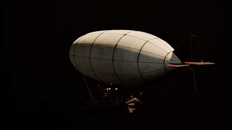
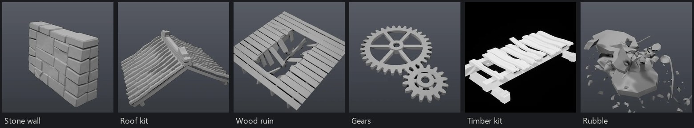
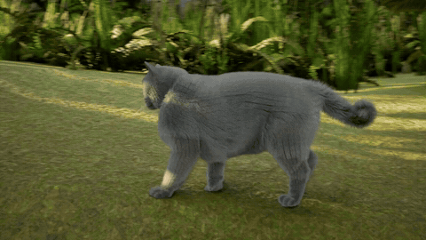

# GraphCode technical reference

For your AI and your technical team: what the AI writes for each product, what Unreal gets, every capability, the presets and examples that ship, and the engine plugins each product uses.
Every kind, block and omission is in [KINDS.md](KINDS.md); every tool and mode is in [TOOLS.md](TOOLS.md);
every Market pack and preset is in [MARKET.md](MARKET.md); every example and case study is in
[EXAMPLES.md](EXAMPLES.md). Exact grammar always comes from the tools' own help and `gc_describe`.

- **Worlds:** [Core: levels](#graphcode-core-levels) · [World](#graphcode-world) · [Shape](#graphcode-shape) · [Market](#graphcode-market-free)
- **Characters:** [Move](#graphcode-move) · [Rig](#graphcode-rig) · [Groom](#graphcode-groom) · [Garment](#graphcode-garment) · [Core Extension](#graphcode-core-extension)
- **Gameplay, UI and data:** [Core](#graphcode-core-blueprints-widgets-materials-data) · [Play](#graphcode-play)
- **Bring work in:** [Integrate](#graphcode-integrate)

Two kinds of document run through all of them. A **`.gc` sidecar** is the canonical text of an existing
asset: LF text, one file per asset, and the same asset always produces the same text, so a diff shows only
what changed. A **program file** (`.gcshape`, `.gcmove`, `.gcrig`, `.gcgroom`, `.gcgarment`, `.gchuman`,
`.gcw`) describes what to build; the built assets get their own sidecars.

---

## Worlds

### GraphCode Core: levels

The persistent level and every actor in it as one document.

- **The AI writes** the level's `.gc`: `actors`, `objects`, `sublevels`, `volumes`, `splines`, `data_layers`
  (read), `partition` and the `level_blueprint`. **You get** the level, changed only where the text changed.
- Change one actor and leave the rest; `delete <Name>` on its own line removes one; `reset <Prop>` inside an
  actor returns that field to its archetype value.
- Place by intent: `@anchor`, `@surface`, `@facing` and `@scale` ("fifty behind the boss, resting on the
  floor, facing the door") resolve when the write is applied.
- One World Partition actor is read and written as `external_actor` without loading the map; `gc_open`
  loads and unloads World Partition regions by bounds.
- Example: a walled canal town whose level document holds 2,648 actors in about 25,000 lines.

### GraphCode World

Write a place as text: terrain, water, planting rules, routes and navigation.

- **The AI writes** a `.gcw` (`gcw 1 level:/Game/...`) with `world { points, courses }`, terrains, water zones,
  named regions and populate lines, and PCG graphs as `.gc`. **You get** a Landscape (optionally streamed as
  tiles), water bodies, planted foliage, navigation and native PCG assets in the open level.
- **Terrain** is an ordered list of instructions over one heightfield: `raise`, `ridge`, `carve`, `flatten`,
  `smooth`, `erode` (droplet and thermal), and `perlin`, `ridged` and `billow` noise, each with `height=` or
  `depth=` profiles along a course, a `slope=` flank profile, per-instruction noise and warp.
- **Filters** such as `[all(height=(Min=1400), slope=(Min=18))]` let an instruction touch only the ground
  the earlier ones left in that range.
- **PNG height brushes:** `stamp(source=file'Brushes/Hill.png', ...)` from 8- or 16-bit grayscale, six blend
  modes (add, subtract, replace, min, max, average), strength and edge falloff.
- **Sculpt replay:** hand sculpts are recorded as exact 16-bit PNGs and replayed on every apply.
- **Streaming:** `terrain(..., stream=tiles(components=4))` for World Partition terrain.
- **Points and routes:** named points and `course a -> b -> c` routes shared by terrain, rivers, roads and
  placed actors.
- **Water:** water zones and bodies authored beside the terrain; GraphCode adds Unreal's Water edit layer
  before the first body. A water-material guide covers optical depth, reflections, flowing normals,
  refraction and foam.
- **Planting:** `foliage(...)` lines name plants, region, density and seed, with height, slope and exclusion
  tests (`not(inside=$Trail)`), so plants stay out of rivers, trails and ponds.
- **PCG:** `pcg(...)` raises a PCG graph over a named region (`trigger=load` volumes generate as soon as the
  write configures them); `pcg_graph`, `pcg_graph_instance` and `pcg_settings` are all readable and creatable.
- **Native Landscape brushes:** bind a placed brush actor to a named edit layer: noise, water levelling,
  particle erosion and Landscape Texture Patch height stamps; detaching restores the heights exactly.
- **Caves and overhangs** are Shape meshes placed on the terrain, sharing its points and courses.
- **Surfaces:** full PBR landscape surfaces with paint layers, texture variation, and placed meshes baked
  into an atlas (colour, normal, roughness).
- **Asking about space** with `gcw_ask`: a named thing's bounds, forward direction and zones; whether an
  agent of a given size can walk from A to B (straight-line versus path length); a wall's bow depth, radius
  and length and the gaps between regions in centimetres, read from the `.gcw` with no editor; and a pixel
  of a render turned into a paste-ready `@anchor`.
- **Roads and buildings:** one surface owner per junction, plan view and height profile planned together,
  plots and doorsteps on shared elevations, and a street-to-door route check.
- **AI navigation:** a State Tree, EQS and navmesh recipe for a character that detours around blocked routes.
- Shipped examples: `Catchment.gcw`, `TextureBrush.gcw`, `TextureMountain.gcw`, `TerrainOperations.gcw`,
  `BP_HeightStamp.gc`, `BP_LandmassErosion.gc` and 16-bit height PNGs in
  [`Plugins/GraphCode/Resources/Examples/NativeTerrain`](../Plugins/GraphCode/Resources/Examples/NativeTerrain).
- Case studies: a jungle valley about 1 km square from about 130 planting lines; a cavern with a
  160 × 120 m pond in a 10 m basin and one continuous layered limestone wall; a jellyfish grotto lit by
  named values; a canal town on a road network of two meshes.
- Engine plugins: PCG and Water for those features; Landscape is built in.
- Guides: ENVIRONMENTS, NATIVE-TERRAIN, WATER, ROADS-AND-BUILDINGS, AI-NAVIGATION, VEGETATION, TEXTURE-VARIATION.

### GraphCode Shape

Props, buildings, vehicles, creatures and plants from short readable recipes.

- **The AI writes** a `.gcshape` recipe; `build { SM_Tub = $Tub }` names what to build. **You get** an ordinary
  Static Mesh under `/Game/...` with its material slots, pivot, sockets, collision and LODs.
- **Entries:** numbers, `profile()` curves, `random()`, `material()` slots, `plane()` outlines, `mesh()` bodies
  and `shape('...')` imports. Sizes are named values, so one number changes every part built from it.
- **Presets are families:** `shape('/GraphCodeShape/Presets/Fixings', Steel=$Brass)` imports a library with
  your own values, and its entries take arguments. 35 preset libraries ship ([MARKET.md](MARKET.md#the-35-shape-presets-that-ship-in-the-plugin)).
- **Outlines:** `circle`, `rect`, `arc`, `points`, `curve`, with `round` and `widen`; SVG artwork as outlines
  that are filled, shelled or rounded.
- **Depth:** `extrude`, `revolve`, `sweep`, `loft`, `fill`, and `polyhedron()` plane-bounded masses. Lofts
  follow blueprint lines with keyed sections and `rails=` (a car body is a worked walkthrough).
- **Reshaping:** `taper`, `bend`, `roughen`, `weather`, `displace`, `raise`, `shell`, `relax`, `crease`,
  `subdivide`, `remesh`, `cut`, `trim`, `fit`, `conform`, `pinch`, `pull`, `drip`, `coat`, `warp`.
- **Combining:** `subtract`, `intersect`, `add`; repetition with `loop` and `repeat`, `step`, `spread`, `turn`,
  `around`, `along`, `onto`, `scatter`, `jitter` and `seed`; `if`/`else`; per-copy `output.index`, `place`, `normal`.
- **Joins** chosen per part: organic, blend, fillet, hard, clip, full or none. Crossing shells are welded.
- **Edge finishes** chosen per material: rounded, chamfered or crisp, radii in centimetres, with declared
  creases (`@sharp`) that survive a `warp`.
- **Damage and wear:** chips, cracks, gouges, punctures, snapped and split wood, erosion, `fracture(...)`, and
  loose piles that settle (`collide=settle`).
- **Skeletal sculpt:** `ball()` and `limb()` masses blended into one surface (`blend=`, `sculpt()`) for
  creatures and soft forms, with hand, digit and anime body presets.
- **Surface data:** UVs and tangents (`uv(none)` to skip), material slots, vertex `colour()`, `imprint`,
  chord-tolerance smoothing (`smooth:`), hard-edge angle (`shade:`), `segments=`; mesh materials `bake(...)`d
  into an atlas, and fine detail baked to a normal map.
- **Build line:** sockets (`socket(EnginePort, at=..., facing=+Z)`), pivots, collision geometry, LODs and a
  triangle budget. Built meshes use Nanite.
- **Same file, same mesh:** the same recipe builds the same triangles in the same order; seedless `random()`
  is keyed by entry name. Every build reports triangles per slot and flags broken faces, non-manifold edges
  and seams.
- **Organic part assembly:** import supplied body or limb meshes, join them through sockets and transition
  bands into one mesh, and carry on to Rig or a MetaHuman reference.
- **Assembly validation:** declared connections, clearances, openings a character capsule fits through,
  hidden parts and wall mounts, checked by a reusable editor check.
- **Vegetation as parts:** leaves of five species at any age, twigs and sprays for the Procedural Vegetation
  Editor, leaf litter, grass from lawn to hay meadow, rush, sedge and climbing ivy. Plants that spread (ivy on
  a wall, litter on the ground) are small parts placed by a PCG graph.
- **Asset quality method:** references first, plan the whole object, build one representative part, three
  scales of detail, render checks.
- Case studies: an 18 m airship (six recipe files, downloadable); the Aether rifle in steel, brass, walnut,
  leather and glass, each its own mesh, engraving baked to a normal map; 16 showcase collections with 94 renders.
- Engine plugins: Geometry Scripting and Geometry Processing; SVG Importer for SVG outlines.
- Guides: GCSHAPE, SHAPE-EDGE-FINISH, ARTISTIC-SHAPES, ORGANIC-PART-ASSEMBLY, ASSEMBLY-VALIDATION, ASSET-QUALITY, VEGETATION.

### GraphCode Market (free)

39 signed packs: mesh recipes, operations you apply to your own shapes, material packs, human, face and
quadruped pose libraries, a guide and two AI skills. Search, describe, install (dependencies first, every
file hash checked, written whole or not at all), update (your edits kept) and remove, from `gc_market` or the
**Get in Unreal** button on [graphcode.dev/marketplace](https://graphcode.dev/marketplace). Installing needs no
licence and never builds. A public read-only catalogue and MCP endpoint (`https://graphcode.dev/mcp`, `search`
and `fetch`) let any agent browse. Every pack by name: [MARKET.md](MARKET.md).

---

## Characters

### GraphCode Move

Animation as short readable programs, and the effects, cinematics and AI assets around it.

- **The AI writes** a `.gcmove` motion program. **You get** Animation Sequences on your skeleton, with build
  notes on joint limits, contact, balance and kinematics, plus montages, composites and blend spaces.
- **Poses:** key poses from body-part presets with values you pass in (`Back = pose(lean=0.0)` called as
  `$Back(lean=45)`); a shipped human library of `$Stance $Back $Head $UpperArm $Forearm $ArmReach $Hang $Hips
  $FootAt $Thigh $Shin $LegReach $Foot $Hand` and a quadruped body library.
- **Motion words:** `swing(<bone>, axis=fold|side|twist, by=)` with phase offsets; follow-through along a chain
  (`follow=auto`, `[share=]`, `[phase=]`); `plant(<chain>, on=$Floor, weight=$Profile)` with a smooth release
  and heel-ball-toe `roll=`; `reach(<chain>, to=$Frame)` to places written in the body's words
  (`point(at=(forward=145, up=135))`), with the trunk, hips and free arm joining a far reach; `balance(..., at=)`;
  `travel(<bone>, velocity=)`, `accel=`, `[clock=]` so speed follows effort; strikes fastest at contact
  (`point=`, `strike=`).
- **Contact and physics:** `collision(self, $Surface)` keeps a chain clear of a surface for the whole clip,
  between keys too; held-prop collision; gravity and floor correction (`clip(gravity=true, collision=$Floor)`);
  root motion; physics-driven parts in a clip.
- **Props:** `attach($Gun, to=palm_grip_l)`, `detach($Prop, at=) [physics]`, and grips carried between clips
  (`pose(source=/Game/.../A_Grab)`). Hands hold fists, pistols, swords and two-handed rifles, seated on the
  prop's geometry.
- **Clips:** `clip(from=$Walk, repeat=4)`, blends, and a wind and settle preview for hair and cloth.
- **Face and speech:** smile, blink and jaw-open as ready-made MetaHuman face controls; lips solved from a
  sound file through Epic's MetaHuman Animator (`clip(speech=)`).
- **Pose panel:** an editor tab with sliders for each key pose, effort and timing: Apply to try, Save to keep.
- **Judging motion:** `gc_render` draws motion trails and velocity and acceleration graphs as well as frames,
  and writes mp4 or animated PNG.
- **Human movement data:** 14 guides of sourced human movement (walking, running, stairs, jumping and landing,
  throwing and striking, weapon handling, grasping and reaching, sitting and standing, turning, lifting and
  carrying, doors, gaze, joint ranges, body size and balance) that the AI reads instead of guessing.
- **Effects:** Niagara systems and parameter collections as text (emitters, stack modules, user parameters
  the game sets at runtime) and simulation caches; effects built as stacked timed layers, one emitter per
  layer; 3D fire, smoke and explosions; flipbook textures.
- **Cinematics:** Level Sequences as text, with a ten-guide film method: intent, shots, camera moves, attention,
  editing and transitions.
- **AI and physics assets:** Behavior Trees, State Trees, Physics Assets (bodies, constraints, collision pairs),
  IK Rigs and IK Retargeters; skeletons patched (retargeting, virtual bones, sockets, slot groups, blend
  profiles, notifies) and animation sequences patched (curves, notifies, settings).
- Shipped: presets in [`Plugins/GraphCodeMove/Content/Presets`](../Plugins/GraphCodeMove/Content/Presets); examples
  WalkAndRun (rolling walk, a run measured at 3.96 m/s, a run-up kick), StairsInAGame, HandAndPistol, FaceExpressions.
- Case studies: a violinist driven by a recording (bow from loudness, vibrato from pitch, 320 notes and 186 bow
  strokes, 55 blinks); Hana, a MetaHuman whose lips are solved from her voice; a hero climbing in and out of
  windows (8 clips in one program, hand and heel contacts within 0.5 cm); a flamethrower of seven emitters.
- Engine plugins: IK Rig, Full Body IK, Control Rig, Control Rig Physics, Physics Control, Niagara, State Tree,
  ACL, Geometry Processing; MetaHuman for face and speech.
- Guides: GCMOVE, ANIMATION, HUMAN-MOVEMENT (and the HUMAN-* set), MOVE-PARAMETRIC-POSES, NATURAL-MOVEMENT,
  MOVE-PHYSICS, POSES, HANDS, HOLDING-A-SWORD, FACE-EXPRESSIONS, EFFECTS, FLIPBOOKS, CINEMATICS-*.

### GraphCode Rig

Say where a mesh bends; get its skeleton, skin weights, physics bodies, IK rig and Control Rig.

- **The AI writes** a `.gcrig`: points, chains, joints, controls, regions, skin, sockets, contacts and a `build{}`
  line. **You get** the skeleton and skin weights, a Physics Asset, an IK Rig, a native Control Rig and morph targets.
- Two routes: keep a mesh that already has bones and add ranges, contacts and sockets, or build a skeleton for
  a bare mesh from points measured on it (`gc_render mode:"ask"` hit queries).
- **Joints:** `range=`, `side=` and `twists=` in degrees from straight, `rest=(fold=, side=)` rest poses, a twist
  range that widens as the arm rises (`twists_raised=`), and joint speed references (`velocity:`, `accel:`,
  `ramp:`) that effort-timed clips read. Ranges come from stated anatomical studies.
- **Contacts and sockets:** heel, ball and toe contacts for foot roll; finger pads, tips and the web for grips;
  sockets on skinless carrier bones (`bone=`) and grip sockets that reuse another's frame.
- **IK chains:** thigh-rooted foot chains so a reach does not own the pelvis, and a neck chain with a look-at goal.
- **Skin:** weights solved on a voxel grid, with `crease=`, `folds=`, `bulge=` and `keep_volume` per region.
- **Morphs:** `morphs { Breathe = morph() { displace(...) } }` as clip controls, or driven by a joint at runtime
  (`morph(follows=elbow_L.fold, range=(30,140))`) through a generated post-process Control Rig; `_L` derives `_R`.
- **Physics:** hull bodies (`physics_asset() [bodies=hull]`) and collision pairs.
- **MetaHumans:** a shared 84-joint body template (70 movable controls, 14 rigid carriers) where a character
  adapter needs only `parent:`, `mesh:`, `into:` and `ik_rig()`; a face adapter over the MetaHuman face curves.
- **Control Rig:** each `control()` exposes a 0-1 value and a `_Weight`; settings, member variables and RigVM
  graphs are text, and generated wiring is preserved when you regenerate.
- Shipped examples: HandAndPistol (a VR hand with contacts and grip sockets), ElephantRig (a whole animal from
  measured points), FootRoll and Runner rigs, the FaceExpressions face adapter.
- Case study: a cat rigged from a bare mesh: 36 joints in measured bands, skin weights on a voxel grid.
- Engine plugins: Geometry Scripting, Geometry Processing, IK Rig, Full Body IK, Deformer Graph, Control Rig.
- Guides: GCRIG, RIG, METAHUMAN-RIG, CONTROL-RIG, HUMAN-JOINT-RANGES, HANDS, FACE-EXPRESSIONS.

### GraphCode Groom

Hair, fur, brows, feathers and hair cards from a short recipe.

- **The AI writes** a `.gcgroom` recipe: strands, regions, layers, features and build lines. **You get** a native
  Groom asset and its binding to your mesh, and shell or card meshes where you ask for them.
- **Strands:** width with a taper profile, stiffness, wave and `random(min,max)` ranges.
- **Regions and flows:** zones with `falloff()`, across-band profiles, ordered flows and `comb(toward, from=, to=)`.
- **Layers** with follicle `depth=`, so hair leaves the skin along its flow; deterministic per-layer seeds.
- **Features:** braids and plaits (the shipped `Braids.gcgroom` library), gathers into ties, buns and half-up
  knots (`constraint(...)`), and strays.
- **Short fur as shells** (`[shells=Coat]`), **stylised hair as card locks** (`card()`, `lock()`, `bend()`,
  `cap=`, `outline=` with toon and outline materials), and **feathers** as rigid rows or painted cards.
- **Levels of detail** (`lods(strands, strands(50%))`) that carry through a MetaHuman assembly, and a strand-cap
  tool (`optimise(points=240)`) for Unreal's 255-point limit.
- **Build notes:** visible scalp per layer, lock crossings, automatic optimisation counts; a memory guard waits
  for room before a large build.
- Preview hair moving with simulation through `gc_render`; bind it on a MetaHuman through the character's
  `outfit { Hair = ... }` block.
- Case study: a cat's coat of over a million strands in four layers (two undercoats, awn and guard hairs) from
  a 64-line recipe; downloadable.
- Engine plugins: Groom (HairStrands), Geometry Scripting; Geometry Processing optional.
- Guides: GROOM, GROOM-STYLING, ANIME-HAIR, FEATHERS, ANIMATION-HAIR-AND-CLOTH.

### GraphCode Garment

Clothing and armour made on a body, the way a maker would describe it.

- **The AI writes** a `.gcgarment` (with a `.gcshape` for buttons, zips and plates). **You get** a static mesh, a
  skinned mesh on the body's skeleton (`[as=skeletal]`), a MetaHuman outfit (`[as=outfit]`) or simulated
  Chaos cloth (`[as=cloth]`), with UV0 and a baked stitch decal texture.
- **Fit:** body-relative rings, armholes, sleeves and openings measured on the body; on a MetaHuman, `mesh:`
  names the character asset.
- **Fabric:** physical numbers: `fabric(weight=288, thickness=1.69mm, stretch=(..), shear=, stiffness=(..),
  friction=, crease=)`, and woven looks.
- **Pieces sewn on as separate cloth:** `patch()` pockets, belt loops and labels, folded strips (`layers=3`),
  `tack()` and stitch rows.
- **Edges** declared per garment or per edge: `turned(2.54cm, twice)`, `faced(...)`, `raw`, narrow hems.
- **Construction:** pressed seams with direction (`press($Armhole_L, -0.635cm)`), bands and ribbing
  (`band($Wrist_L, width=5cm, fabric=$Rib, cut=78.2%)`), collars and lapels (`extend`), darts (`cut` and `sew`),
  waistbands, wrap skirts, ties and knots, and several garments layered on one body.
- **Hang:** a build-time `settle(time=...)` for a hanging pose with hem lift, and runtime cloth held from a
  named place: `hang(from=$Hips, damping=, iterations=, substeps=, ccd, self=, repair)`, including a simulated
  MetaHuman outfit.
- **Curtains:** `Pole = track(...)` and `panel(...) { heading(hooks, on=$Pole, every=12.5cm) settle(...) }`,
  built against a room.
- **Armour as layers:** a quilted gambeson under a cuirass and pauldrons, plates and rivets fitted to the cloth
  under them, rolled edges.
- Shipped: 21 garment examples ([EXAMPLES.md](EXAMPLES.md#garments)), including the same skirt simulated in
  silk and in denim, and two test bodies (T-pose and arms down) to build them on.
- Engine plugins: Geometry Scripting, Geometry Processing; Chaos Cloth and Chaos Cloth Asset for simulated cloth
  and MetaHuman outfits; GraphCode Shape for parts.
- Guides: GARMENT, GARMENT-PIECES-AND-EDGES, GARMENT-HANG-AND-CURTAINS, ANIMATION-HAIR-AND-CLOTH, CHARACTERS.

### GraphCode Core Extension

MetaHumans, MetaSounds, environment queries and procedural trees.

- **The AI writes** a `.gchuman` identity. **You get** a MetaHuman Character, and with `rig()` and `assemble()` a
  rigged, assembled, playable character.
- **Face:** `preset`, whole or regional `blend('Bruce', nose=0.4)`, `sculpt(nose, translate=, scale=)` over 21
  named regions (mirrored unless `[asymmetric]`), and an eyelid crease drawn with `displace(...)` between face handles.
- **Body:** head scale 0.8 to 1.3 and `measure(Height=182, Waist=82.5)`; eyelash and teeth `variant`s.
- **Crowds:** seeded `random(min=165, max=186)` people that rebuild the same.
- **Likeness:** `human(reference=) { points{} }` fits a scan, a drawing or a generated head, life-size.
- **Pipeline:** preview an identity (`through:"identity"`, `preview:"update"`), then `rig(type=joints)` and
  `assemble(pipeline=optimized|cinematic, quality=)`; a dry run counts the service requests first.
- **Character document:** skin per region, accents, eyes, makeup, head model and outfit (hair bound with its LODs).
- **MetaSound** sources and patches (inputs, outputs, variables, graph), **EQS** queries, and **Procedural
  Vegetation Editor** graphs from presets refined into species variants, previewed on a temporary copy.
- Case studies: Hana, a MetaHuman cinematic; a cast of the dead built on one skeleton and one skin material.
- Usage: rigging and assembly use Epic's MetaHuman services (each rig is one Epic request); cinematic assembly
  uses a lot of memory. Each feature uses its engine plugin: MetaHuman Character, MetaHuman, RigLogic, MetaSound,
  Environment Query Editor, Procedural Vegetation Editor.
- Guides: GCHUMAN, CHARACTERS, METAHUMAN-RIG, FACE-EXPRESSIONS, VEGETATION, PVE-PRESETS.

---

## Gameplay, UI and data

### GraphCode Core: Blueprints, widgets, materials, data

- **Blueprints:** Actor, Character and any-class Blueprints with `settings`, `properties`, `interfaces`,
  `dispatchers`, `timelines`, `class_defaults`, `components`, `graph`, `functions` and `macros`; Interfaces,
  Function Libraries and Macro Libraries as their own kinds. A new function and the graphs that call it are
  written in one call; unchanged nodes keep their GUIDs and positions; struct pins use the engine's own export
  text. A write that breaks a Blueprint which compiled is not saved unless you allow it.
- **Animation Blueprints:** the AnimGraph and state machines.
- **Widget Blueprints:** the widget tree, bindings and widget animations; painted at up to eight viewport sizes
  with an overlap, clipping and contrast report; named buttons pressed with `gc_invoke`. Guides cover UI/UX
  design and an HTML-prototype-then-real-widget workflow.
- **Materials:** node graphs for materials and material functions, material instances as parameters, rendered
  through the editor's own renderer; a guide covers tiling texture sets, master materials with instances and
  breaking up repetition.
- **Data:** Data Assets, Data Tables (with their import settings), String Tables, float, vector, colour and
  table curves, user structs and enums, Data Registries.
- **Input:** Enhanced Input Actions (triggers, modifiers, player-mappable settings) and Mapping Contexts
  (mappings, profiles).
- **Also:** Sound Cues, fonts and font faces, physical materials, foliage types, render targets, HLOD layers;
  static and skeletal meshes, textures and sound waves with their import pipelines, sockets and materials,
  patched after import.
- **Review and history:** canonical sidecars on every save, `gc_versions` history, diff and restore, recoverable
  deletes, `gc_search` dependencies and referencers, and the GraphCode panel in the editor ([TOOLS.md](TOOLS.md)).
- **Import:** `gc_import` plans and imports outside meshes, textures and audio with Interchange settings as text.
- Shipped: the StairsInAGame example and the three widget documents of the GraphCode panel itself
  ([`Plugins/GraphCode/Content/UI`](../Plugins/GraphCode/Content/UI)).
- Case studies: a belt-fed machine gun as one readable Blueprint (fire rate, reload, spread, recoil, a HUD that
  reads the gun) with downloadable files; a playable grand piano; a walk-tuning change as a two-line diff.
- Engine plugins: Editor Scripting Utilities, Enhanced Input, Geometry Processing; PCG optional.
- Guides: AI-COLD-START, TOOLS, AUTHORING, CAPABILITY-MAP, GIT, SETTINGS, VALIDATION, UI-UX, UI-TOOLS, MATERIALS,
  GAMEPLAY, CONTENT, GAME-SLICE-EXAMPLE.

### GraphCode Play

Drive the running game from text, capture what is true, and compare runs.

- Start and stop Play-in-Editor; one driver lease per editor (attach, renew, detach).
- `execute` an act, or an ordered list of `steps` run inside the game one per tick, with waits by frames,
  seconds or marks; scripted input; `invoke` a named actor function with typed arguments.
- `spawn` an actor for the session; `set` one instance-editable property (the reply gives old and new value).
- `query` an actor's position, rotation, velocity and tags, overlaps, and navigation paths, without the lease.
- `shot` takes a screenshot of the running game including its HUD; `activate` presses a HUD control the way a
  player would.
- `capture` writes the world to a `.gcp` text snapshot, narrowed by class, name, tag or distance; `diff` compares
  two captures; `load` restarts from a captured instant at an entry event; `apply` puts a capture back.
- `continue` answers a parked wait; `end` asks the run to stop through its graph; `follow` tails a run's log and
  waits for its next event; `collect` gathers a run's folder and checks it against its log; `compare` reads
  several finished runs of one name and reports which marks differed, in what order and with which values;
  `kill` ends a stuck run's process through a confirmed plan; `status` shows the lease and editor and GPU memory.
- Every run writes a `.gcplog` with the frame and time of each step. The game's audio mix records to WAV with
  loudness. Optional Play test nodes are available in Blueprints.
- Case study: a scripted test held fire on ten zombies, all down in 4.28 s, and the rifle never fired by mistake.
- Engine plugins: Gameplay Abilities, Gameplay State Tree.
- Guides: VALIDATION, TOOLS, GAMEPLAY, CAPABILITY-MAP, EFFECTS.

---

## Bring work in

### GraphCode Integrate

Blender meshes and materials into Unreal, as editable assets.

- **Send** selected Blender static meshes from a saved `.blend` (background Blender) or a live session, from the
  bundled add-on's **GraphCode** sidebar tab (Send to Unreal, Send selected meshes) or by asking your AI.
  **You get** one Static Mesh per object with materials on the right slots.
- **Mesh export:** modifiers evaluated at the current frame, UV channels kept, normals and tangents, triangulated,
  rotation and scale baked, origin as pivot; generated instances realised on an export copy.
- **Material translation:** Principled BSDF (base colour, metallic, roughness, emission, IOR and specular,
  normals); node groups flattened per instance; Value, RGB and group inputs become stable material parameters;
  image textures on UV0, scalar and vector maths, mixes, colour ramps, channel split and combine, Invert, Checker;
  tangent-space normal maps with editable strength; Bump as world-space surface gradients; alpha cutouts as Masked.
- **Displacement:** Bump Only, Displacement Only or Both, with real displacement through Nanite tessellation.
- **Baking:** Noise, Voronoi, Wave, Brick and other UV-dependent branches baked to linear EXR (2048 by default)
  with the frozen controls listed; Object, Generated and ambient-occlusion branches baked on the active mesh.
- **Surface mapping** Strict (default) or Engine approximation for Subsurface and thin-translucent glass.
- **Material-only send** from Blender's Shader Editor (for example to `/Game/Integrate/Brass/M_Brass`).
- **Reimport** updates the meshes, materials and textures it owns in place; a destination changed outside
  Integrate is protected. The original Blender scene is left untouched.
- **Conversion report** naming every translated output, baked branch, frozen control and unmet requirement.
  Translated materials also get canonical `.gc` sidecars.
- **Command line:** `export-mesh.py` and `export-material.py`, then `graphcode-integrate.exe --project . --bundle
  <dir>/integrate.json --apply --render`. Blendkit generators and materials work as a source. Setup on a new
  machine is AI-operated.
- Usage: Blender 5.2.1 on Windows with Unit Scale 1; static meshes; enable Nanite on a mesh for tessellated
  displacement. The add-on source ships readable in
  [`Plugins/GraphCodeIntegrate/Resources/blender`](../Plugins/GraphCodeIntegrate/Resources/blender).
- Guides: BLENDER-SETUP, CONTENT, MATERIALS, ENVIRONMENTS; the plugin's own [README](../Plugins/GraphCodeIntegrate/README.md).
